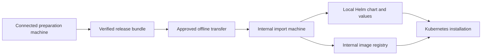

# Install OneUptime in Air-Gapped Kubernetes with an Offline Bundle

Author: [nawazdhandala](https://www.github.com/nawazdhandala)

Tags: Air-Gapped, Monitoring, Observability

Description: Prepare a versioned OneUptime offline bundle, verify its transfer, import images into an internal registry, and install the bundled Helm chart.

An offline Kubernetes installation needs a complete release before the cluster can pull its first application image. OneUptime provides a bundle script that inventories a Helm chart, saves its images, and imports them into an internal registry. The difficult parts are preserving the selected configuration and making every rendered image reference match what you imported.

This guide uses source-reviewed commands, not a claimed live installation. It follows the [official air-gapped installation workflow](https://oneuptime.com/docs/en/installation/air-gapped), with an explicit release compatibility check.

The bundle is the release package you carry into the isolated network. It contains the chart, which describes the Kubernetes resources, and the container images those resources need.



The registry supplies images when pods start. Helm reads the local chart and your values to create the Kubernetes resources. Both must refer to the same release.

## Freeze the Script and Chart Together

The published `17.0.0` chart supports `global.imageRegistry`. The published `14.0.102` chart, although used in documentation examples, lacks that registry-rewrite implementation. Do not assume a current documentation example works unchanged with an older chart.

The commands below use `17.0.0` as a concrete reviewed example, not a recommendation to skip your release approval process. Replace it consistently if selecting another version, and recheck that chart's values and templates. The [published chart archive](https://helm-chart.oneuptime.com/oneuptime-17.0.0.tgz) is the installation input; a source checkout's Chart.yaml may contain build-time version placeholders.

Pin the tooling separately. The [reviewed script source](https://github.com/OneUptime/oneuptime/blob/0de2d9ceac0a2404f5df7ad1f9ab1e22c56bea7e/HelmChart/AirGap/install.sh) implements `images`, `save`, and `push`, plus `--version`, `--values`, `--edition`, `--platform`, `--tool`, and `--chart`. Keep a reviewed copy with the release record.

## Prepare the Internal Prerequisites

Use a staging cluster first. Establish these services before importing OneUptime:

| Requirement | What must already work |
| --- | --- |
| Registry | Internal DNS, TLS trust, push credentials, node pull access |
| Kubernetes | Available capacity, persistent storage, working cluster DNS and time |
| Application access | Internal hostname and a planned gateway or reverse proxy |
| Trust and identity | Internal CA distribution and the chosen local sign-in route |
| Operations | Internal SMTP or another supported local notification destination |

This example assumes an existing internal reverse proxy terminates HTTPS with your certificate and forwards to OneUptime's gateway. Setting `httpProtocol: https` does not install that proxy or certificate. Provision those separately and keep automatic public certificate issuance disabled.

On the connected preparation machine, install Helm 3 and one supported image-copy tool. This guide explicitly selects `crane`; provision and authenticate it on both sides. Inside the gap, also have `kubectl`, registry CA trust, and cluster credentials. Prepare storage classes and capacity for PostgreSQL, ClickHouse, and Valkey. Keep registry bootstrap artifacts available independently of the registry itself.

## Inventory the Connected Release

Create `feature-values.yaml` with the approved topology, persistence settings, and optional features. Leave upstream image references intact at this stage: the connected machine must fetch source images, not images from the future internal mirror. Do not place the destination `global.imageRegistry` in this file.

Download the pinned script on the connected machine, inspect it, then run its inventory command:

```bash
VERSION='17.0.0'  # Reviewed example; replace consistently after approval.
SCRIPT_REV='0de2d9ceac0a2404f5df7ad1f9ab1e22c56bea7e'
EDITION='community'
PLATFORM='linux/amd64'

curl -fsSL \
  "https://raw.githubusercontent.com/OneUptime/oneuptime/${SCRIPT_REV}/HelmChart/AirGap/install.sh" \
  -o air-gap.sh
bash air-gap.sh --help
bash air-gap.sh images --version "$VERSION" \
  --edition "$EDITION" --values feature-values.yaml > release-images.txt
```

Use the same edition and feature values for inventory and saving. For Enterprise Edition, choose `EDITION='enterprise'` and use `image.type: enterprise-edition` at installation. For Arm nodes, select `linux/arm64`. The script saves a selected platform; do not assume one archive supplies a mixed-architecture cluster.

Review `release-images.txt` for optional services and operator images. Pin mutable dependency tags in your feature values too: the reviewed chart defaults include `postgres:latest`, so pinning only OneUptime does not freeze every upstream image. Retain resolved image digests with verification evidence. Enabling a feature after bundle creation can introduce an image you never transferred.

## Save and Verify Before Transfer

While connected, follow OneUptime's [supply-chain verification procedure](https://oneuptime.com/docs/en/self-hosted/supply-chain-security) for publisher signatures and the chart's provenance. Record the verified artifacts and identities. Downloading a provenance file is not the same as verifying it, and bundle checksums do not authenticate a publisher.

```bash
bash air-gap.sh save --version "$VERSION" \
  --edition "$EDITION" --platform "$PLATFORM" --tool crane \
  --values feature-values.yaml
```

The default output is `oneuptime-air-gap-${VERSION}`. Verify the saved chart against its provenance and trusted key before transfer, and reconcile the saved image digests with your verification record. Inspect the bundle:

| Bundle entry | Purpose |
| --- | --- |
| `images/` | Saved image archives |
| `images.txt` | Archive-to-source-image mapping |
| `bundle.env` | Version, edition, platform, and chart path |
| `chart/` | Packaged chart and available provenance file |
| `SHA256SUMS` | Integrity checks for the generated files |

The script refuses an existing nonempty output directory. Choose a fresh location with `--output` for a revised bundle instead of mixing releases.

Transfer the entire directory through your approved process. Also transfer the reviewed script, feature values, image inventory, verification records, and required tooling. These accompanying files are not automatically included in the generated bundle's checksum list; protect them through the transfer process's own integrity record.

## Import into the Internal Registry

On the internal machine, restore the variables and paths explicitly. The registry placeholder is a hostname without an `https://` prefix; replace it with your actual destination. Authenticate `crane` using your approved credential mechanism before running the import.

```bash
VERSION='17.0.0'
BUNDLE="oneuptime-air-gap-${VERSION}"
REGISTRY='registry.example.internal'

bash air-gap.sh push --bundle "$BUNDLE" \
  --registry "$REGISTRY" --tool crane
```

The script checks `SHA256SUMS` before pushing images. Stop on a mismatch and investigate or repeat the transfer; do not regenerate checksums merely to silence the failure. Successful checksum verification establishes consistency with the manifest, whose trust comes from your verified transfer records.

The importer preserves image repository paths and tags beneath the destination registry. Keep its output: it identifies images that need explicit Helm overrides. Use trusted internal certificates rather than making TLS bypass part of the installation procedure.

## Build the Destination Values

Create `offline-values.yaml` as an overlay. Replace the example registry and hostname. Create the `internal-registry` pull secret in namespace `oneuptime` beforehand if authentication is required; omit that entry for a registry permitting anonymous pulls.

```yaml
global:
  imageRegistry: registry.example.internal
image:
  tag: "17.0.0"
  type: community-edition
imagePullSecrets:
  - name: internal-registry
host: oneuptime.example.internal
httpProtocol: https
ssl:
  provision: false
updateCheck:
  disabled: true
instanceCheckIn:
  disabled: true
dnsConfig:
  nameservers: []
probes:
  one:
    allowPrivateNetworkMonitors: true
webhooks:
  allowPrivateNetwork: true
mcpOAuth:
  disableClientIdMetadataDocuments: true
```

These keys were checked against the published chart's values and helpers. The overlay removes configured public fallback resolvers and automatic update/check-in requests; it does not create a firewall or make user-configured external integrations work offline.

Registry rewriting has exceptions. Explicit `image.overrides` and images already naming their own registry retain their references. Operators use their own registry settings. If you enable CloudNativePG, for example, update `postgresOperator.cnpg.imageName` to the imported operand image and separately configure its operator image. Inspect every resulting `image` and `imageName`, not just the application deployment.

## Render, Install, and Inspect

From the internal machine, render the exact local chart with both files, destination overrides last:

```bash
CHART="${BUNDLE}/chart/oneuptime-${VERSION}.tgz"
helm template oneuptime "$CHART" --namespace oneuptime \
  -f feature-values.yaml -f offline-values.yaml > rendered.yaml
```

Review `rendered.yaml` for public image references, storage claims, secrets, and enabled services. Protect it as potentially sensitive. Local [Helm rendering](https://helm.sh/docs/helm/helm_template/) does not prove that the cluster supports every API or can schedule the workload. Avoid dependency downloads inside the gap; use the packaged chart and its bundled dependencies.

After review, install into the intended staging context:

```bash
KUBE_CONTEXT='REPLACE_WITH_STAGING_CONTEXT'
helm install oneuptime "$CHART" --kube-context "$KUBE_CONTEXT" \
  --namespace oneuptime --create-namespace \
  -f feature-values.yaml -f offline-values.yaml \
  --wait --wait-for-jobs --timeout 20m

kubectl --context="$KUBE_CONTEXT" -n oneuptime get pods,jobs,pvc
```

The timeout is an example deployment budget. [Helm installation](https://helm.sh/docs/helm/helm_install/) accepts the local archive; readiness waiting does not establish application correctness. Investigate failed migrations, pending storage, or pull errors before retrying.

## Finish with Application Smoke Checks

Keep external egress blocked during verification. Open the internal HTTPS hostname from a fresh browser, sign in, create a project, and configure a probe to check a harmless internal endpoint. Confirm new telemetry is searchable and a test notification reaches an internal recipient.

For Enterprise Edition, complete offline activation with the instance-bound signed token described in the installation documentation. Do not assume an online license key activates without connectivity.

Archive the bundle, values, import output, rendered-image review, and smoke-check results. If a pod still requests a public registry, correct its value override; if a claim remains pending, investigate storage provisioning. Installation is complete when the selected release can start and perform useful work using the artifacts and services inside the boundary.
