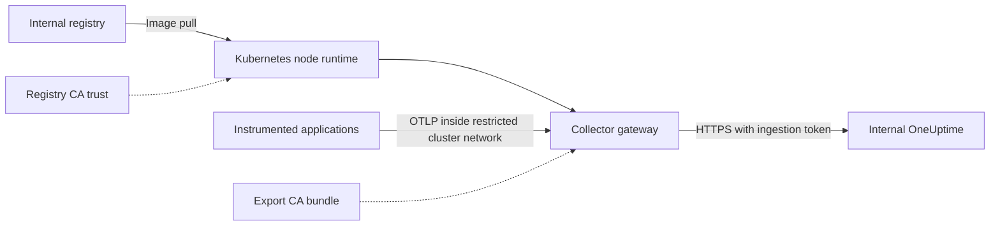

# Install OpenTelemetry Collector in an Air-Gapped Kubernetes Cluster

Author: [nawazdhandala](https://www.github.com/nawazdhandala)

Tags: Air-Gapped, Monitoring, Observability

Description: Install a pinned OpenTelemetry gateway offline, mirror its image, configure authenticated HTTPS export, and validate the rendered Collector configuration.

The OpenTelemetry Collector receives telemetry, processes it, and forwards it to storage. This guide installs one gateway Deployment: applications send logs, metrics, and traces using OpenTelemetry Protocol (OTLP), and the gateway exports them to an internal OneUptime installation.

A gateway does not automatically scrape hosts, read container log files, or discover every workload. Applications must already produce OTLP. Host collection requires additional receivers, mounts, permissions, and often a separate DaemonSet running on every node.



The registry certificate authority (CA) and the export CA serve different clients. Fixing one trust store does not fix the other.

## Pin the Chart and the Distribution Together

This example uses chart **0.180.0** and Collector Contrib **0.163.2**. The official [chart index](https://open-telemetry.github.io/opentelemetry-helm-charts/index.yaml) associates those versions. The [Contrib release manifest](https://github.com/open-telemetry/opentelemetry-collector-releases/blob/v0.163.2/distributions/otelcol-contrib/manifest.yaml) lists its compiled components. A distribution is a particular Collector build; configuration cannot enable a component missing from that build.

These are concrete reviewed versions, not moving `latest` references. Retain the chart, image archive, verified tool binaries, configuration, CA bundle, and integrity records on your transfer media. Keep credentials in your separate approved secret-delivery process.

On a connected preparation machine with Helm and Crane installed, download the chart and a Linux AMD64 image:

```bash
helm pull opentelemetry-collector --version 0.180.0 \
  --repo https://open-telemetry.github.io/opentelemetry-helm-charts
crane pull --platform linux/amd64 \
  otel/opentelemetry-collector-contrib:0.163.2 collector.tar
```

[Crane pull](https://github.com/google/go-containerregistry/blob/main/cmd/crane/doc/crane_pull.md) creates an image archive; pair it with Crane push below. Do not treat every `.tar` file as interchangeable with Docker or OCI formats. Record the selected image digest and file checksums through your approved artifact-verification workflow. This chart has no dependency charts; inspect again if changing versions or wrapping it in another chart.

After verified transfer, on an internal importer already authenticated to the registry and configured to trust its CA:

```bash
crane push collector.tar \
  registry.example.internal/observability/otelcol-contrib:0.163.2
```

[Crane push](https://github.com/google/go-containerregistry/blob/main/cmd/crane/doc/crane_push.md) uploads the saved image. Protect the internal tag from replacement and record the resulting digest. This example restricts scheduling to AMD64; for ARM64 or mixed nodes, retain and mirror the corresponding platforms deliberately.

## Prepare Namespace Resources and Network Access

Use an existing `observability` namespace. Before installation, provision these resources there:

| Resource | Required content |
| --- | --- |
| Image-pull Secret `internal-registry` | Credentials for the internal registry hostname |
| Secret `oneuptime-ingestion` | Key `token`, containing the project's valid ingestion key |
| ConfigMap `oneuptime-ca` | Key `ca.pem`, containing the approved export CA certificate bundle |

Configure registry CA trust on every Kubernetes node's container runtime. Image-pull credentials authenticate the pull; they do not make an unknown certificate authority trusted. Kubernetes documents [private-registry credentials](https://kubernetes.io/docs/tasks/configure-pod-container/pull-image-private-registry/).

Allow the gateway to resolve internal DNS and reach OneUptime HTTPS. Restrict inbound OTLP to approved application namespaces through your network-policy implementation. This example uses unencrypted, unauthenticated OTLP only inside that restricted cluster network; if policy requires encrypted application-to-gateway traffic, configure receiver TLS and client trust before use. No external ingress or load balancer is created.

## Write the Gateway Values

Save this as `gateway-values.yaml`, replacing registry and OneUptime hostnames. It selects the Contrib executable, references existing secrets, and mounts export trust read-only. The resource sizes are starting values for staging, not capacity guarantees.

```yaml
mode: deployment
fullnameOverride: otel-gateway
replicaCount: 1
image:
  repository: registry.example.internal/observability/otelcol-contrib
  tag: "0.163.2"
command:
  name: otelcol-contrib
imagePullSecrets:
  - name: internal-registry
nodeSelector:
  kubernetes.io/arch: amd64
serviceAccount:
  automountServiceAccountToken: false
resources:
  requests:
    cpu: 100m
    memory: 128Mi
  limits:
    memory: 512Mi
extraEnvs:
  - name: ONEUPTIME_INGESTION_KEY
    valueFrom:
      secretKeyRef:
        name: oneuptime-ingestion
        key: token
extraVolumes:
  - name: export-ca
    configMap:
      name: oneuptime-ca
extraVolumeMounts:
  - name: export-ca
    mountPath: /etc/otel/export-ca
    readOnly: true
ports:
  jaeger-compact:
    enabled: false
  jaeger-thrift:
    enabled: false
  jaeger-grpc:
    enabled: false
  zipkin:
    enabled: false
config:
  receivers:
    jaeger: null
    prometheus: null
    zipkin: null
    otlp:
      protocols:
        grpc:
          endpoint: ${env:MY_POD_IP}:4317
        http:
          endpoint: ${env:MY_POD_IP}:4318
  processors:
    memory_limiter:
      check_interval: 1s
      limit_mib: 400
      spike_limit_mib: 100
      limit_percentage: null
      spike_limit_percentage: null
    batch:
      send_batch_size: 256
      send_batch_max_size: 512
  exporters:
    debug: null
    otlp_http/oneuptime:
      endpoint: https://monitoring.example.internal/otlp
      headers:
        x-oneuptime-token: ${env:ONEUPTIME_INGESTION_KEY}
      tls:
        ca_file: /etc/otel/export-ca/ca.pem
  extensions:
    health_check:
      endpoint: ${env:MY_POD_IP}:13133
  service:
    extensions: [health_check]
    pipelines:
      logs:
        receivers: [otlp]
        processors: [memory_limiter, batch]
        exporters: [otlp_http/oneuptime]
      metrics:
        receivers: [otlp]
        processors: [memory_limiter, batch]
        exporters: [otlp_http/oneuptime]
      traces:
        receivers: [otlp]
        processors: [memory_limiter, batch]
        exporters: [otlp_http/oneuptime]
```

The [chart defaults](https://github.com/open-telemetry/opentelemetry-helm-charts/blob/opentelemetry-collector-0.180.0/charts/opentelemetry-collector/values.yaml) include other receivers and a debug exporter. Setting them to `null` removes them when installing this chart directly. Pipelines explicitly connect OTLP to memory limiting, batching, and export for each signal. Declaring a component alone does not activate it. The health-check extension remains enabled because the chart's pod probes require it.

The [HTTP exporter](https://github.com/open-telemetry/opentelemetry-collector/blob/v0.163.0/exporter/otlphttpexporter/README.md) appends `/v1/logs`, `/v1/metrics`, or `/v1/traces` to the endpoint. OneUptime documents [`/otlp` and `x-oneuptime-token`](https://oneuptime.com/enterprise/air-gapped/observability) for internal OTLP/HTTP ingestion. Its built-in gRPC ingress has separate TLS/provisioning constraints; accepting gRPC at this gateway does not require exporting gRPC to OneUptime.

No Kubernetes collection presets are enabled, so this gateway does not need cluster-wide read permissions or host mounts. It has no persistent queue: queued telemetry can be lost on restart or prolonged export failure. If durable buffering is required, design a file-storage-backed sending queue with persistent volumes and appropriate write permissions, then test restart recovery. Adding a disk alone does not make buffering durable. See the [Collector resiliency guide](https://opentelemetry.io/docs/collector/resiliency/) for storage-backed queue requirements.

## Validate the Rendered Configuration Before Installing

Render locally from the transferred archive:

```bash
helm template otel-gateway ./opentelemetry-collector-0.180.0.tgz \
  --namespace observability --values gateway-values.yaml > rendered.yaml
```

Inspect every container image, including any sidecars, initialization containers, and hooks added by your environment. The unmodified example renders one internal Collector image and no public image references. The chart does not install an operator. Keep cluster infrastructure images available independently.

Copy the ConfigMap's `data.relay` content from `rendered.yaml` into `collector.yaml`. That is the complete merged Collector configuration; validating the values fragment would miss chart defaults. With a retained matching `otelcol-contrib` 0.163.2 binary, a mounted CA file, and the required environment variables supplied securely, run the following command. Outside Kubernetes, also supply `MY_POD_IP` and the rendered `OTEL_K8S_*` variables, which the chart normally injects:

```bash
otelcol-contrib validate --config=collector.yaml
```

The [Collector configuration guide](https://opentelemetry.io/docs/collector/configuration/) explains component and pipeline configuration. The complete rendered example passed validation with the matching Darwin ARM64 binary using non-secret placeholder environment values. That checks configuration structure, not Linux container startup, certificate-file loading, authentication, or network delivery. Local chart rendering likewise does not check Kubernetes admission rules.

## Install and Test Without Public Pulls

After environment-specific review, target the intended staging context explicitly:

```bash
helm install otel-gateway ./opentelemetry-collector-0.180.0.tgz \
  --kube-context YOUR_STAGING_CONTEXT --namespace observability \
  --values gateway-values.yaml --wait --timeout 5m
```

This is a new-release installation using [Helm's documented flags](https://helm.sh/docs/v3/helm/helm_install/). Do not use it over an existing release. Point instrumented applications at `http://otel-gateway.observability.svc.cluster.local:4318` for OTLP/HTTP, adjusting the cluster DNS suffix if needed. Use the HTTP/protobuf protocol; [general SDK endpoint settings](https://opentelemetry.io/docs/specs/otel/protocol/exporter/) append the signal paths.

Test on a clean staging node without cached Collector images, with public egress denied at the appropriate node and pod boundaries. Confirm pulls reach only the internal registry. Send uniquely identifiable telemetry for all three pipelines and verify arrival in OneUptime. Readiness alone proves neither ingestion nor export.

An image-pull certificate error belongs to node runtime trust. An exporter certificate error belongs to the mounted CA bundle or destination chain. Authentication failures point to the ingestion key; missing signals suggest pipeline wiring, application instrumentation, or rejected payloads. Record those checks before promoting the gateway, and monitor failed exports and queue pressure afterward.
