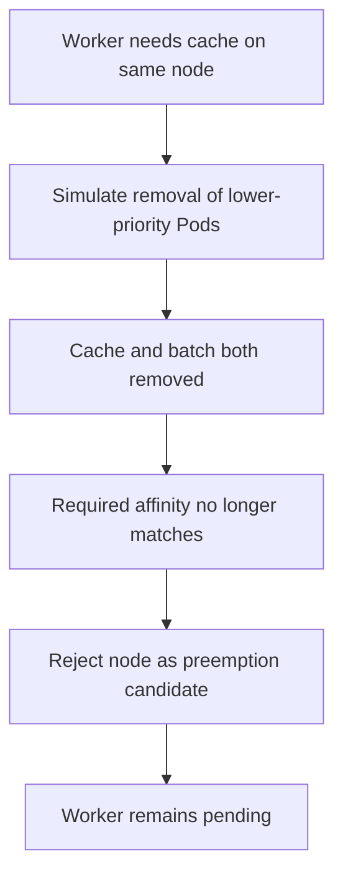

# How Inter-Pod Affinity Can Block Kubernetes Preemption

Author: [nawazdhandala](https://www.github.com/nawazdhandala)

Tags: Kubernetes, Scheduling, Troubleshooting

Description: Diagnose required affinity to lower-priority Pods, understand the scheduler's removal simulation, and choose a placement rule that preserves real dependencies.

A high-priority worker is pending even though a node contains several lower-priority Pods that could be removed. The worker also requires a cache Pod on that same node. If the cache has lower priority too, the scheduler's preemption check can remove the very neighbor the worker requires, making the node appear infeasible.

The important detail is how the default scheduler searches for a candidate. It does not exhaustively try every possible subset of victims. Understanding that first feasibility check explains why “there is plenty of reclaimable CPU” may not be enough.

This article examines **Kubernetes 1.34.0** default preemption behavior. It uses ordinary inter-Pod affinity, not newer group-scheduling features or custom scheduler plugins.

## Understand the required relationship

Inter-Pod affinity places a Pod relative to other Pods selected by labels. A required rule is a hard scheduling condition; a preferred rule contributes to scoring but does not require a matching neighbor.

For example, a worker might require a Pod labeled `app: cache-anchor` in the same hostname topology domain. If no such Pod exists in the relevant namespace on a candidate node, that node fails the requirement. Kubernetes explains selectors, topology domains, and required versus preferred rules in its [affinity documentation](https://kubernetes.io/docs/concepts/scheduling-eviction/assign-pod-node/#inter-pod-affinity-and-anti-affinity).

Affinity is about placement, not application readiness. A matching cache Pod can satisfy the placement relationship without proving that its cache service is usable. The worker still needs normal connection handling and retries.

## Walk through the failed preemption check

Consider this simplified node with four CPU cores available for Pod requests:

| Workload | Requested CPU | Numeric priority | Relevant label |
|---|---:|---:|---|
| Cache anchor | 1 core | 100 | `app: cache-anchor` |
| Batch work | 3 cores | 100 | `app: batch` |
| Pending worker | 2 cores | 1000 | `app: worker` |

The worker requires the cache anchor on the same node. Removing only the batch work would leave enough CPU and preserve the relationship. However, the first preemption simulation removes **all eligible lower-priority Pods** from that node, including the cache.

With the cache absent, the worker's required affinity fails. The node is rejected before the scheduler reaches the step that tries to restore individual candidate victims. The [pinned default preemption implementation](https://github.com/kubernetes/kubernetes/blob/v1.34.0/pkg/scheduler/framework/plugins/defaultpreemption/default_preemption.go) explicitly documents this limitation and its performance motivation.



The simulation does not mean both Pods were actually deleted. In this failure path, the scheduler has not selected this node for victim removal. Keep simulated feasibility and real disruption separate when reading events.

## Inspect a concrete affinity rule

This complete staging Pod illustrates the requirement. The namespace must already exist, `worker-important-example` must be an approved PriorityClass, and a matching cache Pod must already be scheduled. Those prerequisites are intentional: the example does not create an artificial overload or change production priorities.

```yaml
apiVersion: v1
kind: Pod
metadata:
  name: affinity-worker-example
  namespace: scheduling-test
  labels:
    app: worker
spec:
  priorityClassName: worker-important-example
  restartPolicy: Never
  affinity:
    podAffinity:
      requiredDuringSchedulingIgnoredDuringExecution:
        - labelSelector:
            matchLabels:
              app: cache-anchor
          topologyKey: kubernetes.io/hostname
  containers:
    - name: worker
      image: busybox:1.37.0
      command: ["sh", "-c", "sleep 3600"]
      resources:
        requests:
          cpu: "2"
          memory: "128Mi"
        limits:
          cpu: "2"
          memory: "128Mi"
```

No namespace list or namespace selector is supplied, so the affinity term selects matching Pods in the incoming Pod's namespace. The worker itself does not carry the `cache-anchor` label. That avoids confusing this example with special handling for a group of Pods that matches its own affinity rule.

Save it as `affinity-worker.yaml` for a staging review. A server-side dry run checks admission and API validation, but does not run the scheduler or prove placement:

```bash
kubectl --context staging apply --dry-run=server -f affinity-worker.yaml
```

Local schema validation also cannot tell you whether the selected cache exists. Those are separate checks.

## Compare the actual objects and priorities

Use read-only commands to inspect the pending worker and its intended neighbors:

```bash
kubectl --context staging -n scheduling-test get pod affinity-worker-example -o yaml
kubectl --context staging -n scheduling-test get pods \
  -l app=cache-anchor -o wide
kubectl --context staging -n scheduling-test get pods \
  -o custom-columns='NAME:.metadata.name,NODE:.spec.nodeName,PRIORITY:.spec.priority'
kubectl --context staging get nodes -L kubernetes.io/hostname
```

Check numeric priorities on admitted Pods, label spelling, namespace scope, node assignment, and the topology label. A matching Pod in another namespace or on another hostname does not satisfy this rule. Do not infer priority solely from a class name in a template.

If the anchor is lower priority than the worker, ask whether removing every eligible lower-priority Pod leaves any matching anchor in the required domain. That question directly matches the documented candidate check. Review current scheduling events as supporting evidence, but do not assume that every message about affinity identifies the lower-priority-anchor problem; a missing label can produce a simpler failure.

## Choose the correction according to the dependency

If same-node placement is a genuine requirement, model the cache as an essential dependency. Kubernetes recommends affinity toward equal- or higher-priority Pods in its [preemption limitations](https://kubernetes.io/docs/concepts/scheduling-eviction/pod-priority-preemption/#inter-pod-affinity-on-lower-priority-pods).

In the table's example, giving the anchor an approved priority equal to the worker keeps it out of the lower-priority victim set. Removing the batch work can then leave enough requested CPU while retaining the affinity match. This fixes that particular contradiction, but other filters can still prevent placement. Existing Pods need a controlled replacement to adopt a changed priority relationship; do not assume editing a class retroactively changes them.

If same-node placement is only a performance preference, consider a preferred affinity term instead. Make that decision with the application owner: accepting a remote cache can affect latency, traffic, and failure behavior. A softer rule is not appropriate when the program cannot operate without a local dependency.

Adding nodes alone may also fail if the new nodes lack the required anchor. Capacity planning must include both the worker's resources and the dependency placement. Likewise, increasing worker priority without reconsidering its anchor can preserve or worsen the original problem.

The example was validated against Kubernetes 1.34.0's OpenAPI schema, with its selector scope and resource arithmetic reviewed locally. No scheduler simulation or live preemption test was executed. Rehearse the intended dependency and priority relationship in staging, then confirm the worker fits without eliminating the Pod it needs.
