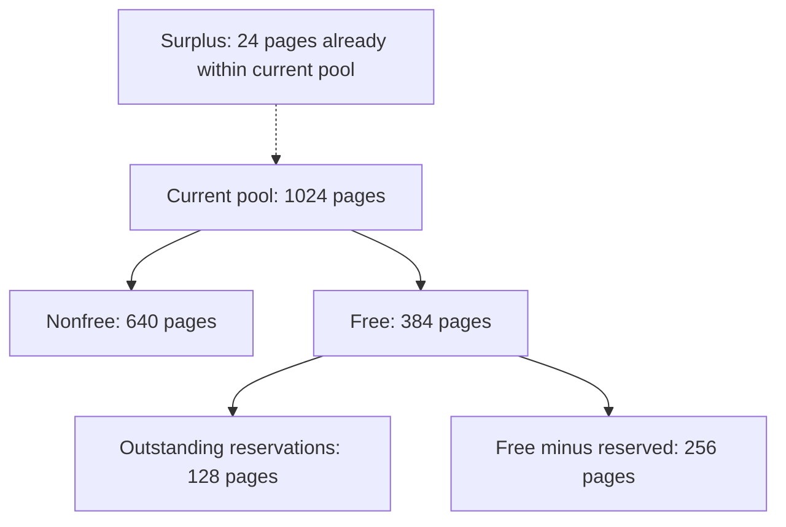

# Interpret HugeTLB Counters Without Double-Counting Memory

Author: [nawazdhandala](https://www.github.com/nawazdhandala)

Tags: Linux, HugePages, Monitoring

Description: Read HugeTLB pool, free, reserved, and surplus counters correctly, reconcile multiple page sizes, and build capacity views without adding overlapping values.

A HugeTLB dashboard can overstate memory consumption even when every scraped value is correct. The problem is often arithmetic: reserved pages are added to free pages, surplus pages are added to a total that already includes them, or a page count is treated as a byte count.

The counters describe overlapping properties of a pool. They are not independent buckets to stack into a memory total. Before building an alert or explaining a capacity incident, decide whether you are measuring physical pool size, allocated pages, or capacity not yet promised to consumers.

This guide uses **Linux 6.12** documentation and its reporting implementation. The examples are illustrative snapshots, not measurements from a running host.

## Start with units and scope

Inspect the default-size summary:

```bash
awk '/^(HugePages_Total|HugePages_Free|HugePages_Rsvd|HugePages_Surp|Hugepagesize|Hugetlb):/' /proc/meminfo
```

The four `HugePages_*` values are counts of pages of the **default huge-page size**. `Hugepagesize` reports that size in KiB, despite the interface's `kB` label. `Hugetlb` reports the memory occupied by HugeTLB pools across all supported sizes. The [meminfo manual](https://man7.org/linux/man-pages/man5/proc_meminfo.5.html) describes these fields.

Keep that scope attached to exported metrics. A value named only `hugepages_free=4` is difficult to interpret: four 2 MiB pages and four 1 GiB pages represent very different capacity.

| Field | Useful interpretation | Mistake to avoid |
|---|---|---|
| `HugePages_Total` | Current default-size pool page count | Treating it as all sizes |
| `HugePages_Free` | Pages not yet allocated from that pool | Assuming none are promised |
| `HugePages_Rsvd` | Outstanding commitments to future allocation | Adding them as another physical pool |
| `HugePages_Surp` | Pages above the persistent pool allocation | Adding them to Total again |
| `Hugepagesize` | Default-size conversion factor | Applying it to every size |
| `Hugetlb` | All-size HugeTLB pool memory | Treating it as active application usage |

The [HugeTLB administration guide](https://www.kernel.org/doc/html/v6.12/admin-guide/mm/hugetlbpage.html) explains these relationships and the size-specific counters under `/sys/kernel/mm/hugepages`.

## Work through one consistent snapshot

Suppose the default size is 2 MiB and the counters are:

```text
HugePages_Total:     1024
HugePages_Free:       384
HugePages_Rsvd:       128
HugePages_Surp:        24
Hugepagesize:       2048 kB
```

There are 1,024 pages in the current pool, representing 2 GiB. Of these, 384 are free, so 640 are nonfree. Those nonfree pages represent 1,280 MiB. They can include backing objects, not just memory visible in one application's resident mappings.

Of the free capacity, 128 pages are already promised. The simple free-minus-reserved estimate is therefore 256 pages, or 512 MiB. It estimates capacity not yet committed from the existing pool; it does not guarantee a particular process can allocate that much.



This diagram illustrates a stable, internally consistent snapshot. Surplus is a separate classification across the pool, not a third branch alongside free and nonfree.

The general reservation model is described in the [kernel reservation documentation](https://www.kernel.org/doc/html/v6.12/mm/hugetlbfs_reserv.html). Its implementation discussion references an older kernel, so use the model without assuming every detailed allocation path is identical on newer systems.

## Keep surplus inside the total

The 24 surplus pages in the example are already included in the 1,024 total. Calculating `(Total + Surp) * page_size` would invent another 48 MiB.

This can be verified directly in [Linux 6.12's HugeTLB reporting source](https://raw.githubusercontent.com/torvalds/linux/v6.12/mm/hugetlb.c): the meminfo total and size-specific sysfs `nr_hugepages` reader report the current `nr_huge_pages` count, while surplus is reported separately. The all-size `Hugetlb` calculation sums that current count multiplied by each page size.

A write to the pool control requests a persistent allocation target, which is a different question from interpreting the current count read back. During resizing, pages still in use can become surplus instead of disappearing immediately. Label observed counts as observed capacity rather than assuming they exactly equal the last requested target.

For the example, subtracting 24 from 1,024 gives 1,000 persistent pages in the observed classification. That subtraction is useful for explaining the pool, but it does not say which particular consumer owns the surplus portion.

## Reconcile multiple page sizes

Now add a second pool containing four 1 GiB pages. Its capacity is 4 GiB, so the all-size pool holds 6 GiB:

```text
(1024 * 2048 KiB) + (4 * 1048576 KiB) = 6291456 KiB
```

The default-size meminfo fields can still show the 2 MiB pool. That does not contradict the larger `Hugetlb` value. Do not multiply the combined page count, 1,028, by one common page size.

Save this Python 3 helper as `pool-report.py`. It reads each size separately and prints both raw counts and derived values:

```python
import argparse
import re
from pathlib import Path

parser = argparse.ArgumentParser()
parser.add_argument("root", type=Path)
args = parser.parse_args()
all_kib = 0
pools = 0
for pool in sorted(args.root.glob("hugepages-*")):
    match = re.fullmatch(r"hugepages-(\d+)kB", pool.name)
    if not match or not pool.is_dir():
        continue
    size_kib = int(match.group(1))
    values = {name: int((pool / name).read_text()) for name in
              ("nr_hugepages", "free_hugepages", "resv_hugepages",
               "surplus_hugepages")}
    total = values["nr_hugepages"]
    free = values["free_hugepages"]
    reserved = values["resv_hugepages"]
    surplus = values["surplus_hugepages"]
    print(f"{size_kib} KiB: total={total}, free={free}, "
          f"reserved={reserved}, surplus={surplus}")
    print(f"  pool={total * size_kib} KiB; "
          f"nonfree={(total - free) * size_kib} KiB; "
          f"free-minus-reserved={free - reserved} pages")
    all_kib += total * size_kib
    pools += 1
if not pools:
    parser.error("no huge-page pool directories found")
print(f"All-size pool total: {all_kib} KiB")
print("Sequential snapshot; negative differences need investigation.")
```

Run it on the Linux host:

```bash
python3 pool-report.py /sys/kernel/mm/hugepages
```

For the two example pools, expect `All-size pool total: 6291456 KiB`. The script does not add reserved or surplus counts to the total. It also keeps negative differences visible rather than silently replacing them with zero.

Reads happen sequentially. Compare with meminfo over a quiet interval and investigate persistent discrepancies; do not expect an atomic snapshot while applications allocate, free, or resize pools. Save the raw values when diagnosing a mismatch.

## Interpret changes through the allocation lifecycle

In a simple isolated reservation-backed workload, creating a mapping can increase outstanding reservations before its pages are touched. Touching the mapping can then reduce both free pages and outstanding reservations as pages become allocated. That transition is expected; a falling reserved count does not necessarily mean a consumer released capacity.

Likewise, releasing an application mapping may not return every page immediately if shared references or backing objects remain. Use the application's lifecycle and mapping evidence to explain the counters rather than inferring ownership from a host aggregate.

Transparent Huge Pages belong to a separate mechanism. Do not add `AnonHugePages` to an explicit HugeTLB pool utilization numerator or interpret a THP allocation as depletion of `HugePages_Free`. The [THP documentation](https://www.kernel.org/doc/html/v6.12/admin-guide/mm/transhuge.html) describes its allocation model separately.

## Build alerts around the next allocation

A useful dashboard shows current pool bytes, nonfree bytes, free pages, outstanding reservations, and free-minus-reserved pages **per page size**. Keep the surplus series alongside these as an explanatory signal rather than stacking it into consumption.

For a service that needs 32 additional 2 MiB pages during restart, compare that requirement with uncommitted capacity for the matching size. Then check eligible NUMA nodes, filesystem limits, cgroup restrictions, and simultaneous restarts. A globally healthy estimate cannot override those constraints.

Avoid a single “HugeTLB used percent” without defining its numerator. `nonfree / total` describes physical pool occupancy; `(nonfree + reserved) / total` describes a different commitment-oriented view in a consistent snapshot. Neither is the percentage of all host RAM used by the application, and a zero-sized pool requires explicit handling rather than division.

The helper was tested against synthetic two-size pools, including the 6 GiB example, a negative free-minus-reserved difference, and an empty input directory. No Linux allocation lifecycle or concurrent scraping test was performed. Keep that distinction when using the arithmetic as a starting point for production monitoring.
