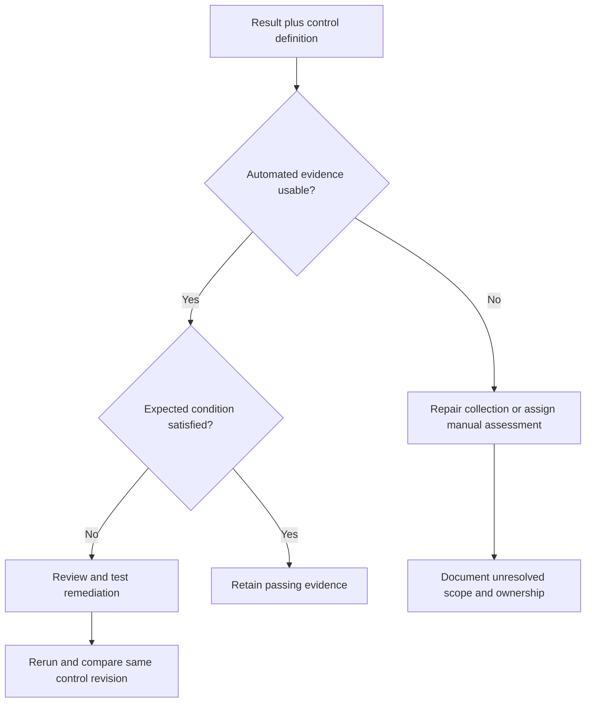

# Interpret kube-bench PASS, FAIL, WARN, and INFO Results

Author: [nawazdhandala](https://www.github.com/nawazdhandala)

Tags: Kubernetes, Security, Compliance

Description: Read kube-bench statuses alongside reasons, scoring, and manual-check definitions so skipped or unexecuted controls do not become false compliance claims.

A kube-bench report with no failed checks can still contain unfinished work. Some controls need human evidence, others were skipped, and some could not be evaluated. Treating every non-FAIL line as a pass loses the most important part of the report.

Read each status with its control definition, reason, and observed evidence. Then separate technical remediation from manual assessment and scanner-coverage problems. This produces an actionable review queue without changing the raw findings.

This guide pins **kube-bench v0.14.0**. Its status behavior was checked in source and with a small synthetic local fixture. Those fixture results demonstrate the reporting logic; they are not findings from a Kubernetes cluster.

## What each result actually establishes

| Result | What it means in the pinned implementation | What to do next |
|---|---|---|
| PASS | The implemented test accepted its observed input | Confirm the check and evidence fit the intended node and benchmark |
| FAIL | A scored test failed, or its execution encountered an error | Inspect actual/expected values and the reason before choosing remediation |
| WARN | Human assessment or another unresolved condition needs attention | Determine whether the check is manual, unscored, undefined, or unable to execute |
| INFO | An individual check can be marked skipped | Record why it was skipped and what evidence or exception covers it |

The [status evaluation implementation](https://github.com/aquasecurity/kube-bench/blob/v0.14.0/check/check.go) matters here. A WARN is not simply a low-severity FAIL. The result can indicate that no automated pass/fail decision was possible at all.

Also distinguish an individual check's INFO status from informational headings in human-readable output. A line introducing a section is not itself a control result. When building a report parser, use structured result records rather than counting every line containing `[INFO]`.

## Understand manual, skipped, and unscored checks

A control declared with `type: manual` is reported as WARN in v0.14.0. Its purpose is to direct an assessor to gather evidence that the tool cannot decide automatically. Assign that work to someone who can evaluate the relevant policy, architecture, or operational practice.

A control declared `type: skip`, or skipped through the command-line skip mechanism, is reported as INFO. Skipping does not mean the system passed the check. The [control execution code](https://github.com/aquasecurity/kube-bench/blob/v0.14.0/check/controls.go) applies group and individual skip selections before evaluating results.

`scored: false` is a different field. An automated test can be unscored; it is not necessarily manual. In the pinned implementation, a failing unscored test produces WARN rather than FAIL. Missing test definitions can also produce WARN. Consequently, a queue that treats every WARN as “manual review only” will miss configuration or execution problems.

Use the control's `type`, `scored`, `reason`, and test definition together. Do not infer assessment method solely from a word in the control's descriptive title. The [controls format documentation](https://github.com/aquasecurity/kube-bench/blob/v0.14.0/docs/controls.md) explains how checks and skip declarations are represented.

## Preserve machine-readable evidence

For an already approved ordinary Linux worker assessment against the bundled `cis-1.11` controls, capture JSON from the authorized scanner environment:

```bash
bundle_dir="$PWD"
./kube-bench run --benchmark cis-1.11 --targets node \
  --config "$bundle_dir/cfg/config.yaml" \
  --config-dir "$bundle_dir/cfg" --json \
  > report.json 2> scanner.log
scanner_status=$?
printf 'Scanner process exit: %s\n' "$scanner_status"
```

This runs a real scan. It assumes the benchmark and target have already been selected for the system and the scanner has the required host visibility. Use your approved profile instead of copying `cis-1.11` to an unrelated distribution.

Keep stderr separate so diagnostic messages do not become part of the JSON document. Preserve both files, the process status, node identity, image or binary version, configuration revision, and command. A malformed or empty report is an execution problem, not an empty set of security findings.

By default, the v0.14.0 JSON output wraps results in `Controls` and `Totals`. The `--nototals` option changes that shape, so choose and document one format for your parser. The [JSON writer](https://github.com/aquasecurity/kube-bench/blob/v0.14.0/cmd/common.go) defines this layout.

## Extract the fields needed for review

With jq installed, this command reads the default JSON form and lists each result's context:

```bash
jq -r '
  .Controls[] as $control |
  $control.tests[] as $group |
  $group.results[] |
  [$control.version, $control.node_type, .test_number, .status,
   (.type // ""), (.scored | tostring), (.reason // ""), .test_desc] |
  @tsv
' report.json
```

The output includes the benchmark version, target, check ID, status, type, scoring flag, reason, and description. It is a review index; retain the original JSON for fields such as `actual_value`, `expected_result`, and `remediation`. These field names come from the [check structure](https://github.com/aquasecurity/kube-bench/blob/v0.14.0/check/check.go) and [report structures](https://github.com/aquasecurity/kube-bench/blob/v0.14.0/check/controls.go).

To focus on unresolved check records without discarding their details:

```bash
jq '[.Controls[].tests[].results[] |
     select(.status == "FAIL" or .status == "WARN" or .status == "INFO")]' \
  report.json > review-items.json
```

Do not merge reports from several nodes without adding node identity. The same control can pass on one worker and fail on another. Likewise, a control ID alone is not a stable identity across different benchmark families or revisions.

## Diagnose a FAIL before applying its remediation text

Start with the reason and observed value. Did the tool actually inspect the intended file or process? Does the profile match the distribution? Was the input unavailable because of permissions or a missing mount? An execution error can be represented as FAIL for a scored check, so the status alone does not prove that a particular insecure setting was observed.

When the evidence is valid, review the remediation in the context of the running workload. A suggested change to API-server flags, kubelet configuration, or admission policy can affect application behavior. Test the planned change and rerun the relevant check before expanding the rollout.

Preserve the before-and-after reports. If the problem was scanner visibility, document that correction separately from a change to the cluster's security configuration. Otherwise, the audit history can misleadingly imply that a security weakness was fixed when the scanner simply learned to read the right file.



## Track manual completion outside the raw result

For a manual check, create an assessment record with the benchmark and control ID, affected nodes or scope, reviewer, evidence location, decision, review date, and follow-up owner. If an exception is approved, include its rationale, compensating controls, and expiration or review date.

Keep the original WARN or INFO result intact. A separate assessment decision can explain how the organization satisfied or accepted the requirement; rewriting the scanner's output to PASS would erase the distinction between automated observation and human judgment.

Avoid a headline percentage that silently excludes all WARN and INFO records. Publish the automated result counts alongside unresolved manual work, skipped controls, and node coverage. A smaller denominator after adding skips is not proof of improved security.

## Treat process exit separately from the report

In v0.14.0, failed checks do not make the process exit nonzero by default. The [default exit-code flag](https://github.com/aquasecurity/kube-bench/blob/v0.14.0/cmd/root.go) is zero. An explicit `--exit-code` can make FAIL results affect process status, but that still does not turn WARN or INFO into completed assessments.

The local synthetic fixture for this article produced PASS, FAIL, manual WARN, skipped INFO, unscored WARN, and missing-test WARN. Its default process status was zero despite the FAIL; setting `--exit-code 3` changed that status to 3. No cluster was scanned. Use this distinction when deciding whether a completed Job represents successful execution, successful automated checks, or a finished compliance review: those are separate outcomes.
