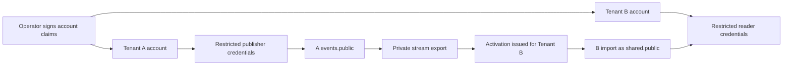

# Isolate NATS Tenants with Accounts, JWTs, and Private Exports

Author: [nawazdhandala](https://www.github.com/nawazdhandala)

Tags: NATS, Security, Messaging

Description: Build two isolated NATS accounts, issue restricted JWT credentials, and share one subject through a private export and account-specific activation.

Prefixing subjects with tenant names is a naming convention. It becomes an isolation boundary only when permissions enforce it. NATS accounts provide a stronger starting point: separate subject namespaces. Two accounts can both use `events.private` without receiving each other's traffic.

This tutorial builds a disposable operator-mode lab with nsc 2.11.0 and NATS Server 2.11.4. It uses restricted user credentials and a private export to share exactly one event subject. The tests use Core NATS; this is not a recipe for granting broad JetStream management access.

## Separate identity, namespace, and permission

Three questions need separate answers:

| Question | NATS mechanism |
| --- | --- |
| Which account does this connection belong to? | User credentials signed by the account |
| Which tenant's subjects can it see? | Account namespace, plus explicitly configured imports |
| What can this user publish or subscribe to? | User subject permissions |

In operator mode, an operator signs account claims and an account signs user claims. These signed documents are JWTs, or JSON Web Tokens. NKeys are the public/private key identities used for signing and connection proof. The [operator-mode guide](https://docs.nats.io/learn/security/operator-mode) explains the trust chain. This example intentionally uses the pinned `nsc` tool rather than mixing its commands with newer `nats auth` commands.

A `.creds` file includes a user JWT and the user's private seed. Treat it as a secret. The server needs the trusted operator and account claims, not copies of operator or account private seeds.



Here, a stream export means one-way publish/subscribe sharing. It does not create a JetStream stream or persist messages. Service exports cover a different pattern, request/reply. The [cross-account guide](https://docs.nats.io/learn/security/cross-account) describes that distinction.

## Create an isolated signing workspace

Install [nsc 2.11.0](https://github.com/nats-io/nsc/releases/tag/v2.11.0), NATS Server 2.11.4, and Python 3. Run the following in a fresh shell. The temporary directory is a disposable lab workspace containing sensitive keys; do not use an existing production operator store.

```bash
set -eu
umask 077
lab_dir=$(mktemp -d)
NSC_BIN=$(command -v nsc)
nsc_lab() { "$NSC_BIN" -H "$lab_dir/nsc" "$@"; }

nsc_lab add operator --name TENANT_LAB --sys
nsc_lab add account --name TENANT_A
nsc_lab add account --name TENANT_B
```

The `-H` option keeps nsc configuration, claims, and its key store under this lab directory. `--sys` creates the operator's system account. Keep its credentials separate from tenant applications; they are for administration.

The temporary location does not make this key material unimportant. A production signing store needs controlled access, encrypted backup, and an explicit recovery process. Never copy the whole store into every application image.

## Give each user an explicit role

Create a publisher and an observer in A, then a reader in B:

```bash
nsc_lab add user --account TENANT_A --name publisher \
  --allow-pub 'events.>' --allow-sub '_INBOX.>'
nsc_lab add user --account TENANT_A --name observer \
  --deny-pub '>' --allow-sub 'events.>'
nsc_lab add user --account TENANT_B --name reader \
  --deny-pub '>' --allow-sub 'events.>,shared.public'
```

`>` matches trailing subject tokens. The reader deliberately has access to `events.>` within B so the isolation test can show that identical names in A remain invisible. In a real reader that only needs the imported event, narrow that subscription permission to `shared.public`.

The explicit publish denial matters. Do not assume that omitting a publish restriction means publishing is forbidden. The publisher's `_INBOX.>` subscription permission allows local reply inboxes; it does not grant access to another account's private subjects. The permission flags are implemented by [nsc's tagged user command](https://github.com/nats-io/nsc/blob/v2.11.0/cmd/adduser.go).

Write credentials to files rather than printing them into terminal logs:

```bash
nsc_lab generate creds --account TENANT_A --name publisher \
  --output-file "$lab_dir/publisher.creds"
nsc_lab generate creds --account TENANT_A --name observer \
  --output-file "$lab_dir/observer.creds"
nsc_lab generate creds --account TENANT_B --name reader \
  --output-file "$lab_dir/reader.creds"
```

Each application receives only its own credentials. Account signing seeds belong to whoever administers that account, not to ordinary publishers.

## Share one subject with one receiving account

Make `events.public` a private export from A. Unlike a public export that other accounts may import, this requires an activation grant:

```bash
nsc_lab add export --account TENANT_A --subject events.public --private

b_key=$(nsc_lab describe account --name TENANT_B --json | \
  python3 -c 'import json,sys; print(json.load(sys.stdin)["sub"])')

nsc_lab generate activation --account TENANT_A --subject events.public \
  --target-account "$b_key" --expiry 1d \
  --output-file "$lab_dir/public-activation.jwt"

nsc_lab add import --account TENANT_B \
  --token "$lab_dir/public-activation.jwt" --local-subject shared.public
```

The extracted `sub` value is B's public account identity, not its private key. The activation authorizes that account to import the selected subject for the stated validity period. B exposes the imported event locally as `shared.public`, so its users still need subscription permission for that local name.

These flags are verified against the tagged [activation generator](https://github.com/nats-io/nsc/blob/v2.11.0/cmd/generateactivation.go) and [import command](https://github.com/nats-io/nsc/blob/v2.11.0/cmd/addimport.go). An import does not give B general access to A's subjects or permission to publish back into A.

## Load the claims into a disposable server

Generate a memory-resolver configuration after all account changes:

```bash
nsc_lab generate config --mem-resolver --config-file "$lab_dir/auth.conf"

cat > "$lab_dir/server.conf" <<'CONF'
listen: "127.0.0.1:14233"
include "auth.conf"
CONF

nats-server -t -c "$lab_dir/server.conf"
nats-server -c "$lab_dir/server.conf"
```

The server runs in the foreground. The include is relative to the configuration directory. A resolver supplies account JWTs to the server; this memory-resolver lab embeds the required account claims in the generated configuration. Editing your nsc store alone does not update an already-running server's copy. The [tagged memory-resolver generator](https://github.com/nats-io/nsc/blob/v2.11.0/cmd/memresolverconfigbuilder.go) shows what the generated file contains.

For production, plan how account updates reach every server, including activation changes and revocations. Use verified TLS for connections across networks. This lab binds only to loopback and intentionally omits TLS so it isolates the authorization tests from certificate configuration.

## Test denied paths as well as the allowed import

A Go application using nats.go 1.42.0 loads its credentials through the client option below. Replace the file path with that application's generated file:

```go
nc, err := nats.Connect("nats://127.0.0.1:14233",
    nats.UserCredentials("/path/to/reader.creds"),
    nats.ErrorHandler(func(_ *nats.Conn, _ *nats.Subscription, err error) {
        log.Printf("NATS permission or connection error: %v", err)
    }))
```

Handle the returned connection error, close the connection on shutdown, and observe asynchronous errors while running. A Core NATS `Publish` call can return before a permission violation arrives from the server. A nil immediate error is therefore not proof that a prohibited publication succeeded. See the [pinned Go client](https://github.com/nats-io/nats.go/blob/v1.42.0/nats.go).

The local acceptance test used generated credentials and verified these outcomes:

| Action | Expected and observed outcome |
| --- | --- |
| A publisher sends `events.private`; A observer subscribes | A observer receives it |
| B reader subscribes to the same `events.private` name | No cross-account message arrives |
| A publisher sends `events.public` | B receives it as `shared.public` |
| B reader tries to publish `events.private` | Asynchronous permission violation; no message delivered |

The tests passed against a single disposable server. They did not exercise a multi-server resolver, credential theft recovery, activation expiry, TLS, or revocation propagation. Before rollout, add those operational cases and prove that every server receives updated claims. Namespace isolation and a working import are only part of the tenant boundary; controlled signing keys, restricted user permissions, and reliable claim distribution keep that boundary intact.
