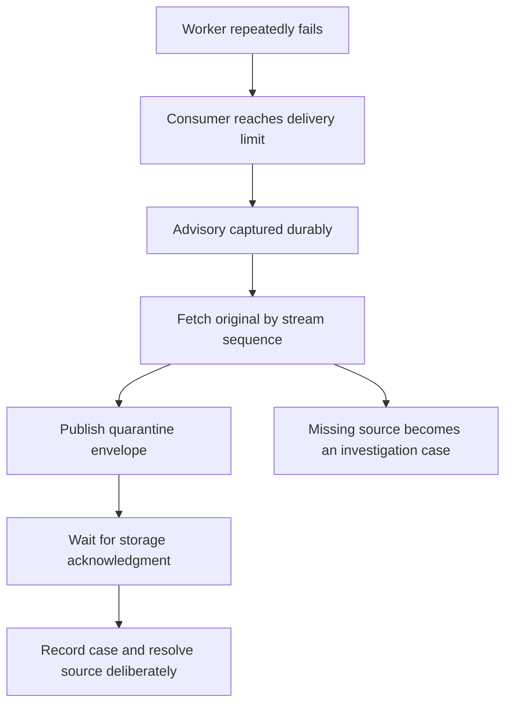

# Handle JetStream Poison Messages with a Dead-Letter Workflow

Author: [nawazdhandala](https://www.github.com/nawazdhandala)

Tags: NATS, Messaging, Go, Troubleshooting

Description: Capture MaxDeliver advisories, preserve failed JetStream payloads in quarantine, and resolve poison messages with confirmed storage and controlled retries.

A poison message is one that repeatedly fails processing because of its content or an enduring incompatibility. Retrying malformed data forever wastes capacity and hides the real problem. But stopping retries is only half a solution: you also need evidence, ownership, and a safe way to recover the failed operation.

JetStream's `MaxDeliver` setting limits delivery attempts for a consumer. It does not automatically move a message into a dead-letter queue. Build that workflow explicitly around advisories, retained source data, and confirmed quarantine storage.

This walkthrough targets **NATS Server 2.11.4** and **nats.go 1.42.0**. The local lab exercised retry exhaustion, advisory capture, payload copying, and a repeated copy within the deduplication window. It did not test production retention races or a distributed recovery service.

## Treat an advisory as a pointer, not the failed payload

When a message reaches the consumer's delivery threshold, the server can publish an advisory on:

```text
$JS.EVENT.ADVISORY.CONSUMER.MAX_DELIVERIES.<STREAM>.<CONSUMER>
```

Its JSON identifies the stream, consumer, stream sequence, and delivery count. The type is `io.nats.jetstream.advisory.v1.max_deliver`. The [tagged event schema](https://github.com/nats-io/nats-server/blob/v2.11.4/server/jetstream_events.go) contains no original message body.

You must retrieve the original by stream sequence while it remains retained. If retention has already removed it, the advisory cannot reconstruct it. Record that as an unresolved evidence gap instead of pretending the job was successfully quarantined.



A source message reaching `MaxDeliver` is not automatically a successful job, and it is not automatically a saved dead-letter record.

## Capture advisories before failures happen

A plain live subscription can miss an advisory while the listener is offline. Provision a stream that captures the relevant advisory subject before starting the workload. This example fragment assumes a connected modern Go JetStream client `js`, a bounded context `ctx`, and `time` plus `jetstream` imports:

```go
_, err := js.CreateStream(ctx, jetstream.StreamConfig{
    Name: "FAILURE_ADVISORIES",
    Subjects: []string{
        "$JS.EVENT.ADVISORY.CONSUMER.MAX_DELIVERIES.JOBS.workers",
    },
    Storage: jetstream.FileStorage,
    Retention: jetstream.LimitsPolicy,
    MaxAge: 24 * time.Hour,
    MaxMsgs: 10000,
})
if err != nil { return err }
```

The stream and consumer names are lab examples; replace them with your approved scope. The retention limits are illustrative and must cover the expected outage and investigation window. One file-backed server is not a high-availability design.

Consume this advisory stream using a durable processor. Acknowledge an advisory only after the quarantine write and durable case record succeed. Capturing the event and copying the original are separate operations, so retries and reconciliation are still necessary.

The server's [advisory publishing code](https://github.com/nats-io/nats-server/blob/v2.11.4/server/jetstream_events.go) checks for interest. Creating the capture stream after an incident is not a way to recover earlier missed notifications.

## Preserve the original without changing it

The helper below handles one captured advisory. It requires `context`, `encoding/json`, `fmt`, and `github.com/nats-io/nats.go/jetstream`. Before calling it, provision a separate stream that captures `quarantine.jobs`, with storage, retention, and permissions appropriate for the original payload's sensitivity.

The validation deliberately accepts only the known lab stream and consumer. In a service covering many workloads, use an explicit authorized mapping instead of letting arbitrary event fields choose unrestricted source and destination resources.

```go
type Advisory struct {
    Type string `json:"type"`
    Stream string `json:"stream"`
    Consumer string `json:"consumer"`
    StreamSeq uint64 `json:"stream_seq"`
    Deliveries uint64 `json:"deliveries"`
}
func quarantine(ctx context.Context, js jetstream.JetStream, data []byte) error {
    var advisory Advisory
    if err := json.Unmarshal(data, &advisory); err != nil { return err }
    if advisory.Type != "io.nats.jetstream.advisory.v1.max_deliver" ||
        advisory.Stream != "JOBS" || advisory.Consumer != "workers" ||
        advisory.StreamSeq == 0 {
        return fmt.Errorf("unexpected advisory")
    }
    source, err := js.Stream(ctx, advisory.Stream)
    if err != nil { return err }
    original, err := source.GetMsg(ctx, advisory.StreamSeq)
    if err != nil { return err }
    body, err := json.Marshal(struct {
        Advisory Advisory `json:"advisory"`
        Message *jetstream.RawStreamMsg `json:"message"`
    }{advisory, original})
    if err != nil { return err }
    key := fmt.Sprintf("lab/%s/%s/%d", advisory.Stream,
        advisory.Consumer, advisory.StreamSeq)
    _, err = js.Publish(ctx, "quarantine.jobs", body, jetstream.WithMsgID(key))
    return err
}
```

`GetMsg` reads the original stored record. The envelope preserves its subject, headers, payload, sequence, and stored time using the [raw-message type](https://github.com/nats-io/nats.go/blob/v1.42.0/jetstream/stream.go). JSON encodes its byte payload as base64. The helper waits for the JetStream publish result and performs no source deletion or source acknowledgment.

`WithMsgID` gives repeated copies the same publisher deduplication identity. That protection is limited to the destination stream's deduplication window. It is not a permanent case ledger. The lab key also assumes one account and one stream incarnation; production identities should include the account/domain and stream incarnation so recreating a stream cannot collide with old cases. The [tagged Go client documentation](https://github.com/nats-io/nats.go/blob/v1.42.0/jetstream/README.md) describes publication and deduplication options.

## Resolve the case after storage is confirmed

Add a durable case record containing the source identity, quarantine location, failure category, handler version, and resolution status. If the quarantine publish times out, its outcome may be uncertain; retry using the same identity and reconcile the destination. Do not mark the advisory complete merely because a publish call was attempted.

Decide whether the failure is transient, permanently invalid, or caused by a deployment bug. A temporary database outage needs a different response from an impossible schema version. `Term` can stop further delivery of a message, but it does not itself store a dead-letter payload. The [acknowledgment guide](https://docs.nats.io/learn/jetstream/acknowledgment) explains termination and retry responses.

Any source cleanup must respect retention policy and other consumers. Deleting a stream message can affect readers beyond the failed worker. For an event log, retaining the source until its normal expiry may be the right decision. For a work queue, use a separately reviewed resolution procedure after evidence is safely retained. Never purge the entire source stream to clear one poison message.

## Test exhaustion and recovery as separate stages

Use a disposable source stream with identifiable invalid data. Configure a small finite `MaxDeliver`, allow the attempts to fail without acknowledgment, and keep exercising bounded pulls so the server evaluates delivery eligibility. Do not assume an advisory is guaranteed to appear at a particular wall-clock instant just because the worker has stopped asking for messages.

In our pull-consumer lab, a further bounded pull after the second unacknowledged attempt allowed exhaustion to be observed without a third delivery. The advisory was captured, the payload copied, and repeating the copy immediately produced one quarantine message through deduplication. The source message remained readable.

Also test the difficult cases: the advisory processor is offline, quarantine storage rejects a write, the source expires before retrieval, and the processor crashes after copying but before recording completion. Those cases need explicit retry or reconciliation outcomes; the local happy-path lab does not prove them solved.

When a repair is ready, replay through a controlled recovery path with the original business operation identity. Limit throughput, verify the corrected handler, and record the recovery result in the case. A dead-letter workflow is complete only when failed work is either safely recovered or deliberately closed with retained evidence.
