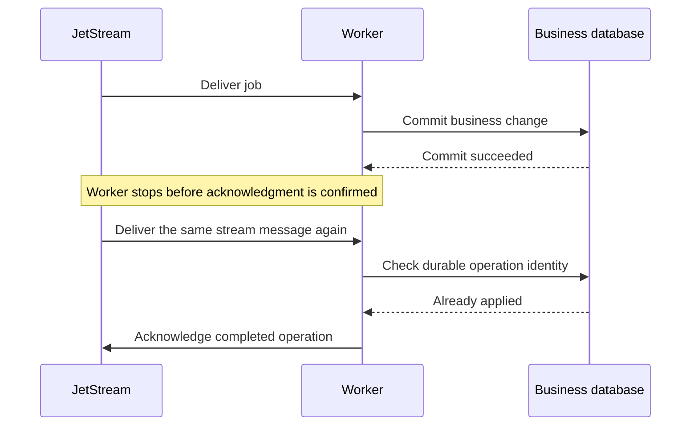

# Why JetStream Redelivers Messages Your Worker Already Processed

Author: [nawazdhandala](https://www.github.com/nawazdhandala)

Tags: NATS, Messaging, Go, Troubleshooting

Description: Diagnose JetStream redelivery using message metadata, acknowledgment confirmation, AckWait and BackOff, then protect business effects with idempotency.

Your worker logs “processed successfully,” but the same job arrives again. The natural assumption is that JetStream ignored the acknowledgment. Often, the log proves only that the application finished its work. It says nothing about whether the server received the acknowledgment before its delivery deadline.

A reliable investigation separates three events: completing the business operation, sending the acknowledgment, and receiving confirmation that the server accepted it. They can fail independently.

The examples here target **NATS Server 2.11.4** and **nats.go 1.42.0**. A local experiment deliberately omitted an acknowledgment, observed redelivery, and then confirmed the acknowledgment with the modern Go JetStream API. No network-packet loss or external database failure was injected.

## First prove that it is a redelivery

A duplicate business payload is not necessarily a redelivered stream message. A publisher might have sent the same job twice, or two independent consumers might each receive their legitimate copy.

Record the stream name, consumer name, stream sequence, consumer sequence, delivery count, and application operation ID. For a `jetstream.Msg`, this helper reads metadata without acknowledging the message:

```go
func logDelivery(msg jetstream.Msg) error {
    metadata, err := msg.Metadata()
    if err != nil { return err }
    fmt.Printf("stream=%s consumer=%s stream_seq=%d consumer_seq=%d delivered=%d\n",
        metadata.Stream, metadata.Consumer, metadata.Sequence.Stream,
        metadata.Sequence.Consumer, metadata.NumDelivered)
    return nil
}
```

Use `fmt` and `github.com/nats-io/nats.go/jetstream` imports in your existing worker. The [message metadata API](https://github.com/nats-io/nats.go/blob/v1.42.0/jetstream/message.go) exposes these fields.

Within the same stream and consumer, the same stream sequence with an increased delivery count indicates redelivery. The same operation ID at a different stream sequence points toward duplicate publication. Different consumer names may indicate intentional fan-out or an accidentally unique durable name per worker replica.

This distinction determines which component to fix. Increasing `AckWait` will not prevent a publisher from storing the same business operation twice.

## Locate the acknowledgment gap



The second delivery protects against lost work. The application must prevent it from repeating an already committed effect. Acknowledging before committing merely changes the failure mode: the server can consider the message complete even though the business operation never happened.

Use logs that distinguish “business commit succeeded,” “acknowledgment sent,” and “acknowledgment confirmed.” Capture errors from every stage instead of placing one success log after an unchecked call.

## AckSync and DoubleAck belong to different Go APIs

In the legacy `nats.go` JetStream API, `(*nats.Msg).AckSync()` sends a synchronous acknowledgment and waits for confirmation. The tagged [legacy implementation](https://github.com/nats-io/nats.go/blob/v1.42.0/js.go) distinguishes it from ordinary `Ack()`.

In the newer `github.com/nats-io/nats.go/jetstream` package, the corresponding confirmation method is `DoubleAck(ctx)` on `jetstream.Msg`. Do not copy `AckSync` onto that interface and expect it to compile.

For a message whose business operation has already succeeded, this helper bounds the wait for confirmation:

```go
func confirmAck(msg jetstream.Msg) error {
    ctx, cancel := context.WithTimeout(context.Background(), 2*time.Second)
    defer cancel()
    return msg.DoubleAck(ctx)
}
```

It requires `context`, `time`, and the modern `jetstream` import. Check its returned error and record the operation identity if confirmation is uncertain. Two seconds is a lab example; choose a deadline appropriate to your network and shutdown budget.

A confirmation timeout does not prove that the server failed to apply the acknowledgment. The reply itself may be delayed or lost. Likewise, successful confirmation does not reverse a duplicate side effect that already occurred elsewhere.

## Review the effective retry clock

The consumer's acknowledgment deadline starts with delivery, not when a worker finally begins executing a buffered message. Large batches, slow handlers, database contention, and pauses can consume that time.

| Setting or action | Meaning for retry timing |
|---|---|
| `AckWait` | Deadline for acknowledgment when no backoff schedule overrides it |
| `BackOff` | Timeout-based redelivery schedule; overrides `AckWait` |
| `Nak()` | Requests prompt redelivery rather than following the timeout backoff |
| `NakWithDelay(...)` | Requests redelivery after the specified delay |
| `InProgress()` | Resets the redelivery timer while work continues |

The [consumer configuration types](https://github.com/nats-io/nats.go/blob/v1.42.0/jetstream/consumer_config.go) document the `BackOff` override and its relationship to `MaxDeliver`. The acknowledgment methods and their timing are documented in the [acknowledgment guide](https://docs.nats.io/learn/jetstream/acknowledgment).

Inspect the server's current consumer configuration rather than only the application's desired settings. For example, this fragment inside an administration function creates a consumer with a timeout schedule:

```go
consumer, err := js.CreateConsumer(ctx, "JOBS", jetstream.ConsumerConfig{
    Durable: "worker",
    AckPolicy: jetstream.AckExplicitPolicy,
    MaxDeliver: 5,
    BackOff: []time.Duration{30*time.Second, 2*time.Minute, 10*time.Minute},
})
if err != nil { return err }
_ = consumer
```

Here `js` is a connected modern JetStream client, `ctx` has a deadline, and `JOBS` already exists. Provision this centrally; do not have every replica overwrite consumer policy. The final interval is reused for remaining delivery attempts when the schedule is shorter than `MaxDeliver`. These durations are illustrative, not a recommended schedule for every workload.

If processing legitimately takes longer, choose an adequate deadline or send progress notifications under a bounded processing policy. Progress notifications must stop when the handler fails or loses ownership. They should not indefinitely hide a stuck operation. Also reduce prefetch or batch size when messages spend most of their deadline waiting inside a worker.

## Make the business change safe to repeat

For a database-backed operation, use a stable operation ID and a durable uniqueness constraint. The deduplication decision and business mutation should commit in the same database transaction. If the ID already records a successful application of that operation, return the recorded result and acknowledge the duplicate delivery.

An in-memory map is insufficient across process restarts. Recording “seen” before doing the work is also unsafe: a crash can leave the ID marked complete without its business effect. Recording it afterward in a separate transaction leaves a duplicate-effect window.

For an external API, use its idempotency mechanism where available and reconcile uncertain outcomes. A local database transaction cannot atomically commit a third-party payment or email delivery. Keep that boundary explicit instead of claiming the acknowledgment method solves it.

## Verify the repair with a controlled failure

In a disposable staging stream, publish one identifiable job, receive it, and intentionally omit the acknowledgment. Confirm that the next delivery has the same stream sequence and a higher delivery count. Then acknowledge with confirmation and inspect outstanding acknowledgments.

Our local test used a short backoff schedule with a longer `AckWait`. It observed the second delivery before the longer deadline, confirming that backoff controlled the timeout. After `DoubleAck`, outstanding acknowledgments became zero and no further delivery appeared during the bounded observation window.

Next, test your application-specific failure window: commit the business change, stop before acknowledgment, and allow another worker to receive the message. The acceptance condition is one durable business effect with a repeat delivery handled safely. Do not judge the repair solely by whether the message was delivered once.

Finally, monitor retry counts and exhausted attempts. A message that reaches `MaxDeliver` needs an operational handling plan; increasing that limit forever is not a substitute for understanding why processing or acknowledgment keeps failing.
