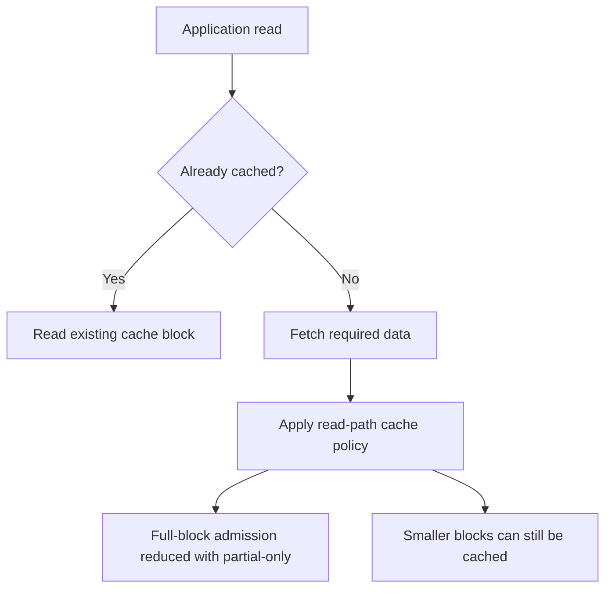

# Use JuiceFS cache-partial-only When Sequential Reads Outrun Local Disk

Author: [nawazdhandala](https://www.github.com/nawazdhandala)

Tags: JuiceFS, Storage, Performance

Description: Test whether JuiceFS cache writes slow sequential scans, understand what cache-partial-only actually changes, and preserve useful caching for smaller reads.

A local cache is not automatically faster than object storage. A worker with a busy or slow disk can spend substantial time writing blocks that a sequential job will never read again. In that situation, caching every full block can add pressure without providing reuse.

JuiceFS offers `--cache-partial-only` for this pattern. This guide examines **Community Edition 1.4.2**, explains the flag's limits, and sets up a comparison that keeps cache effects separate from application correctness.

## Establish that the cache device is the bottleneck

Start with the actual job, not a generic throughput claim. Record sequential-read throughput, object-download traffic, local disk activity, CPU use, and the job's completion time over the same interval.

A convincing candidate is a scan with little reuse, fast remote reads, and a saturated cache device. If object requests are slow, CPU is exhausted, or metadata lookups dominate, changing cache admission may not address the limiting resource.

The official cache guide describes partial-only caching as useful when object-storage throughput exceeds local-cache throughput, particularly when applications also make smaller random reads. That is a workload-dependent opportunity, not a default recommendation for every SSD-backed client. [JuiceFS cache guidance](https://github.com/juicedata/juicefs/blob/v1.4.2/docs/en/guide/cache.md#client-read-cache).

Also check whether other applications share the device. A change that helps the scan but makes another workload reread its useful data from object storage may be a net regression.

## Know what the flag changes

The mount implementation maps `--cache-partial-only` to a disabled `CacheFullBlock` setting. In the ordinary full-block read path, the cache-admission decision then accepts blocks smaller than the configured block size rather than every full block.

The comparison is about the storage block being handled, not simply the size passed to the application's `read` call. A small application read can still interact with a full object block, range-read logic, and prefetch. [Mount configuration](https://github.com/juicedata/juicefs/blob/v1.4.2/cmd/mount.go), [pinned chunk read path](https://github.com/juicedata/juicefs/blob/v1.4.2/pkg/chunk/cached_store.go).



This is not a “no local disk I/O” switch. Existing cached blocks can still be read. Explicit warmup can populate blocks, and the implementation's prefetch path can also populate cache. Turning the flag on does not delete old cached data.

It also does not make writeback staging disappear. The pinned source warns that partial-only behavior is ineffective for staged blocks when writeback is enabled. Keep writeback out of the initial experiment so the comparison addresses read caching alone.

## Construct a comparison with one changed variable

Choose a stable, non-sensitive test dataset that resembles the production job. Include a large sequential scan and a smaller repeated-read workload if both matter to the application. Record file sizes and a known content digest before the comparison.

Use isolated clients or a dedicated staging environment with comparable starting conditions. Do not drop host page cache or erase a shared cache directory on a production worker. The operating system's memory cache can make the second run much faster even when the JuiceFS disk-cache policy did nothing useful.

Hold client version, object endpoint, cache device, memory, worker count, and network conditions as constant as practical. Run the baseline with ordinary caching, then the candidate with only this flag added. Repeat in a different order to reduce the influence of transient remote or host load.

A clean result should explain both the job speed and the change in resource use. “The second run was faster” is not enough evidence to adopt a new policy.

## Apply the candidate setting to a staging mount

Prepare a dedicated local cache path and empty mount point, and replace the metadata endpoint and password-file location with tested staging values:

```bash
export META_PASSWORD_FILE=/etc/juicefs/staging-meta-password
juicefs mount \
  --cache-dir /srv/juicefs-read-test-cache \
  --cache-size 20480 \
  --cache-partial-only \
  rediss://juicefs@staging-metadata.example.internal:6379/1 \
  /mnt/jfs-read-test
```

The 20480 MiB cache size is an example budget, not a performance target. This starts the client in the foreground and leaves writeback disabled. Provision valid Redis TLS trust and appropriate directory permissions first. [Metadata connection guide](https://github.com/juicedata/juicefs/blob/v1.4.2/docs/en/reference/how_to_set_up_metadata_engine.md).

Use the same command without `--cache-partial-only` for the baseline. Coordinate normal unmounting between runs through the mount owner, and never stack this command over an existing mount.

Confirm the effective options in the client's startup information. A service configuration edit that was not deployed is not a valid comparison, and a second unrelated client on the host can confuse metrics attribution.

## Read the same data and verify the result

This Python 3 helper sequentially reads a selected existing file and reports both bytes consumed and a SHA-256 digest. Replace the path with a reviewed test file:

```python
import hashlib
import time
from pathlib import Path

path = Path("/mnt/jfs-read-test/dataset/scan.bin")
hash_value = hashlib.sha256()
count = 0
started = time.monotonic()
with path.open("rb") as source:
    for block in iter(lambda: source.read(1024 * 1024), b""):
        count += len(block)
        hash_value.update(block)
elapsed = time.monotonic() - started
print(f"bytes={count} seconds={elapsed:.3f}")
print(f"sha256={hash_value.hexdigest()}")
```

The digest and byte count should match across configurations. The time includes hashing and Python overhead; this is a repeatable integrity-aware read probe, not a pure storage benchmark. If hashing saturates CPU, use the application's real workload for the performance decision. [Python hashlib documentation](https://docs.python.org/3/library/hashlib.html).

Run the smaller repeated-read case too. Partial-only caching can be attractive precisely because the workload benefits from retaining small blocks while avoiding unnecessary full-block admission. But whether the application's access pattern reaches that path must be measured, not inferred from file extensions.

## Interpret the results across the whole job

| Observation | Interpretation to investigate |
| --- | --- |
| Less local write activity and faster scan | Full-block cache admission may have been costly |
| Same scan time with less disk traffic | Resource savings may still matter to neighboring jobs |
| More object traffic on later scans | Lost full-block reuse may outweigh the first-run improvement |
| Small-read latency regresses | Useful cache coverage or prefetch behavior may have changed |
| Full blocks still appear in cache | Check existing data, warmup, prefetch, and writeback settings |

Use client metrics and host disk telemetry together, keeping each mount identifiable. Avoid comparing a warm memory-cache baseline with a cold candidate. [JuiceFS monitoring guidance](https://github.com/juicedata/juicefs/blob/v1.4.2/docs/en/administration/monitoring.md).

If sparse reads generate excessive object traffic, evaluate prefetch separately after this comparison. Changing both flags simultaneously makes it difficult to attribute the result. If repeated full scans dominate instead, ordinary full-block caching on a faster device may remain the better choice.

Roll out the accepted setting to a small worker group, retain a known baseline configuration, and watch both scan completion time and repeat-read cost. Removing the flag later changes admission policy; it is not an instant reconstruction of the previous warm cache.

The helper was tested locally for byte counts and hashes across empty, small, and multi-chunk files. Shell syntax and the JuiceFS 1.4.2 option mapping were checked. No FUSE cache-policy experiment or performance improvement was measured here; the comparison remains a staging procedure for the target workload.
