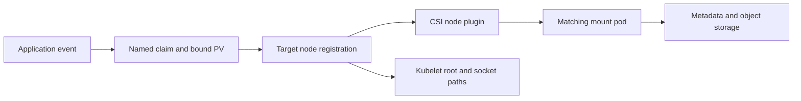

# Trace JuiceFS CSI ContainerCreating Failures from Pod to Kubelet

Author: [nawazdhandala](https://www.github.com/nawazdhandala)

Tags: JuiceFS, Kubernetes, Troubleshooting

Description: Follow a blocked application through its claim, CSI node registration, mount pod, and kubelet paths before restarting or replacing storage components.

`ContainerCreating` is a symptom, not a storage diagnosis. An application might be waiting for an image, network setup, a Secret, or a filesystem mount. Start with its events and follow the failing dependency instead of deleting every pod that mentions JuiceFS.

This guide uses **JuiceFS CSI driver and chart 0.34.0**, with the normal `mountpod` mode. Examples assume the driver runs in `kube-system`; substitute your actual namespace and resource names. Sidecar and serverless mount modes need a different resource map.

## Establish which operation is blocked

Set the application identifiers and inspect its current state:

```bash
APP_NS='REPLACE_APPLICATION_NAMESPACE'
APP_POD='REPLACE_APPLICATION_POD'
kubectl -n "$APP_NS" get pod "$APP_POD" -o wide
kubectl -n "$APP_NS" describe pod "$APP_POD"
```

Look at event messages, timestamps, the assigned node, and container waiting reasons. If the failure is an application image pull, investigate that image rather than the storage driver. If the event identifies a failed volume mount, record the volume name and full error.

An unscheduled pod has no target node yet. Resolve scheduling first rather than querying a CSI node pod using an empty node name. Preserve the evidence before restarting anything. [Pinned JuiceFS troubleshooting flow](https://github.com/juicedata/juicefs-csi-driver/blob/v0.34.0/docs/en/administration/troubleshooting.md).



## Match the volume explicitly

Applications can use several PVCs. List them and choose the one named by the failing event rather than taking the first claim automatically:

```bash
kubectl -n "$APP_NS" get pod "$APP_POD" \
  -o jsonpath='{range .spec.volumes[*]}{.name}{"\t"}{.persistentVolumeClaim.claimName}{"\n"}{end}'
```

Entries without a claim name may be Secrets, projected credentials, or other volume types. Set `CLAIM` to the relevant PVC, then inspect it:

```bash
CLAIM='REPLACE_FAILING_CLAIM'
kubectl -n "$APP_NS" describe pvc "$CLAIM"
PV=$(kubectl -n "$APP_NS" get pvc "$CLAIM" -o jsonpath='{.spec.volumeName}')
```

If the claim is not bound and `PV` is empty, investigate provisioning and the controller. Do not continue with an unqualified PV query that could list unrelated resources.

For a bound claim, confirm the driver and record the volume handle:

```bash
kubectl get pv "$PV" \
  -o jsonpath='{.spec.csi.driver}{"\n"}{.spec.csi.volumeHandle}{"\n"}'
```

The expected driver is normally `csi.juicefs.com`. The handle identifies the volume within the driver's workflow; preserve it alongside the application UID and node. [JuiceFS PV configuration](https://github.com/juicedata/juicefs-csi-driver/blob/v0.34.0/docs/en/guide/pv.md).

## Distinguish cluster driver configuration from node registration

Check both objects:

```bash
NODE=$(kubectl -n "$APP_NS" get pod "$APP_POD" -o jsonpath='{.spec.nodeName}')
kubectl get csidriver csi.juicefs.com -o yaml
kubectl get csinode "$NODE" -o yaml
```

Run the node query only after confirming `NODE` is nonempty. `CSIDriver` describes cluster-wide driver behavior. The pinned chart sets `attachRequired: false` because this filesystem driver does not use a separate attach operation. A missing or incorrect object can change Kubernetes's attach assumptions. Restore it through the reviewed installation source rather than adding an unrelated external attacher. [CSIDriver behavior](https://kubernetes-csi.github.io/docs/csi-driver-object.html).

`CSINode` records node-specific driver information. Look for the JuiceFS driver in that node's driver list; an object existing for the node does not mean JuiceFS is registered. Missing registration directs attention to the node plugin and registrar. [CSINode registration information](https://kubernetes-csi.github.io/docs/csi-node-object.html).

## Inspect the CSI node pod on the affected worker

Use both the driver label and node field selector:

```bash
kubectl -n kube-system get pods -l app=juicefs-csi-node \
  --field-selector "spec.nodeName=$NODE" -o wide
```

Substitute the returned pod name in the following commands. If none is returned, inspect DaemonSet scheduling and node eligibility first.

```bash
kubectl -n kube-system describe pod REPLACE_CSI_NODE_POD
kubectl -n kube-system logs REPLACE_CSI_NODE_POD \
  -c juicefs-plugin --since=20m --tail=200
kubectl -n kube-system logs REPLACE_CSI_NODE_POD \
  -c node-driver-registrar --since=20m --tail=200
```

The plugin logs explain mount requests; registrar logs help explain socket registration. Confirm container names in the pod if your deployment customizes them. When a container restarted, inspect its previous instance with `--previous` as well. [kubectl logs options](https://kubernetes.io/docs/reference/kubectl/generated/kubectl_logs/).

Correlate the recorded volume handle and time window. A healthy plugin on another worker does not clear the failing node.

## Check kubelet paths as one coherent configuration

A common registration failure is a mismatch between the host's kubelet root and the chart's `kubeletDir`. Ask the node administrator for the effective kubelet configuration; absence of a command-line flag alone is not proof that every distribution uses the default layout.

With `jq` installed, inspect the rendered host paths and registrar environment from the actual DaemonSet:

```bash
kubectl -n kube-system get daemonset juicefs-csi-node -o json | jq '{
  hostPaths: [.spec.template.spec.volumes[] | select(.hostPath) |
    {name, path: .hostPath.path}],
  registrarEnv: [.spec.template.spec.containers[] |
    select(.name == "node-driver-registrar") | .env[]]
}'
```

The kubelet directory, plugin socket path, and registration directory must agree with the host layout. In chart 0.34.0, these are derived from `kubeletDir` and the plugin-directory setting. Do not fix only one path by hand or create arbitrary symlinks on the node. [Pinned chart release](https://github.com/juicedata/charts/releases/tag/helm-chart-juicefs-csi-driver-0.34.0).

Render a proposed values change first, then roll it out using the driver's normal management process with an appropriate disruption plan. Restarting kubelet is not the first diagnostic step for a configuration mismatch. [JuiceFS registration failure cases](https://github.com/juicedata/juicefs-csi-driver/blob/v0.34.0/docs/en/administration/troubleshooting-cases.md).

## Find the matching mount pod without guessing

List mount pods on the same node:

```bash
kubectl -n kube-system get pods \
  -l app.kubernetes.io/name=juicefs-mount \
  --field-selector "spec.nodeName=$NODE" -o wide
```

Use the CSI node logs and recorded volume identity to select the relevant pod. Do not rely exclusively on a name substring: mount sharing can make the relationship less obvious, and several application pods may depend on one mount pod.

Inspect its events and recent logs. A pending mount pod points toward scheduling, resources, or admission. `ImagePullBackOff` points toward the mount image or registry access. A running container that reports metadata authentication or certificate failures points toward backend configuration. Keep informational context instead of filtering out all INFO and WARNING lines.

If no mount pod exists, determine whether the node plugin received the request and whether creation was denied. If it exists but the filesystem never mounts, investigate its client logs and connectivity before touching the application's PVC.

## Verify the correction without discarding evidence

Change the component implicated by the evidence, then observe registration, mount-pod readiness, application startup, and an approved file read/write check. Confirm that the correction survives a controlled reschedule when appropriate.

Avoid deleting a claim to repair a mounting error: that changes storage lifecycle and can expose data to its reclaim policy. Likewise, do not delete a shared mount pod without identifying affected applications and any pending writeback data.

Local checks rendered chart 0.34.0 with default and alternate kubelet roots and verified corresponding socket/host paths. The jq inspection and shell syntax were checked against fixtures. No live Kubernetes registration, mount failure, restart, or recovery was reproduced; the commands form a staged diagnostic path rather than a claimed incident repair.
