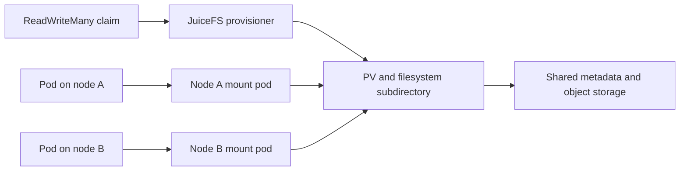

# Provision Shared Kubernetes Volumes with the JuiceFS CSI Driver

Author: [nawazdhandala](https://www.github.com/nawazdhandala)

Tags: JuiceFS, Kubernetes, CSI

Description: Install a pinned JuiceFS CSI chart, connect an existing filesystem, and test a dynamically provisioned ReadWriteMany claim across two worker nodes.

A shared filesystem lets pods on different nodes access the same files, but Kubernetes still needs a driver to connect a claim to that filesystem. JuiceFS's Container Storage Interface (CSI) driver supplies that integration. Dynamic provisioning creates a Kubernetes volume for a claim without requiring an administrator to write a separate PersistentVolume manifest each time.

This example uses **CSI chart and driver 0.34.0**, a **JuiceFS Community Edition 1.4.2** mount image, and manifests rendered for **Kubernetes 1.34**. It assumes an existing, tested JuiceFS filesystem and a staging cluster with at least two suitable Linux workers.

## Understand what is being shared

A PersistentVolumeClaim (PVC) is the application's storage request. A StorageClass tells the provisioner which driver and credentials to use. With JuiceFS dynamic provisioning, a claim normally receives its own subdirectory within the existing filesystem.



ReadWriteMany, often shortened to RWX, means the volume supports read/write mounts from multiple nodes. It does not coordinate application transactions or make concurrent writes to the same file safe automatically. Kubernetes access modes describe mounting capabilities, not an application locking protocol. [Kubernetes volume access modes](https://kubernetes.io/docs/concepts/storage/persistent-volumes/#access-modes).

Two different PVCs are not the same shared directory. The two test pods below deliberately reference one claim. [Pinned JuiceFS provisioning guide](https://github.com/juicedata/juicefs-csi-driver/blob/v0.34.0/docs/en/guide/pv.md).

## Check node and backend prerequisites

Every participating node needs the required FUSE capability and network access to the metadata engine and object store. The driver uses privileged infrastructure components and host mount propagation; the cluster's admission policy must permit that reviewed deployment. Do not bypass a restricted application namespace's policy indiscriminately.

Confirm the kubelet root directory. The example uses `/var/lib/kubelet`; a distribution with a different root requires a matching chart value. Also verify image availability, metadata credentials, object-storage access, and certificate trust from the driver and mount-pod environments. Host trust alone does not establish container trust. [CSI installation requirements](https://github.com/juicedata/juicefs-csi-driver/blob/v0.34.0/docs/en/getting_started.md).

Use an existing formatted filesystem for this tutorial. Provision a Secret named `juicefs-volume` in `kube-system` through your secret-management system. Its `name` field must identify that filesystem and `metaurl` must contain its tested metadata connection reference. Provide any required object credentials, encryption material, environment settings, or CA files using the documented Secret/configuration mechanisms. Do not commit real credentials into chart values.

For an already-formatted Community Edition volume, the guide permits omitting `storage` and `bucket` to avoid formatting again. Keep the actual volume settings under the storage owner's control.

## Pin and render the driver chart

Save this as `values-juicefs.yaml`:

```yaml
kubeletDir: /var/lib/kubelet
mountMode: mountpod
dashboard:
  enabled: false
defaultMountImage:
  ce: juicedata/mount:ce-v1.4.2@sha256:4177c77bc873898127debf45786515b78c79bee18fed378d276fb221baa85640
storageClasses: []
```

This selects independent mount pods, disables the optional dashboard, and leaves StorageClass management separate. The mount-image digest was resolved from the public registry during review; verify supported platforms and availability in your environment. Driver images and mount images serve different roles.

```bash
helm repo add juicefs https://juicedata.github.io/charts/
helm repo update juicefs
helm template juicefs-csi-driver juicefs/juicefs-csi-driver \
  --version 0.34.0 --namespace kube-system --kube-version 1.34.0 \
  -f values-juicefs.yaml > juicefs-rendered.yaml
```

Review the rendered permissions, host paths, images, and CSI driver object. Rendering is local generation, not API validation or proof that nodes can mount. This values file rendered ten objects with Helm 3.17.3 during local review. [Pinned chart release](https://github.com/juicedata/charts/releases/tag/helm-chart-juicefs-csi-driver-0.34.0).

After cluster review, install the same version and values:

```bash
helm upgrade --install juicefs-csi-driver juicefs/juicefs-csi-driver \
  --version 0.34.0 --namespace kube-system -f values-juicefs.yaml
kubectl -n kube-system get pods -o wide
kubectl get csidriver csi.juicefs.com
```

Confirm the controller and node components are healthy before creating application storage. Resolve failed pulls, admission failures, or kubelet-path mismatches first.

## Create the class and claim

Create the `juicefs-demo` namespace through your normal process. Save the following as `shared-storage.yaml`. The Secret references must match the already-provisioned Secret exactly:

```yaml
apiVersion: storage.k8s.io/v1
kind: StorageClass
metadata:
  name: juicefs-rwx
provisioner: csi.juicefs.com
parameters:
  csi.storage.k8s.io/provisioner-secret-name: juicefs-volume
  csi.storage.k8s.io/provisioner-secret-namespace: kube-system
  csi.storage.k8s.io/node-publish-secret-name: juicefs-volume
  csi.storage.k8s.io/node-publish-secret-namespace: kube-system
reclaimPolicy: Retain
---
apiVersion: v1
kind: PersistentVolumeClaim
metadata:
  name: shared-data
  namespace: juicefs-demo
spec:
  accessModes:
    - ReadWriteMany
  storageClassName: juicefs-rwx
  resources:
    requests:
      storage: 10Gi
```

`Retain` makes data disposal a deliberate administrative step after claim removal. It is not a backup policy. The requested size also does not provision a dedicated object bucket; assess the driver's quota behavior and the shared backend capacity separately.

```bash
kubectl apply -f shared-storage.yaml
kubectl -n juicefs-demo get pvc shared-data
kubectl -n juicefs-demo describe pvc shared-data
```

Expect the claim to become `Bound`. If it stays pending, inspect events and the controller before changing mount settings: provisioning and node mounting are different stages.

## Verify sharing across two nodes

Save this as `shared-test.yaml`. The required anti-affinity places the two replicas on distinct hostnames; one remains pending if the cluster cannot satisfy that requirement. [Kubernetes anti-affinity](https://kubernetes.io/docs/concepts/scheduling-eviction/assign-pod-node/#inter-pod-affinity-and-anti-affinity).

```yaml
apiVersion: apps/v1
kind: Deployment
metadata:
  name: shared-test
  namespace: juicefs-demo
spec:
  replicas: 2
  selector:
    matchLabels:
      app: shared-test
  template:
    metadata:
      labels:
        app: shared-test
    spec:
      affinity:
        podAntiAffinity:
          requiredDuringSchedulingIgnoredDuringExecution:
            - labelSelector:
                matchLabels:
                  app: shared-test
              topologyKey: kubernetes.io/hostname
      containers:
        - name: test
          image: busybox:1.37.0
          command: ["sh", "-c", "sleep 3600"]
          volumeMounts:
            - name: shared
              mountPath: /data
              mountPropagation: HostToContainer
      volumes:
        - name: shared
          persistentVolumeClaim:
            claimName: shared-data
```

This is a temporary test workload. Adapt its execution identity and permissions to your namespace policy; production applications should use their approved user and group IDs. Mount propagation follows the driver's documented pattern for recovering mounts after mount-pod failure. [Pinned application example](https://github.com/juicedata/juicefs-csi-driver/blob/v0.34.0/docs/en/guide/pv.md#dynamic-provisioning).

```bash
kubectl apply -f shared-test.yaml
kubectl -n juicefs-demo get pods -l app=shared-test -o wide
```

After both pods are ready, substitute their actual names below. Create a uniquely named marker on the first and read it on the second:

```bash
kubectl -n juicefs-demo exec POD_A -- sh -c \
  'set -eu; p=$(mktemp /data/rwx-check.XXXXXX); printf "shared-volume-check\n" > "$p"; echo "$p"'
kubectl -n juicefs-demo exec POD_B -- cat /data/REPLACE_WITH_PRINTED_MARKER
```

The marker command uses BusyBox shell utilities and stops if creation or writing fails. [BusyBox command reference](https://busybox.net/downloads/BusyBox.html). The expected result is the same marker text. Verify distinct nodes and the same PVC before interpreting success. Then repeat with application-owned files and permission requirements. This small visibility test does not establish locking, throughput, disaster recovery, or application consistency.

Local validation verified the chart archive against its repository-index checksum, rendered the pinned configuration, and checked YAML relationships and shell syntax. No Kubernetes API admission, live provisioning, mount-pod execution, or cross-node read was performed. Keep those as explicit staging acceptance steps before adopting the class for production.
