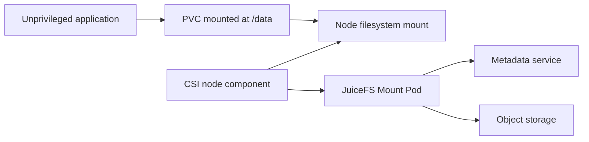

# Use JuiceFS CSI Without Privileged Application Pods

Author: [nawazdhandala](https://www.github.com/nawazdhandala)

Tags: JuiceFS, Kubernetes, CSI, Security

Description: Move JuiceFS mounting into managed CSI components, keep application containers unprivileged, and verify filesystem permissions without weakening workload policy.

A container that runs both your application and a JuiceFS mount command combines two different responsibilities. The application needs access to files. The mount process needs access to the node's filesystem machinery. Giving the entire application privileged execution to satisfy the second requirement expands the consequences of an application compromise.

The JuiceFS Container Storage Interface (CSI) driver separates these responsibilities. Kubernetes presents a mounted volume to the application; the application does not run the FUSE mount process. FUSE is the kernel interface that connects filesystem requests to a userspace program.

This guide uses **JuiceFS CSI Driver and chart 0.34.0**, with **Community Edition 1.4.2** as the mount client. It covers Linux nodes using ordinary Mount Pod mode. Injected sidecars and serverless deployments have different boundaries and need a separate review.

## Identify where the privilege moves

CSI does not remove the privileged storage layer. The pinned chart includes privileged node-side containers and host mounts. Those components need tightly controlled installation permissions, images, credentials, and updates. Review the [chart release and its node template](https://github.com/juicedata/charts/releases/tag/helm-chart-juicefs-csi-driver-0.34.0) before deciding which namespace and nodes may run it.

The practical improvement is that an application can consume a persistent volume claim (PVC) without receiving `/dev/fuse`, `SYS_ADMIN`, host paths, or privileged mode. A PVC is the application's request for persistent storage; the storage configuration behind it remains an administrator responsibility.



The arrows show responsibility and access, not a network proxy through the CSI controller for every file operation. Applications use filesystem calls. The JuiceFS client handles metadata and object access.

For comparison, the official [container deployment guide](https://github.com/juicedata/juicefs/blob/v1.4.2/docs/en/deployment/juicefs_on_docker.md) shows direct mounting with elevated privileges and a Compose example with FUSE device access. Those requirements belong to the process creating the mount. They are not a reason to make every consumer privileged.

## Prepare the storage boundary first

Have the storage administrator install the pinned driver, configure its backend credentials, and provide a staging PVC. This example assumes a **Bound** PVC named `juicefs-app-test` in namespace `storage-test`. It intentionally omits storage credentials from the application manifest.

Before starting the application, provision an `app-test` directory inside that volume with ownership and permissions appropriate for numeric user and group `1000:1000`. Do this through your approved storage administration process. Do not recursively change ownership on an existing shared dataset just to make a demonstration work.

JuiceFS uses Unix-style user and group IDs for file permissions. The [CSI permission guide](https://github.com/juicedata/juicefs-csi-driver/blob/v0.34.0/docs/en/security/permission.md) demonstrates applications running under different identities. A user named `app` inside two images is not necessarily the same numeric identity.

Do not assume that setting `fsGroup` will always repair existing ownership. Kubernetes behavior depends on volume and driver support, and recursively changing a large tree can have operational consequences. For this test, provision the intended identity and directory explicitly so the expected result is clear.

## Run an application-shaped check

Save the following as `juicefs-unprivileged-check.yaml`. It uses BusyBox 1.37.0 for basic shell utilities and an existing PVC. It writes only one uniquely named test file under the dedicated directory, checks its contents, and removes that same file.

```yaml
apiVersion: v1
kind: Pod
metadata:
  name: juicefs-unprivileged-check
  namespace: storage-test
spec:
  restartPolicy: Never
  automountServiceAccountToken: false
  securityContext:
    runAsNonRoot: true
    runAsUser: 1000
    runAsGroup: 1000
    seccompProfile:
      type: RuntimeDefault
  containers:
    - name: check
      image: busybox:1.37.0
      command: ["/bin/sh", "-ec"]
      args:
        - |
          id
          file=$(mktemp /data/app-test/access-check.XXXXXX)
          trap 'rm -f "$file"' EXIT
          printf 'juicefs-access-ok\n' > "$file"
          test "$(cat "$file")" = juicefs-access-ok
          echo 'Non-root file access passed'
      securityContext:
        privileged: false
        allowPrivilegeEscalation: false
        readOnlyRootFilesystem: true
        capabilities:
          drop: ["ALL"]
      volumeMounts:
        - name: data
          mountPath: /data
          mountPropagation: HostToContainer
  volumes:
    - name: data
      persistentVolumeClaim:
        claimName: juicefs-app-test
```

The root filesystem is read-only, but `/data` is a separate writable volume. Dropping capabilities and disabling privilege escalation prevent the shell from gaining mount privileges. Disabling the service-account token suits this check because it never calls the Kubernetes API; preserve API access deliberately for workloads that actually need it.

`HostToContainer` allows host mount changes to propagate into the application. JuiceFS recommends it as a recovery safeguard. It does not ask the application to publish mounts back to the host. See the [pinned recovery configuration](https://github.com/juicedata/juicefs-csi-driver/blob/v0.34.0/docs/en/guide/configurations.md#automatic-mount-point-recovery).

## Check admission separately from file access

Use your actual staging context in place of `staging`. First ask the API server to validate the proposed Pod without storing it:

```bash
kubectl --context staging apply --dry-run=server \
  -f juicefs-unprivileged-check.yaml
```

The [kubectl apply reference](https://kubernetes.io/docs/reference/kubectl/generated/kubectl_apply/) describes server-side dry runs. A successful response confirms that this request passed applicable server-side checks at that moment. It does not mount the PVC or execute the shell. Review any admission errors before applying:

```bash
kubectl --context staging apply -f juicefs-unprivileged-check.yaml
kubectl --context staging -n storage-test logs \
  juicefs-unprivileged-check
kubectl --context staging -n storage-test get pod \
  juicefs-unprivileged-check
```

Wait for the Pod to start before reading logs. The expected result is the numeric identity, `Non-root file access passed`, and eventual `Completed` status. A failed check should exit nonzero rather than silently continuing.

The security fields follow Kubernetes' [Restricted policy requirements](https://kubernetes.io/docs/concepts/security/pod-security-standards/), but clusters can enforce additional admission rules. Keep the application namespace's restrictions. Give the separately managed storage components only the reviewed exemptions they require.

## Fix the right failure

An admission rejection concerns the Pod specification or cluster policy. A Pod stuck in `ContainerCreating` with mount events usually requires inspecting the PVC, driver, node, or backend. A running container reporting `Permission denied` on `mktemp` points toward filesystem ownership, parent-directory traversal, or access controls.

Changing the application to privileged mode is not a sound first response to any of those symptoms. Inspect the intended UID/GID and directory permissions, then correct the specific mismatch. Likewise, do not copy backend credentials into the application just because mounting failed elsewhere.

Move a real workload only after its staging check covers the operations it needs: creating files, renaming them, locking if applicable, and reading existing data under the intended identity. Test mount recovery separately; this short-lived Pod proves neither restart behavior nor descriptor continuity.

The example was parsed and its shell syntax checked locally, and the pinned chart's privileged storage components were inspected. No Kubernetes admission or live JuiceFS access was executed. The deployment boundary is useful only when the cluster test confirms both parts: storage components can establish the mount, and the application can use it while retaining its restricted security settings.
