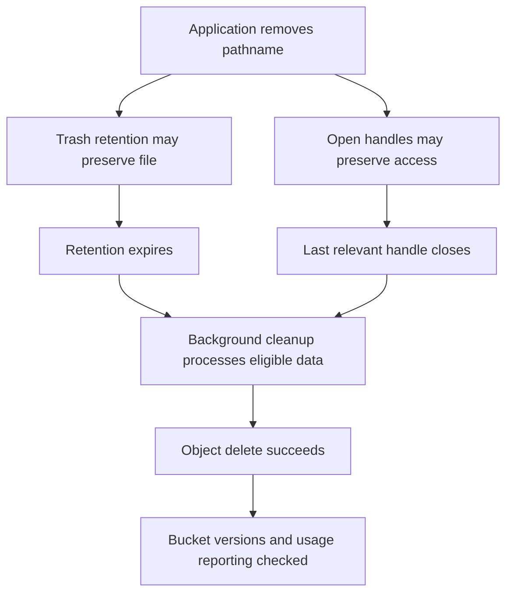

# Why JuiceFS Deletes Do Not Immediately Reduce Object Storage Usage

Author: [nawazdhandala](https://www.github.com/nawazdhandala)

Tags: JuiceFS, Storage, Troubleshooting

Description: Trace retained JuiceFS storage through trash, open files, stale slices, background cleanup, and bucket versions before choosing a cleanup action.

Deleting a large directory from JuiceFS and seeing no immediate drop in bucket usage is not enough evidence of a leak. The pathname may be gone while the data remains recoverable in trash, available to an open process, waiting for background deletion, or retained as a noncurrent bucket version.

Start by identifying which layer still owns the bytes. This guide uses **JuiceFS Community Edition 1.4.2** and keeps the first investigation non-destructive. Do not delete objects directly from the backing bucket just because their names do not resemble application files.

## Separate a removed name from reclaimed storage

A file's visible directory entry, its metadata, and its object-storage blocks are different things. A successful application deletion establishes that a pathname was removed from that application's view. It does not establish that every underlying copy has expired.



This is a diagnostic map rather than a strict implementation sequence. Several conditions can overlap. Overwriting a file also creates old data that needs reclamation even though the filename never disappears.

## Establish which usage number stayed high

Record the deletion time, affected path, volume identity, approximate data size, and the metric that failed to fall. A directory's visible contents, JuiceFS filesystem usage, and provider-reported bucket usage measure different sets of data.

| Observation | First explanation to investigate |
| --- | --- |
| Directory is empty but JuiceFS usage remains high | Trash or still-retained files |
| Visible trash is small but old data remains | Stale slices from overwrites |
| Pending deletion stays high | Background cleanup or object deletion failures |
| Current bucket objects decrease but billed storage does not | Noncurrent versions or provider accounting |
| Only one application's view differs | Wrong mount, subdirectory, or active file handles |

Compression, shared data references, and updates mean that a file's logical size is not necessarily the exact number of bytes to reclaim from object storage. Compare trends and categories before promising a particular reduction.

## Inspect trash policy and retained data

In this release, trash is enabled by default. Deleted files can be retained under the hidden `.trash` directory at the filesystem root until their retention period expires. The root here means the JuiceFS volume root; a subdirectory mount does not expose that same view. The [tagged trash documentation](https://github.com/juicedata/juicefs/blob/v1.4.2/docs/en/security/trash.md) describes both retention and access rules.

Using an approved administrative environment with metadata access, run:

```bash
META_URL='rediss://metadata.example.internal:6379/9'
juicefs status "$META_URL" --more
```

Replace the endpoint and database with the affected volume, and supply authentication through your existing secure mechanism. This requests detailed statistics and may be expensive on a large filesystem. Run it deliberately, not as a tight polling loop.

Inspect the configured retention and the `Trash Files`, `Trash Slices`, `Pending Deleted Files`, and `Pending Deleted Slices` categories when present. Save a timestamped result for comparison. Protect the output as operational information; it can include volume settings and client session details.

A slice is a piece of file data referenced by metadata. Overwriting or editing a file can leave old slices retained for recovery, even when no corresponding entry is visible while browsing `.trash`. Therefore, an empty-looking trash directory does not prove that no recoverable old data remains.

Do not set retention to zero simply to see whether the graph changes. That changes the recovery policy for the volume. First establish whether the retained data is expected and whether any backup or recovery workflow still depends on it.

## Check for live consumers and background workers

Unix unlink semantics allow an open file to remain usable after its last pathname is removed. JuiceFS tracks sustained inodes for these cases. An inode is the metadata identity of a file, distinct from its name. The [Linux unlink documentation](https://man7.org/linux/man-pages/man2/unlink.2.html) explains the underlying model; the [JuiceFS close implementation](https://github.com/juicedata/juicefs/blob/v1.4.2/pkg/meta/base.go) removes sustained state when the relevant client closes the removed file.

Inspect the session list from `juicefs status`. For a session that needs investigation, use its actual ID:

```bash
SESSION_ID=123
juicefs status "$META_URL" --session "$SESSION_ID"
```

Replace 123 with an observed session ID. This reports detailed session information, including sustained inodes and locks, rather than closing anything. Correlate it with the owning service. Request an application-controlled close or restart only after understanding the workload; do not kill arbitrary processes to make storage graphs move.

Automatic trash cleanup requires an online client running background jobs. Check that relevant mount services are healthy and were not started with `--no-bgjob`. Cleanup runs periodically, and a large backlog still takes time after eligibility. Review client logs for failed object deletes, authentication errors, throttling, or unreachable storage. A mounted filesystem serving cached reads is not proof that object deletion works.

## Run garbage collection in inspection mode first

Garbage collection compares metadata references with stored objects. In 1.4.2, this invocation is check-only:

```bash
juicefs gc "$META_URL"
```

It can scan a large object set and incur listing traffic, so schedule it with appropriate capacity. Confirm the metadata endpoint belongs to the live volume before starting. Reading an incomplete or stale metadata copy against production objects is not a sound basis for deletion decisions.

The report separates valid, pending, compacted, leaked, and skipped objects. A leaked object is not referenced in the metadata view used by that scan. Recent objects are skipped by the default safety window; do not remove that protection to make the totals agree. See the [pinned garbage-collector implementation](https://github.com/juicedata/juicefs/blob/v1.4.2/cmd/gc.go).

The flags `--delete` and `--compact` change the operation. The former performs cleanup; the latter triggers compaction. Neither belongs in the initial evidence-gathering command. Before any destructive run, review current metadata correctness, recovery retention, backup dependencies, and the intended scope with the storage owner.

A local check for this article used a disposable SQLite/file-storage volume with one synthetic unreferenced chunk. Check-only GC reported that chunk as leaked and left its bytes intact. This validates the inspection behavior, not production reclamation speed or recovery safety.

## Account for the bucket's own retention

Even a successful object delete may not reduce all provider storage categories. In a versioning-enabled Amazon S3 bucket, a simple delete normally adds a delete marker while older versions remain stored. Their removal is a separate lifecycle decision. AWS documents this in [deleting object versions](https://docs.aws.amazon.com/AmazonS3/latest/userguide/DeletingObjectVersions.html).

Inspect current and noncurrent usage separately. Review object-lock requirements, retention rules, failed deletion events, and the provider's metric update schedule. Do not add a broad age-based expiration rule to JuiceFS's live object prefix: an old object can still contain current file data.

## Decide from evidence, then verify the result

If retention explains the bytes, wait for the approved window and verify cleanup progresses. If background work is absent, restore a correctly configured client. If deletes fail, fix the specific storage access or availability problem. If leaked objects remain, plan reviewed garbage collection with recoverable metadata and data.

After a change, repeat the same observations at sensible intervals: retained categories, pending work, current object usage, and noncurrent versions. Keep a successful file-read check alongside the capacity measurements. Reclaimed space is only a successful outcome when the expected data and recovery guarantees remain intact.
