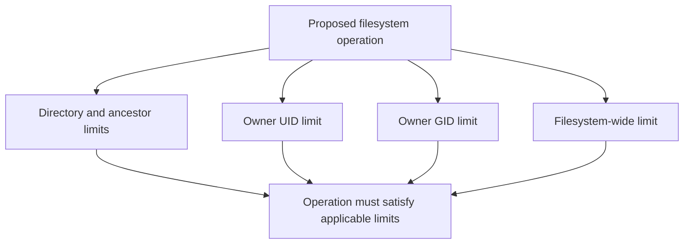

# Manage JuiceFS Directory, User, and Group Quotas Safely

Author: [nawazdhandala](https://www.github.com/nawazdhandala)

Tags: JuiceFS, Storage, Linux

Description: Set JuiceFS quotas by directory, UID, and GID, understand their accounting differences, and check or repair usage counters without changing file ownership.

A team can run out of file allocations while plenty of object-storage capacity remains. Another team can delete files and still find its user quota exhausted because those files remain in Trash. These situations require different responses; increasing a storage limit without checking its scope can hide the real cause.

JuiceFS quotas constrain filesystem usage. They are not a direct limit on the object-storage provider's bill. Start by deciding whether your policy follows a project directory, a numeric file owner, a numeric group, or the whole filesystem.

This guide uses **JuiceFS Community Edition 1.4.2** and its `quota` command. Run administrative changes against an approved staging volume first, and confirm that every writable client supports the features you intend to enforce. Older-client compatibility is a deployment prerequisite, not something a newer administrative binary fixes by itself.

## Choose the ownership of the limit

An inode represents a filesystem object such as a file or directory. An inode quota limits object count, while a capacity quota limits accounted space. Tiny-file workloads often need both.

| Scope | What it follows | Example policy |
| --- | --- | --- |
| Filesystem | Total volume usage | Keep the volume within an approved allocation |
| Directory | Entries within a directory tree | Limit one project's workspace |
| User | Objects owned by a numeric UID | Limit one service identity across directories |
| Group | Objects owned by a numeric GID | Limit a shared team's owned objects |

UID and GID mean user ID and group ID. These are numbers stored with files, not the human-readable names displayed by one host. Coordinate those numbers across clients before using identity-based quotas.

A file may be subject to several limits. A larger child-directory allocation does not bypass a smaller applicable parent limit, and a directory with room available does not cancel the owner's quota. The [quota guide](https://github.com/juicedata/juicefs/blob/v1.4.2/docs/en/guide/quota.md) describes the scopes and nested-directory behavior.



This is a policy diagram, not an assertion about the order of internal checks.

## Inspect before changing policy

Use a protected administrative environment where `META_URL` already contains the approved metadata address. Do not paste credentials into a shared terminal transcript. These commands do not require a local mount:

```bash
juicefs --version
juicefs quota list "$META_URL"
juicefs quota get "$META_URL" --path /projects/analytics
```

The path is relative to the **JuiceFS volume root**. If the volume is mounted at `/mnt/jfs`, the directory argument is `/projects/analytics`, not `/mnt/jfs/projects/analytics`. The same distinction applies when an application mounts only a subdirectory.

Record the current settings and usage before changing anything. An absent quota is different from a failed metadata connection or an incorrectly selected volume. Resolve that uncertainty before applying a new limit.

## Set a directory budget

For an existing staging project directory, this assigns 10 GiB and 100,000 inodes:

```bash
juicefs quota set "$META_URL" \
  --path /projects/analytics \
  --capacity 10 \
  --inodes 100000

juicefs quota get "$META_URL" --path /projects/analytics
```

GiB is a binary unit: 1 GiB equals 1,073,741,824 bytes. Read the returned limit and usage columns and compare them with the approved budget. Initial accounting for a large existing tree can take time and load the metadata service.

The command also supports `--create` for a missing directory. Use it only when directory creation is intentional; do not add it merely to suppress a path error. In this release, omitted limit flags preserve the corresponding setting during an update, whereas explicitly setting a limit to zero removes that limit. The [command implementation](https://github.com/juicedata/juicefs/blob/v1.4.2/cmd/quota.go) distinguishes these cases.

## Add user and group limits deliberately

Suppose the agreed service identity is UID 1000 and its shared group is GID 100. These are examples, not recommended universal identity numbers:

```bash
juicefs quota set "$META_URL" \
  --uid 1000 --capacity 2 --inodes 200

juicefs quota set "$META_URL" \
  --gid 100 --capacity 5 --inodes 500

juicefs quota get "$META_URL" --uid 1000
juicefs quota get "$META_URL" --gid 100
```

Replace the IDs and budgets with reviewed values. Use separate commands: `--path`, `--uid`, and `--gid` are mutually exclusive selectors. The 1.4.2 command rejects UID 0 for user-quota management.

These limits follow the ownership of filesystem objects. They do not charge whichever login happened to initiate a write. A directory with the set-group-ID permission bit can make new files inherit its group, so verify resulting ownership using a small staging file before assuming which group budget will be consumed.

Changing ownership to escape a quota is not a counter repair. It changes access and accounting policy and needs its own review.

## Explain usage before declaring it incorrect

Several legitimate differences can surprise an operator:

- File length is accounted with 4 KiB alignment, so a simple sum of application payload bytes can differ from quota usage.
- Directories and other object types also consume inodes and minimum accounted space.
- Hard links can contribute multiple directory entries while global and identity accounting count the underlying inode once.
- Moving a file into Trash removes it from its original directory tree, but global and owner usage can remain until actual cleanup.

Consequently, comparing a directory's usage directly with a user's usage is not a consistency test. They measure different sets of objects. Use the [accounting rules](https://github.com/juicedata/juicefs/blob/v1.4.2/docs/en/guide/quota.md#usage-accounting-scope) and confirm which scope the application exhausted.

Usage updates are also asynchronous across clients. Do not expect an exactly instantaneous distributed billing ledger. Keep allocation headroom and validate behavior with representative concurrency rather than designing around the final available byte or inode.

## Check first, repair only a confirmed mismatch

For a suspect directory, begin with a check that does not request repair:

```bash
juicefs quota check "$META_URL" --path /projects/analytics
```

For a specific identity, use its selector:

```bash
juicefs quota check "$META_URL" --uid 1000
juicefs quota check "$META_URL" --gid 100
```

A check without a selector covers user and group quotas in this version; do not assume it checks every directory quota. For directories, `--strict` requests a more thorough usage calculation and may be expensive for a large tree:

```bash
juicefs quota check "$META_URL" \
  --path /projects/analytics --strict
```

Retain the output and investigate errors. If a mismatch remains, schedule a quiet period for the affected writers and ensure the metadata recovery procedure is current. Then explicitly authorize the counter change through your normal operational process:

```bash
juicefs quota check "$META_URL" \
  --path /projects/analytics --strict --repair

juicefs quota check "$META_URL" \
  --path /projects/analytics --strict
```

The second command verifies the result without requesting another repair. Equivalent targeted user/group checks can use `--repair`. Repair recomputes accounting; it does not restore deleted files, repair object data, or create additional capacity. Do not use broad repair as a substitute for investigating a client that repeatedly loses accounting updates.

## Verify enforcement through a controlled workload

On a disposable test tree, use the intended application identity to create a small file, confirm ownership and usage, and exercise a deliberately small limit. Check errors at write, flush, and close, since applications may not learn about a failed operation at the first write call. Directory and identity quota failures are associated with `EDQUOT`; a filesystem-wide capacity limit can produce `ENOSPC`.

Local validation for this guide exercised set, get, list, check, and repair commands on an isolated SQLite/file-backed volume, including selector rejection. It did not test concurrent mounted clients or deliberately corrupt counters. Repeat enforcement and recovery checks in staging before relying on the policy for production isolation.
