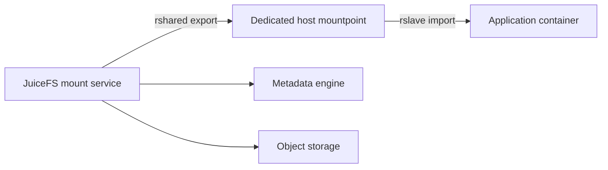

# Propagate a JuiceFS FUSE Mount Between Docker Compose Services

Author: [nawazdhandala](https://www.github.com/nawazdhandala)

Tags: JuiceFS, Docker, Storage

Description: Share a JuiceFS mount through a dedicated Linux host path using rshared and rslave propagation, with scoped FUSE privileges and readiness checks.

Two containers can bind the same host directory and still see different filesystems. If one container mounts JuiceFS after the other container starts, the new mount must cross their mount namespaces. A bind mount without the right propagation settings may expose only the original empty directory.

This example targets a dedicated staging host running **rootful Docker Engine on Linux**, with **Docker Compose 2.39.4** syntax and **JuiceFS Community Edition 1.4.2**. Docker Desktop does not support this bind-propagation workflow. Rootless Docker and hardened host policies need separate validation.

## Understand the propagation direction

A mount namespace determines which mounts a process sees. The mount service creates the FUSE filesystem; the host path carries it to the application container. FUSE means Filesystem in Userspace: the JuiceFS process handles filesystem requests through the kernel.



`rshared` permits mount events to propagate between peers recursively. `rslave` lets the application receive events from its source without propagating its own events back. These are mount-event settings, not file read/write permissions. Docker documents their behavior and Linux-only constraints in its [bind-mount guide](https://docs.docker.com/engine/storage/bind-mounts/#configure-bind-propagation).

## Prepare one dedicated host mountpoint

Choose an empty staging directory, `/srv/juicefs-export` here, that has no existing consumers or nested mounts. A host administrator should verify that scope before running:

```bash
sudo mkdir -p /srv/juicefs-export
sudo mount --bind /srv/juicefs-export /srv/juicefs-export
sudo mount --make-rshared /srv/juicefs-export
findmnt --mountpoint /srv/juicefs-export \
  --output TARGET,SOURCE,FSTYPE,PROPAGATION
```

The self-bind makes the directory a mountpoint with its own propagation setting. The final command should show shared propagation. Run this initialization once for the prepared directory; do not stack repeated bind mounts onto an already prepared path. Never replace the path with `/` to make propagation work everywhere.

These changes are runtime mount configuration and need a reviewed persistence mechanism if required after reboot. The [mount manual](https://man7.org/linux/man-pages/man8/mount.8.html) documents bind mounts and propagation operations.

If the path is already used, inspect its current mounts and consumers instead of applying the preparation commands blindly. Confirm Docker's daemon namespace sees the prepared path before starting the services.

## Configure the mount service and consumer

The volume must already be formatted, and its metadata and object storage must be reachable from the container network. Place its authenticated metadata URL in `./secrets/metadata-url`, protected from unrelated local users and excluded from source control. A private CA or encrypted-volume passphrase also needs deliberate provisioning; add those through the deployment's approved trust and secret mechanisms.

Save this as `compose.yaml`:

```yaml
services:
  juicefs:
    image: juicedata/mount:ce-v1.4.2@sha256:4177c77bc873898127debf45786515b78c79bee18fed378d276fb221baa85640
    entrypoint: ["/bin/sh", "-ec"]
    command:
      - |
        exec juicefs mount --cache-dir /cache --cache-size 2048 \
          "$$(cat /run/secrets/metadata_url)" /mnt
    cap_add:
      - SYS_ADMIN
    devices:
      - /dev/fuse:/dev/fuse
    security_opt:
      - apparmor:unconfined
    stop_grace_period: 1m
    secrets:
      - metadata_url
    volumes:
      - type: bind
        source: /srv/juicefs-export
        target: /mnt
        bind:
          propagation: rshared
          create_host_path: false
      - type: volume
        source: juicefs-cache
        target: /cache
    healthcheck:
      test: ["CMD-SHELL", "cat /mnt/.control >/dev/null"]
      interval: 10s
      timeout: 5s
      retries: 6
      start_period: 20s

  app:
    image: busybox:1.37.0
    command: ["sh", "-c", "ls /jfs && sleep 3600"]
    depends_on:
      juicefs:
        condition: service_healthy
    volumes:
      - type: bind
        source: /srv/juicefs-export
        target: /jfs
        bind:
          propagation: rslave
          create_host_path: false

secrets:
  metadata_url:
    file: ./secrets/metadata-url

volumes:
  juicefs-cache:
```

The published JuiceFS image is pinned by digest. Its [official image recipe](https://github.com/juicedata/juicefs-csi-driver/blob/v0.34.0/docker/ce.juicefs.Dockerfile) installs the client and FUSE utilities. BusyBox is only a diagnostic consumer; replace it with the actual application after the mount path is verified.

The foreground `exec` keeps JuiceFS as the service process. The cache is stored in a named volume, separately from the exported mount. The `$$` escapes Compose interpolation so the container shell reads the secret file at runtime. File-backed Compose secrets still need secure host-file handling; see Docker's [secret configuration](https://docs.docker.com/reference/compose-file/secrets/) and [interpolation rules](https://docs.docker.com/reference/compose-file/interpolation/).

`SYS_ADMIN`, `/dev/fuse`, and the AppArmor relaxation apply only to the mount service, following the [JuiceFS container example](https://github.com/juicedata/juicefs/blob/v1.4.2/docs/en/deployment/juicefs_on_docker.md#mount-juicefs-in-docker). They are powerful permissions. For production, replace the broad AppArmor relaxation with a tested policy where possible and review other host security controls. The consumer needs neither the FUSE device nor mount capabilities.

## Validate configuration, then inspect all three views

```bash
docker compose config --quiet
docker compose up -d
docker compose ps
findmnt --mountpoint /srv/juicefs-export \
  --output TARGET,SOURCE,FSTYPE,PROPAGATION
docker compose exec app sh -c 'cat /proc/self/mountinfo'
```

Configuration validation checks the Compose model, not kernel behavior. The application should start only after the mount service's healthcheck succeeds. The `.control` check comes from the official JuiceFS example and distinguishes the mounted filesystem from an ordinary empty directory at startup.

Inspect the host mount and the application's mount information for the expected JuiceFS filesystem. A plain `ls` succeeding is insufficient: it also succeeds on an empty local directory. Then read a known test file through the host path and the consumer, comparing its content with a trusted source.

Run a small authorized write/readback test in a dedicated JuiceFS directory if the real application needs writes. Verify numeric ownership and permissions using the application's actual identity. The root diagnostic consumer is not evidence that a non-root production application has access.

## Treat readiness and recovery separately

`depends_on: condition: service_healthy` gates startup. It does not automatically stop an already-running consumer when JuiceFS later becomes unhealthy, nor does it guarantee that existing open file handles recover after a mount-service failure.

In staging, test a controlled mount-service restart with representative application activity. Observe mount visibility, open-file errors, latency, and recovery behavior. Do not infer uninterrupted operation just because the new mount appears at `/jfs`. A process can retain handles associated with the previous filesystem connection.

This example intentionally leaves automatic restart policy to a separate deployment decision. Avoid a restart loop that hides repeated mount failures while applications keep trying to use the path. Add application-specific failure handling and alerts before unattended operation.

## Stop in dependency order

Stop consumers before unmounting the filesystem:

```bash
docker compose stop app
docker compose exec juicefs juicefs umount /mnt
docker compose stop juicefs
```

Use a normal unmount after confirming there are no remaining consumers, including host processes. Do not force-detach a busy mount. If you enable writeback beyond this example, account for pending uploads and use its documented flush procedure.

Keep the named cache volume until its contents and recovery role are understood. Host propagation cleanup is a separate administrative action after all propagated mounts are gone; it is not a reason to remove the export directory recursively.

The Compose model was rendered with version 2.39.4 and checked for service dependencies, secret-file references, capabilities, and propagation settings. No Docker daemon or Linux FUSE propagation test was run here. Validate the three actual mount views on the intended Linux host before relying on this arrangement.
