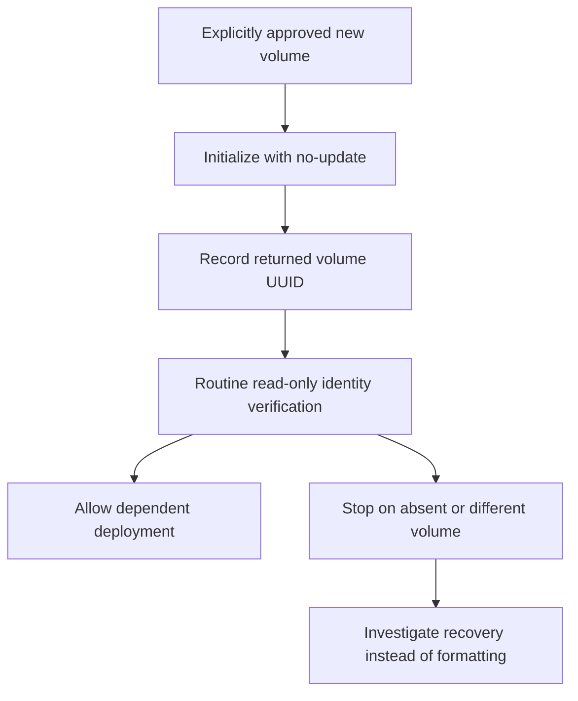

# Initialize JuiceFS Safely from Terraform or Argo CD

Author: [nawazdhandala](https://www.github.com/nawazdhandala)

Tags: JuiceFS, Terraform, Argo CD

Description: Separate JuiceFS initialization from routine deployment checks, use no-update for bootstrap retries, and record volume identity outside disposable job state.

A storage initializer should survive retries without silently changing an existing filesystem. It should also stop when an established volume disappears, rather than creating an empty replacement that happens to have the same name.

Terraform resource state and Kubernetes Job history help schedule work, but neither is the filesystem's durable identity. Build the workflow around JuiceFS's recorded volume UUID, a unique identifier generated when the volume is created.

This example uses **JuiceFS Community Edition 1.4.2**, **Terraform 1.11.4**, and the documented **Argo CD 3.2** hook lifecycle. The detailed executable example runs through Terraform; the same initialization-versus-verification split applies to an Argo-managed Job.

## Use the release's existing-volume protection

In JuiceFS 1.4.2, `format --no-update` returns without updating a volume whose existing format loads successfully. Without that flag, `format` retains a deprecated configuration-update path. `--force` is a separate, dangerous option and does not belong in an unattended bootstrap retry.

The [format implementation](https://github.com/juicedata/juicefs/blob/v1.4.2/cmd/format.go) distinguishes a genuinely unformatted metadata store from other loading errors. Do not replace that distinction with a shell shortcut such as “status failed, therefore initialize.” Authentication and network failures are not evidence that a database is empty.

`--no-update` also does not confirm that the existing volume matches the requested name or bucket. A successful no-op must be followed by identity and configuration verification.

## Keep first creation separate from routine checks

Before the first run, independently confirm the intended metadata database or namespace is new, the object-storage location is approved, and no other initializer owns it. Serialize bootstrap work. After initialization, record the UUID in the protected deployment inventory and require it for routine checks.



The recorded UUID must survive Terraform-state loss, Job deletion, and namespace recreation. If the inventory is lost or ambiguous, stop and recover that evidence. Do not turn uncertainty into another first-time bootstrap.

## Implement an initializer with a verification mode

Save the following as `bootstrap.sh` beside the Terraform configuration. The runner needs Bash, Python 3, and the pinned JuiceFS binary. Supply `META_URL`, `VOLUME_NAME`, `STORAGE_TYPE`, and `BUCKET_URL` through the approved environment. Storage credentials should come from the runner's protected credential mechanism, not literal values in Terraform or Git.

```bash
#!/usr/bin/env bash
set -euo pipefail
: "${META_URL:?required}"
: "${VOLUME_NAME:?required}"
: "${STORAGE_TYPE:?required}"
: "${BUCKET_URL:?required}"

case "${1:-}" in
  initialize)
    if [ -n "${EXPECTED_UUID:-}" ]; then
      echo "Known volume: use verify mode" >&2
      exit 1
    fi
    juicefs format --no-update \
      --storage "$STORAGE_TYPE" \
      --bucket "$BUCKET_URL" \
      "$META_URL" "$VOLUME_NAME"
    ;;
  verify)
    : "${EXPECTED_UUID:?required for an established volume}"
    ;;
  *)
    echo "Usage: bootstrap.sh initialize|verify" >&2
    exit 2
    ;;
esac

juicefs status "$META_URL" | python3 -c '
import json, os, sys
setting = json.load(sys.stdin)["Setting"]
checks = {
    "Name": os.environ["VOLUME_NAME"],
    "Storage": os.environ["STORAGE_TYPE"],
    "Bucket": os.environ["BUCKET_URL"],
}
for key, expected in checks.items():
    actual = str(setting[key])
    if key == "Bucket":
        actual, expected = actual.rstrip("/"), expected.rstrip("/")
    if actual != expected:
        raise SystemExit("Volume configuration mismatch: " + key)
expected_uuid = os.environ.get("EXPECTED_UUID")
if expected_uuid and setting["UUID"] != expected_uuid:
    raise SystemExit("Volume UUID mismatch")
print("Verified volume UUID:", setting["UUID"])
'
```

The first mode creates only during the authorized bootstrap phase, or leaves an already formatted volume unchanged before checking its identity fields. The second mode never calls `format`; a missing established volume therefore fails verification instead of being replaced.

The bucket comparison tolerates a trailing slash added by storage normalization, but not a different endpoint. Other provider-specific canonicalization may require an explicitly reviewed comparison rule. Extend checks for required encryption, retention, or format settings without automatically rewriting them.

Do not enable shell tracing. Protect runner logs and process access because metadata addresses can contain credentials. The final printed UUID is inventory evidence, not a backup of metadata or file contents.

## Invoke bootstrap through Terraform's resource lifecycle

Use a dedicated initialization configuration:

```hcl
terraform {
  required_version = "= 1.11.4"
}

resource "terraform_data" "juicefs_initialize" {
  provisioner "local-exec" {
    working_dir = path.module
    command     = "bash ./bootstrap.sh initialize"
  }
}
```

The built-in `terraform_data` resource does not require a provider download. Its creation-time provisioner runs in the Terraform execution environment, which must have backend connectivity and the environment values described above. The [resource documentation](https://developer.hashicorp.com/terraform/language/resources/terraform-data) describes this use of provisioners.

Do not add a timestamp trigger that replaces the resource on every apply. Do not attach a destroy provisioner that deletes the filesystem. Keep ordinary client deployments separate from this bootstrap state, and run `bash bootstrap.sh verify` with the recorded UUID in their deployment checks.

A second normal apply with unchanged state should have no bootstrap work. Resource replacement, state loss, or a failed provisioner can change that lifecycle, which is why command-level protection and independent UUID records still matter. Terraform state is not proof that the storage backend remains healthy or even exists.

## Apply the same policy to Argo CD Jobs

A `PreSync` hook expresses ordering before a sync; it is not a permanent “run exactly once” guarantee. Named hooks, `generateName`, and hook deletion policies determine whether later syncs create new executions. Argo CD documents these behaviors in its [3.2 resource-hook guide](https://argo-cd.readthedocs.io/en/release-3.2/user-guide/resource_hooks/).

Use a separately controlled bootstrap application or Job for initial creation. Provide an execution image pinned to the tested JuiceFS release and containing the wrapper's dependencies. Reference credentials through your existing secret-delivery mechanism, serialize initialization, retain the UUID externally, and examine Job completion and logs.

Routine application hooks should execute verification mode with that UUID. Deleting and recreating a verification Job is then a repeatable read check, not an opportunity to initialize storage again. A Job's disappearance must never be interpreted as evidence that the metadata store is empty.

## Test the failure cases before deployment

Rehearse new-volume initialization, a repeated bootstrap, a configuration mismatch, a wrong UUID, and an unavailable metadata endpoint. Confirm that routine verification never creates a filesystem. Check that later applications are blocked when verification fails.

Local validation used the exact wrapper with a disposable SQLite/file-backed volume and Terraform 1.11.4. It checked initialization, repeated no-update behavior, read-only identity checks, mismatch rejection, and an unchanged second Terraform plan. No cloud database, S3 authentication, Kubernetes Job, or Argo CD controller was exercised.

Treat first creation as a controlled event and subsequent deployment as identity verification. That distinction remains useful even after the original Terraform resource or bootstrap Job is long gone.
