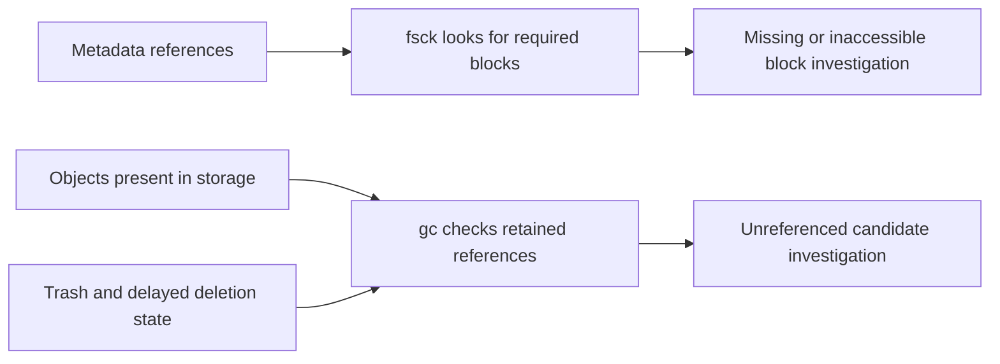

# Diagnose JuiceFS Missing Data, Leaked Objects, and Stale Slices

Author: [nawazdhandala](https://www.github.com/nawazdhandala)

Tags: JuiceFS, Storage, Troubleshooting

Description: Use read-only JuiceFS fsck and gc checks to distinguish missing referenced blocks from unreferenced or retained data before choosing recovery or cleanup.

A larger-than-expected object bucket and an unreadable file can both look like storage trouble, but they point in opposite directions. An unreadable file may reference data that is missing. A large bucket may contain data no current file references, or data deliberately retained for recovery.

Do not start either investigation by deleting objects. First compare what JuiceFS metadata references with what object storage contains. Then separate missing data, unreferenced candidates, retained history, and access failures.

This guide uses **JuiceFS Community Edition 1.4.2**. The initial commands are check-only operations. They still consume metadata, network, and object-listing capacity, so schedule large scans and preserve their output. The examples assume a protected administrative environment with the correct volume's metadata address in `META_URL`.

## Understand the two directions of comparison

JuiceFS metadata describes files and the slices that hold their contents. Those slices are stored as blocks in object storage. A filesystem consistency scan and a garbage-collection scan ask different questions about that relationship.



| Observation | Likely investigation | What it does not prove |
| --- | --- | --- |
| Required block cannot be found | Missing data, wrong endpoint, or access failure | That deleting other objects will help |
| Old object has no retained reference | Possible leaked object | That a current file is corrupt |
| Data is pending deletion or retained in Trash | Retention and cleanup lifecycle | That retention should be disabled |
| Files read successfully but a checksum differs | Content/version integrity | That a presence-only scan will detect it |

The exact scan logic is in the tagged [fsck implementation](https://github.com/juicedata/juicefs/blob/v1.4.2/cmd/fsck.go) and [gc implementation](https://github.com/juicedata/juicefs/blob/v1.4.2/cmd/gc.go).

## Establish which volume and storage you are examining

Record the client version and inspect volume status:

```bash
juicefs --version
juicefs status "$META_URL" --more
```

Confirm the volume identity, object endpoint, and active sessions against deployment records. Keep credential-bearing configuration and logs restricted. An unexpected storage address can make intact data appear absent simply because the client is checking the wrong backend.

Also record recent events: credential rotation, storage lifecycle changes, manual bucket edits, metadata restoration, failed uploads, and client restarts. These provide hypotheses to test; they are not evidence that a specific component caused the failure.

Before treating an object error as confirmed loss, check whether the underlying operation returned not-found, permission denied, TLS failure, timeout, or a listing error. Repair permissions or connectivity first when appropriate. A failed `HEAD` request is not always a missing object.

## Check the affected path before scanning the entire volume

If a specific project tree is affected, use its path inside JuiceFS:

```bash
juicefs fsck --path /projects/analytics --recursive "$META_URL"
```

Replace the path with the incident scope. It is not the host mountpoint path: `/projects/analytics` remains the volume-relative path even if the filesystem is mounted at `/mnt/jfs`. `--recursive` includes descendants when checking the selected directory.

For a whole-volume scan:

```bash
juicefs fsck "$META_URL"
```

Without `--path`, this version lists metadata slices and storage objects, then checks required blocks. A targeted scan follows the selected metadata and checks the corresponding objects. Neither command requires a FUSE mount, although independent application reads remain useful for verifying symptoms.

Keep the complete output. Missing-block reports can include an object key, file path or inode, and the storage error. An inode is the filesystem's numeric object identity. Correlate those identifiers with the affected application before deciding whether the incident is one file, one directory, or a broader storage problem.

A clean result means the checks performed did not find the reported inconsistency. It is not a byte-for-byte verification against a trusted content manifest. This implementation primarily checks referenced block presence; do not describe it as a full checksum scrub.

## Inspect extra storage with check-only gc

If the concern is unexpected storage growth, run:

```bash
juicefs gc "$META_URL"
```

With neither `--delete` nor `--compact`, this is the documented check-only mode. The summary separates valid, pending-delete, compacted, leaked, delayed-deletion, and skipped categories. Preserve these categories rather than reducing the output to one storage total.

The 1.4.2 scanner skips recently modified objects using a one-hour age boundary. This helps avoid treating in-flight writes as old leaks. It also means a newly created unreferenced object may not appear as a leak immediately. Do not change timestamps or repeatedly force cleanup to defeat that safeguard in a live backend.

Storage billing can additionally include provider object versions, incomplete multipart uploads, or data outside the scanned JuiceFS prefix. A JuiceFS object scan is not a complete provider billing inventory. Investigate those independently using the provider's own reporting and retention policy.

## Treat stale slices and Trash as recovery state

When files change, older slices can remain retained even though current reads use newer blocks. Deleted files can also remain in Trash until retention and cleanup permit removal. These are distinct from an object that has no relevant metadata reference.

The [Trash documentation](https://github.com/juicedata/juicefs/blob/v1.4.2/docs/en/security/trash.md#gc) explains retained slices and their role in recovering earlier metadata states. A large retained-data count can therefore be expected after heavy rewrites or deletions.

Changing retention is a recovery-policy decision. Do not turn it off simply to make bucket usage match current file sizes. Verify retention duration, active cleanup clients, and recent workload changes first. Keep enough capacity for the intended recovery window.

## Choose recovery and cleanup separately

For a confirmed missing referenced block, preserve metadata and object evidence, limit affected writes, and check available storage versions or backups. Recover the exact required data through the approved recovery process. Garbage collection cannot recreate missing file bytes.

For leaked candidates, first confirm the metadata source is authoritative for that storage prefix and that recent writes, migrations, and recovery activities are understood. Only then consider a separately approved cleanup window. The `--delete` option also handles delayed-deletion state; it is not merely a harmless extension of inspection.

Likewise, `fsck --repair` is not a universal data-recovery switch. In this release it requires a selected path and can repair directory metadata structures. It does not download missing bytes from an unknown backup. The repair-directory mode option also affects permissions of repaired directories, so any such repair requires an explicit ownership and access review.

## Verify the conclusion with a small reproducible case

Local validation used an isolated SQLite metadata database and file-backed object store with JuiceFS 1.4.2. A normal imported file passed both whole-volume and scoped checks. Temporarily withholding its sole data block caused `fsck` to report the affected file; returning that block made the check pass.

A separate, old, synthetic unreferenced object was then added only to that disposable backend. Check-only `gc` reported it as leaked and left it intact, while `fsck` still passed. These tests demonstrate the diagnostic distinction, not behavior under production concurrency or S3 authorization failures.

In your incident, retain before-and-after checks and verify representative file contents through the application. Declare recovery complete only when the affected data is usable and the original failure is explained. Declare cleanup complete separately, after confirming the approved objects were removed without reducing the required recovery coverage.
