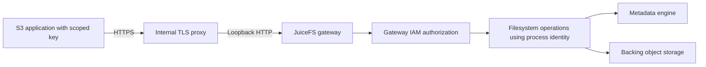

# Expose JuiceFS Through an S3 Gateway with TLS and Scoped Access

Author: [nawazdhandala](https://www.github.com/nawazdhandala)

Tags: JuiceFS, S3, Security

Description: Configure a JuiceFS S3 gateway, preserve signed requests through TLS termination, and distinguish gateway IAM from filesystem permissions and bucket isolation.

An application that speaks S3 can access JuiceFS without mounting it through FUSE. The gateway translates S3 requests into operations on an existing JuiceFS filesystem. It is useful for tools that need object-style access, but its credentials, filesystem identity, and TLS endpoint need separate configuration.

This guide targets **JuiceFS Community Edition 1.4.2**. It uses one exported bucket, a gateway listening only on loopback, and a TLS proxy on the same host. It does not assume that every Amazon S3 feature or modern MinIO administration command is supported.

## Identify the three credential boundaries

There are three distinct access paths:

| Boundary | Credentials or identity | What it controls |
| --- | --- | --- |
| Application to gateway | Gateway S3 access key and secret | Which API requests the application may perform |
| Gateway to JuiceFS | Metadata and backing-storage credentials | Access to the actual filesystem infrastructure |
| Gateway filesystem operations | Gateway process UID and GID | Unix permission checks within JuiceFS |

Do not give an application the backing bucket's credentials when it needs gateway access. Likewise, a gateway access key is not a Unix user account. The [gateway implementation](https://github.com/juicedata/juicefs/blob/v1.4.2/pkg/gateway/gateway.go) creates its filesystem context from the process's user and group IDs.



Identity and Access Management (IAM) policies govern gateway API access. They do not automatically apply to another process accessing the same files through a native JuiceFS mount.

## Start with one explicit bucket

Provision the JuiceFS volume and its service account first. Supply `MINIO_ROOT_USER` and `MINIO_ROOT_PASSWORD` through your restricted secret mechanism. These are gateway administrator credentials, not ordinary application credentials. Do not place literal passwords in a service unit or shell history.

With those variables already present, a foreground staging command is:

```bash
: "${MINIO_ROOT_USER:?Supply gateway administrator credentials securely}"
: "${MINIO_ROOT_PASSWORD:?Supply gateway administrator credentials securely}"

juicefs gateway \
  --bucket-name reports \
  --cache-dir /srv/juicefs-cache/gateway \
  --cache-size 10240 \
  rediss://metadata.example.internal:6379/9 \
  127.0.0.1:9000
```

Replace the metadata endpoint and database with the existing volume and supply its authentication separately. Prepare the cache directory for the service account. `10240` is an illustrative 10GiB cache limit in MiB. A service manager should provide the same environment, directories, and foreground command.

Without an override, the single bucket uses the filesystem's name. Here it is deliberately called `reports`. This changes the API bucket name, not the backing object bucket. By contrast, `--multi-buckets` exposes top-level directories as separate buckets and ignores the single-bucket name override. These modes are documented in the [tagged gateway guide](https://github.com/juicedata/juicefs/blob/v1.4.2/docs/en/guide/gateway.md).

Multiple buckets do not establish separate metadata databases, infrastructure credentials, or process identities. Use them only with a reviewed authorization design, and keep administrative access distinct from application access.

## Terminate TLS without changing signed requests

For an internal endpoint, issue a certificate whose Subject Alternative Name includes `s3.example.internal`. Install its full certificate chain and private key on the proxy. Distribute the issuing certificate authority to clients; do not disable certificate verification.

The following NGINX `server` block belongs inside the existing `http` context. Replace all hostnames and certificate paths. It assumes the proxy and gateway share the same host and network namespace:

```nginx
server {
    listen 443 ssl;
    server_name s3.example.internal;

    ssl_certificate /etc/nginx/tls/s3-fullchain.pem;
    ssl_certificate_key /etc/nginx/tls/s3-key.pem;
    ssl_protocols TLSv1.2 TLSv1.3;

    client_max_body_size 0;

    location / {
        proxy_pass http://127.0.0.1:9000;
        proxy_http_version 1.1;
        proxy_set_header Host $http_host;
        proxy_set_header Connection "";
        proxy_set_header X-Forwarded-Proto $scheme;
        proxy_request_buffering off;
        proxy_buffering off;
    }
}
```

S3 signatures include request details such as the host and path. Preserve the original Host header and avoid adding a path prefix or rewriting object paths. The `proxy_pass` value intentionally has no replacement URI. Request buffering is disabled so large uploads need not be fully staged by NGINX; response buffering is also disabled. `client_max_body_size 0` removes NGINX's request-size ceiling, so enforce suitable limits through the application's upload policy and capacity planning.

These directives follow the [NGINX proxy reference](https://nginx.org/en/docs/http/ngx_http_proxy_module.html) and [HTTPS configuration guidance](https://nginx.org/en/docs/http/configuring_https_servers.html). Validate the complete site configuration with your installed NGINX before deployment. This block was source-reviewed, not executed in the local gateway test.

If the proxy runs on another machine or in another network namespace, loopback does not reach the gateway. Redesign the private upstream and protect that network path rather than exposing unauthenticated infrastructure broadly. Test long uploads against your proxy timeouts before rollout.

## Give applications scoped credentials

The claim that JuiceFS supports only a single gateway user is outdated for this release. Since 1.2, regular users can be added and shared across gateway processes accessing the same filesystem. The startup administrator remains process-specific. IAM changes are cached; the documented default refresh interval is five minutes.

The versioned guide recommends MinIO Client `RELEASE.2021-04-22T17-40-00Z` for administration compatibility. Use that guide and the matching command help when provisioning users and policies; do not assume current `mc` syntax maps directly to this embedded gateway.

Create a dedicated application identity and attach only the needed bucket or prefix permissions. Test allowed and denied operations from every gateway instance after policy changes. Service accounts inherit their parent's privileges, so creating another key alone does not reduce access. For independent filesystem-level isolation, consider separate volumes and separately scoped service identities.

## Check access with an explicit client configuration

This read-only example uses **Boto3 1.40.0**. Install it in a dedicated environment and supply the gateway application's credentials through the standard AWS credential environment or a dedicated profile. These must be gateway credentials, not unrelated cloud-account credentials.

```python
import boto3
from botocore.config import Config

client = boto3.client(
    "s3",
    endpoint_url="https://s3.example.internal",
    region_name="us-east-1",
    verify="/etc/company-ca/internal-ca.pem",
    config=Config(
        signature_version="s3v4",
        s3={"addressing_style": "path"},
        connect_timeout=5,
        read_timeout=30,
        retries={"max_attempts": 2},
    ),
)

page = client.list_objects_v2(
    Bucket="reports", Prefix="checks/", MaxKeys=10
)
for item in page.get("Contents", []):
    print(item["Key"], item["Size"])
```

Replace the endpoint, CA file, bucket, and prefix. Path-style requests avoid requiring a separate DNS name and certificate for every bucket. An empty result can be legitimate; a permission error is not. This reads only the first page and is a smoke check, not a complete inventory. Client configuration is covered by the [Boto3 configuration documentation](https://docs.aws.amazon.com/boto3/latest/guide/configuration.html).

For acceptance, also perform an authorized upload and readback of a unique test object, an unauthorized-prefix check, and a wrong-credential check. Test multipart uploads, object metadata, tags, and ETags separately if applications depend on them; the gateway has explicit feature switches for several of these behaviors.

Local testing used JuiceFS 1.4.2 and Boto3 1.40.0 against a disposable loopback gateway. Signed upload, download, and listing succeeded, and incorrect credentials returned HTTP 403. It did not test TLS termination, delegated IAM policies, multiple gateway instances, or production load. Those checks complete the deployment evidence before handing the endpoint to applications.
