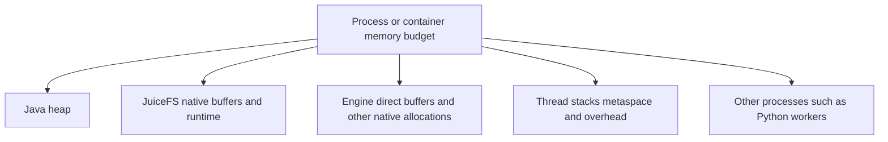

# Run JuiceFS Java SDK Workloads with Explicit Native Memory Budgets

Author: [nawazdhandala](https://www.github.com/nawazdhandala)

Tags: JuiceFS, Apache Spark, Apache Flink, Hive

Description: Configure the JuiceFS Hadoop Java SDK across Spark, Flink, and Hive, then budget native memory separately from the JVM heap and test each worker path.

A Spark driver can list a JuiceFS directory successfully while executors fail to load the filesystem class. A Flink job can find the right class and still exceed its container limit because the storage client's native memory is missing from the budget.

Treat deployment and memory sizing as separate checks. Every process that accesses JuiceFS needs the compatible SDK and configuration, and its process allocation must cover more than Java heap.

This guide uses **JuiceFS Community Edition Java SDK 1.4.2** configuration. Spark examples reference **3.5.7** and Flink memory settings reference **1.20** documentation. These are source-checked examples, not a claim that an entire multi-product compatibility matrix was tested.

## Deploy the SDK where storage calls execute

Use the official release's `juicefs-hadoop-1.4.2.jar` or an approved build from that tag. Check the artifact's provenance, native library platform support, Hadoop dependency compatibility, and Java runtime before distributing it. The [SDK build descriptor](https://github.com/juicedata/juicefs/blob/v1.4.2/sdk/java/pom.xml) identifies version 1.4.2; the [deployment guide](https://github.com/juicedata/juicefs/blob/v1.4.2/docs/en/deployment/hadoop_java_sdk.md) explains installation and platform requirements.

| Engine | Processes that need review |
| --- | --- |
| Spark | Submission client, driver, executors, and long-running Thrift server where used |
| Flink | Client, JobManager, and every TaskManager performing filesystem operations |
| Hive | HiveServer2, metastore where it accesses locations, and the selected query-engine workers |

Use each deployment's supported classpath distribution mechanism. For ordinary distributions, JuiceFS documents Spark's `jars` and Flink's `lib` locations. Copying a JAR only onto a laptop or gateway does not install it in remote worker containers. Restart the affected long-running services after an approved classpath change.

Do not combine Community Edition `io.juicefs` class names with configuration examples for another JuiceFS edition. Also avoid copying an obsolete JDK 8 `tools.jar` instruction blindly into a Java 17 installation. The pinned guide calls for the following export option on newer Java runtimes:

```text
--add-exports=java.base/sun.nio.ch=ALL-UNNAMED
```

Apply it through the engine's supported JVM-option settings to the processes that load the SDK. Retain any existing required JVM options.

## Configure the volume, not a replacement filesystem

Merge these properties into the effective Hadoop configuration used by the relevant processes:

```xml
<configuration>
  <property>
    <name>fs.jfs.impl</name>
    <value>io.juicefs.JuiceFileSystem</value>
  </property>
  <property>
    <name>fs.AbstractFileSystem.jfs.impl</name>
    <value>io.juicefs.JuiceFS</value>
  </property>
  <property>
    <name>juicefs.analytics.meta</name>
    <value>REPLACE_WITH_APPROVED_METADATA_URL</value>
  </property>
  <property>
    <name>juicefs.memory-size</name>
    <value>300</value>
  </property>
</configuration>
```

Here `analytics` is the existing volume name used in `jfs://analytics/`. Replace the metadata URL through protected configuration delivery, including credentials and CA trust as required. Do not format a volume from each executor. All workers must reach both the metadata service and the object-storage endpoint.

The two class properties serve Hadoop's filesystem interfaces. `juicefs.memory-size` is a read/write buffer setting measured in MiB; it is not the JVM heap limit. The [SDK configuration tables](https://github.com/juicedata/juicefs/blob/v1.4.2/docs/en/deployment/hadoop_java_sdk.md#client-configurations) define these settings.

## Budget beyond the Java heap

The SDK guide advises allowing up to roughly four times `juicefs.memory-size` in additional off-heap memory depending on workload. With a 300 MiB buffer setting, that planning allowance is 1,200 MiB. Treat it as a sizing starting point, not a hard memory cap or a guarantee that the process will stay below it.



The SDK's default cache directory is `memory`, so cache settings also deserve review. A disk-cache design changes the resource mix but does not eliminate native buffering. Measure resident memory and container usage during representative concurrent reads and writes, not just a small directory listing.

Budget per worker process and consider multiple filesystem clients or volumes in one JVM. Multiplying a single buffer number by the number of cluster machines is not enough to understand allocation within each process.

## Give Spark explicit non-heap headroom

For Spark 3.5.7 on YARN or Kubernetes, a staging submission can include:

```bash
spark-submit \
  --executor-memory 4g \
  --conf spark.executor.memoryOverhead=2048 \
  --conf spark.hadoop.juicefs.memory-size=300 \
  --conf spark.driver.extraJavaOptions=--add-exports=java.base/sun.nio.ch=ALL-UNNAMED \
  --conf spark.executor.extraJavaOptions=--add-exports=java.base/sun.nio.ch=ALL-UNNAMED \
  smoke.py
```

This assumes the cluster manager, SDK distribution, and volume configuration are already supplied. The 2,048 MiB overhead value is an illustrative allocation to test, not a production recommendation. It must accommodate other native allocations and, unless separately configured, Python workers too.

Spark's `spark.memory.offHeap.size` configures Spark-managed off-heap memory; it does not directly cap JuiceFS's native allocations. Spark documents how heap, memory overhead, configured off-heap memory, and PySpark memory contribute to container sizing in its [3.5.7 configuration reference](https://spark.apache.org/docs/3.5.7/configuration.html).

For `smoke.py`, use a unique writable staging location:

```python
from pyspark.sql import SparkSession

spark = SparkSession.builder.appName("juicefs-smoke").getOrCreate()
path = "jfs://analytics/smoke/REPLACE_WITH_UNIQUE_RUN_ID"
try:
    spark.range(10).write.mode("errorifexists").parquet(path)
    assert spark.read.parquet(path).count() == 10
finally:
    spark.stop()
```

Replace the run ID. The no-overwrite mode protects an earlier test result. Confirm tasks actually ran on the intended workers; local mode does not validate remote executor installation.

## Allocate Flink native memory deliberately

The pinned SDK's [Flink filesystem factory](https://github.com/juicedata/juicefs/blob/v1.4.2/sdk/java/src/main/java/io/juicefs/FlinkFileSystemFactory.java) copies `fs.` and `juicefs.` configuration keys into its Hadoop configuration. Deliver the same class mappings and volume settings through that supported configuration path.

For a staging TaskManager using the Flink 1.20 memory model, an illustrative allocation is:

```yaml
taskmanager.memory.process.size: 6144m
taskmanager.memory.task.off-heap.size: 1536m
```

Merge these into a reviewed complete Flink configuration. They reserve room in the process budget; they do not configure the JuiceFS buffer by themselves. Slots, managed memory, network memory, heap, and other native users still compete within the total.

Flink documents that native allocations can be accounted in its off-heap components, while doing so also affects the JVM direct-memory limit. Review that distinction and the workload's allocation path in the [TaskManager memory guide](https://nightlies.apache.org/flink/flink-docs-release-1.20/docs/deployment/memory/mem_setup_tm/). Verify a small distributed read/write job and, where relevant, checkpoint recovery before adopting the settings.

## Verify Hive and observe the real limit

Ensure Hive's services and query-engine containers load the SDK and the same volume configuration. Test an isolated table location and a small insert/read under the intended identity. A successful metastore operation alone does not prove workers can read table data.

For every engine, distinguish Java heap exhaustion from container memory termination. Record heap usage, process resident memory, concurrency, cache configuration, and actual container limits. Increase only the budget component implicated by measurements, and check whether the scheduler accepted the new request.

The XML and YAML examples were parsed locally, Python syntax was checked, and memory arithmetic and property names were reviewed against official sources. No Spark, Flink, Hive, or native Java SDK workload was executed. Use the smoke tests and a representative load test to establish deployment compatibility and memory headroom before production rollout.
