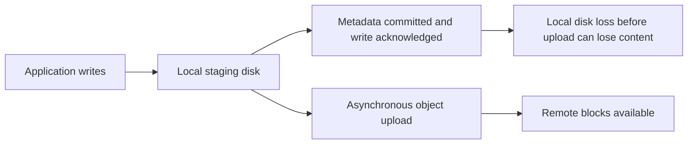

# Evaluate JuiceFS Writeback for Small Files Without Losing Staged Data

Author: [nawazdhandala](https://www.github.com/nawazdhandala)

Tags: JuiceFS, Performance, Data Integrity

Description: Understand how JuiceFS writeback changes durability, measure both acknowledgment and upload completion, and protect staging data during shutdown and failures.

Extracting an archive containing thousands of small files can spend much of its time waiting for remote uploads. JuiceFS's `--writeback` option can shorten that wait by accepting data into local staging and uploading it asynchronously. The improvement comes with a different failure boundary: the local disk can temporarily hold the only copy of acknowledged content.

This guide uses **JuiceFS Community Edition 1.4.2**. It provides a small staging experiment and a decision framework. It does not recommend enabling writeback for every workload or treating a faster command completion time as proof that data is safely remote.

## Understand which acknowledgment became faster

With the default upload path, JuiceFS uploads file data before committing the corresponding file-write metadata. With client writeback enabled, it can commit metadata while blocks remain in the client's staging directory, then upload them later.



That means a successful application `fsync` in this mode must not be interpreted as independent proof that the blocks have reached object storage. This client option is also different from the kernel FUSE `writeback_cache` option. Check which one a deployment actually enables. [JuiceFS write-cache behavior](https://github.com/juicedata/juicefs/blob/v1.4.2/docs/en/guide/cache.md#client-write-cache).

The 1.4.2 implementation can stage blocks and queue uploads; the default writeback threshold covers all block sizes. The option's usefulness for small-file workloads does not mean that it automatically applies only to small files. [Pinned chunk write path](https://github.com/juicedata/juicefs/blob/v1.4.2/pkg/chunk/cached_store.go).

## Decide whether the workload tolerates local staging

Writeback is most promising when a fast, reliable local disk can absorb a temporary burst that object storage can drain afterward. It is less compelling when the local disk is already slower than the remote path, or when sustained production exceeds upload capacity.

A rough queue calculation helps expose the limit. If a workload produces 80 MiB/s while upload sustains 50 MiB/s, staged data grows by about 30 MiB/s. Ten minutes adds roughly 17.6 GiB before allowing for overhead or other disk users. A larger cache delays exhaustion; it does not remove the throughput deficit.

Ask who owns the disk through restarts, upgrades, and rescheduling. Ephemeral container storage, an automatically deleted node disk, or a cache-cleaning job can make the risk unacceptable. Read-cache eviction and staged-write deletion are not equivalent operations.

Keep writeback disabled when the application's durability requirement cannot tolerate losing acknowledged data with a client disk. A separate backup protects previously captured state; it does not preserve content that never left the failed staging device.

## Use a disposable volume for the experiment

Prepare a staging volume, a persistent local cache directory, and an empty mount point. Keep production mounts separate. Replace all endpoints and paths, and provision the metadata password file and TLS trust first:

```bash
export META_PASSWORD_FILE=/etc/juicefs/staging-meta-password
juicefs mount \
  --writeback \
  --cache-dir /srv/juicefs-staging-cache \
  --cache-size 10240 \
  --free-space-ratio 0.20 \
  rediss://juicefs@staging-metadata.example.internal:6379/1 \
  /mnt/jfs-staging
```

The foreground client uses a 10240 MiB read-cache target. That number is not a hard cap on the writeback backlog. Read cache and staging share disk capacity, and the free-space behavior must be considered separately. Do not add `--upload-delay` to this first experiment: it deliberately changes when uploads can start. [Pinned mount options](https://github.com/juicedata/juicefs/blob/v1.4.2/cmd/mount.go).

Run the same controlled workload once without `--writeback` and once with it, using separate test directories and otherwise comparable settings. Coordinate normal unmount/remount between configurations; do not launch two owners for one mount point.

## Measure acknowledgment and remote availability separately

Save this Python 3 script locally and run it only after confirming the staging mount is present. It creates 100 new 4 KiB files inside a unique directory and prints an external verification record:

```python
import hashlib
import json
import os
import tempfile
import time
from pathlib import Path

mount = Path("/mnt/jfs-staging")
if not mount.is_mount():
    raise SystemExit("Expected staging mount is absent")
work = Path(tempfile.mkdtemp(prefix="writeback-probe.", dir=mount))
expected = {}
started = time.monotonic()
for i in range(100):
    data = os.urandom(4096)
    name = f"sample-{i:03d}"
    with (work / name).open("xb") as output:
        output.write(data)
        output.flush()
        os.fsync(output.fileno())
    expected[name] = hashlib.sha256(data).hexdigest()
print(json.dumps({
    "directory": work.name,
    "acknowledgment_seconds": time.monotonic() - started,
    "sha256": expected,
}, indent=2))
```

Redirect its output to a protected local file outside JuiceFS. The mount guard checks that a mount exists, not that it is the intended volume; verify volume identity beforehand. The timer includes file creation, data generation, flushing, and hashing. It is a small functional probe, not a general performance benchmark. [Python fsync semantics](https://docs.python.org/3/library/os.html#os.fsync).

Next, read the named files from an independent client with its own cache and compare each hash with the record. Measure how long that verification takes. Do not use only a read on the writing client: it can access its local staged content.

## Watch the queue, not just the producer

While the test is running, inspect the writer's virtual statistics file:

```bash
cat /mnt/jfs-staging/.stats
```

Look for `juicefs_staging_blocks` and `juicefs_staging_block_bytes`. Track them over time and distinguish a decreasing backlog from one that continues growing. A missing metric is not evidence of zero staged data. Correlate the readings with upload errors and the independent reader's results. [Staging metrics documentation](https://github.com/juicedata/juicefs/blob/v1.4.2/docs/en/guide/cache.md#client-write-cache).

Also watch local free space, inodes, and disk latency. A short producer run may finish quickly while the system spends much longer draining. Record both times so the apparent speedup does not hide a longer recovery or shutdown window.

## Preserve staging through failures and shutdown

The default staging layout includes `<cache-dir>/<volume-UUID>/rawstaging/`. Never delete that directory to fix disk pressure. Losing it before successful upload can lose file content. If the mount fails, preserve the device and its volume-specific layout while investigating; do not attach it to unrelated volumes or start competing upload owners.

For planned shutdown, stop writers, release file handles, and coordinate with the mount supervisor. Then use the normal flushing unmount:

```bash
juicefs umount --flush /mnt/jfs-staging
```

The pinned implementation waits for writeback staging before normal unmounting. Check the command's result and retain logs. A supervisor timeout or forced termination can interrupt the intended shutdown, so rehearse the available maintenance window with a realistic backlog. [Unmount implementation](https://github.com/juicedata/juicefs/blob/v1.4.2/cmd/umount.go).

If object storage is unavailable, preserve staging and resolve reachability or credentials. Repeated upload timeouts and cross-client read failures deserve investigation; clearing cache does not recreate missing remote blocks. [JuiceFS upload troubleshooting](https://github.com/juicedata/juicefs/blob/v1.4.2/docs/en/administration/troubleshooting.md#io-error-object-storage).

Accept writeback only when the measured gain matters, upload capacity catches up, disk ownership is durable enough, and operators can safely drain or preserve the queue. Otherwise, keep the default upload path and investigate metadata latency or upload concurrency separately.

Local tests checked the probe's file generation, hashes, and absent-mount refusal using a temporary ordinary filesystem with the mount predicate mocked for the successful case. No JuiceFS writeback, FUSE, disk-loss, or cross-client upload test was run. The procedure describes the tests to perform; it does not claim a measured speedup.
