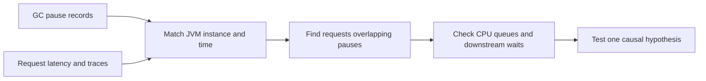

# Correlate JVM GC Pauses with p99 Request Latency

Author: [nawazdhandala](https://www.github.com/nawazdhandala)

Tags: Java, Garbage Collection, Monitoring

Description: Read unified G1 garbage-collection logs, avoid double-counting pause events, and compare them with per-instance latency before blaming GC for slow requests.

A latency graph rises at the same time as garbage-collection activity. That is a reason to investigate, but it is not yet a diagnosis. Some collection work runs concurrently with application threads, a single event produces many log lines, and a five-minute p99 graph does not identify which requests were delayed.

Build a timeline for one JVM before changing collector settings. This guide uses G1 on Azul Zulu OpenJDK 17.0.16+8. A small local allocation program generated real logs for parser validation. No HTTP service or production latency benchmark was run.

## Capture enough context to identify a pause

The JVM, or Java Virtual Machine, manages heap memory for Java objects. Garbage collection reclaims objects that are no longer needed. A stop-the-world pause suspends application execution while the collector completes work that requires it. G1 also performs concurrent work, so the elapsed duration of a concurrent cycle is not automatically application pause time. Oracle explains this distinction in its [G1 overview](https://docs.oracle.com/en/java/javase/17/gctuning/garbage-first-g1-garbage-collector1.html).

For a staging service already using G1, add this logging option to its reviewed Java startup command. Create a writable `logs` directory first and replace `service.jar` with your application:

```bash
java '-Xlog:gc*,safepoint:file=logs/gc.log:time,uptime,level,tags:filecount=5,filesize=10M' \
  -jar service.jar
```

The quoted argument requests GC details plus safepoint events, with wall time and JVM uptime on each line. It also configures log rotation. Keep JVM-instance identity with collected files so records from restarts or replicas are not mixed. The [JDK 17 launcher documentation](https://docs.oracle.com/en/java/javase/17/docs/specs/man/java.html) describes the logging syntax and decorators.

This command does not select a heap size or change your collector. Preserve the service's existing startup options. Trial logging volume and disk retention before broad rollout; verbose logs that fill a disk create another incident.

## Read the event once

The local lab produced this summary:

```text
[2026-11-21T09:39:53.868+0000][0.020s][info][gc          ] GC(0) Pause Young (Normal) (G1 Evacuation Pause) 23M->5M(64M) 0.690ms
```

`GC(0)` identifies the collection within that JVM run. `Pause Young` identifies the event. The heap occupancy changed from 23 MB to 5 MB with a 64 MB heap, and the reported pause lasted 0.690 milliseconds. The summary's timestamp is near the end of the event, not a request's start time.

Other lines with the same collection identifier describe workers, heap regions, phases, and CPU time. Do not add those phase durations to the summary as if they were independent pauses. Parallel work can also make CPU-time totals differ from elapsed time.

A nearby safepoint line reports time reaching the safepoint and time spent there. A safepoint is a state where the JVM can safely perform certain coordinated operations. Its total can include the same collection pause already summarized above. Treat it as complementary evidence, not another interval to add blindly.

## Extract summaries without counting phases

The accompanying [pauses.py](./pauses.py) is a small Python 3 parser scoped to the shown JDK 17 G1 log layout. It selects `info` lines tagged only `gc` whose messages begin with `Pause` and end in a millisecond duration.

```bash
python3 pauses.py logs/gc.log > pauses.csv
```

The CSV contains the end wall time, end uptime, collection identifier, duration, and description. In the local test it extracted 15 summaries with 15 distinct identifiers, excluding start, phase, CPU, and safepoint lines. This is intentionally not a universal parser for every collector and log format.

Process all relevant rotated files for an incident window, retaining their JVM identity. If you combine files, remove duplicated records introduced by overlapping exports. Do not deduplicate solely on `GC(0)`, because another JVM or restart can legitimately reuse that identifier.

For a rough pause interval, subtract the duration from the summary timestamp. Remember that log timestamp precision and emission timing limit that estimate. When an exact overlap matters, inspect the corresponding start record and finer-grained recordings rather than treating rounded timestamps as exact boundaries.

## Compare one JVM with its requests

Use per-instance request metrics, then look at the affected route. The following PromQL example assumes an existing classic histogram named `http_request_duration_seconds` with `job`, `route`, and `instance` labels. Replace these names and values with your instrumentation:

```promql
histogram_quantile(
  0.99,
  sum by (le, instance) (
    rate(http_request_duration_seconds_bucket{
      job="checkout", route="/checkout"
    }[5m])
  )
)
```

The result is an estimated 99th-percentile request duration in seconds for each instance over a rolling five-minute window. `le` is the bucket-boundary label required for this classic-histogram calculation. See Prometheus's [`histogram_quantile` reference](https://prometheus.io/docs/prometheus/latest/querying/functions/#histogram_quantile).

Do not average p99 values across replicas and call that the service p99. For aggregate histogram quantiles, aggregate compatible bucket counts before calculating the quantile. For this diagnosis, retaining the instance dimension prevents one JVM's pause from being compared with unrelated replicas. Prometheus discusses aggregation and quantile error in its [histogram guidance](https://prometheus.io/docs/practices/histograms/).

## Move from visual overlap to a hypothesis



For each suspicious window, record the largest pause, total non-overlapping pause time, request rate, errors, and a few slow traces from that instance. Inspect requests that were already active when the pause began and those that waited in a queue while the process could not serve them.

An illustrative 80 ms pause can contribute to a 200 ms request without explaining all 200 ms. Queueing may outlast the pause, and a downstream call may account for most of the remaining time. Conversely, a pause affecting fewer than one percent of observations may be poorly represented by p99. Check the request count and finer tail evidence before dismissing it.

Align clocks and units. Wall time connects logs with distributed traces; uptime helps reason within one JVM run. A restart invalidates an assumed uptime-to-wall-time offset. A five-minute rolling percentile also spreads evidence over a window, so it will not trace the shape of a subsecond pause exactly.

## Decide what evidence to collect next

If slow requests repeatedly overlap large G1 pauses, inspect collection type, occupancy changes, allocation behavior, and the dominant phases. If latency rises without matching pauses, investigate CPU contention, thread queues, locks, network delays, and downstream services. Concurrent GC can still compete for CPU, but that is a different hypothesis from a stop-the-world pause.

Avoid immediately lowering a pause target or forcing a young-generation size. Oracle's [G1 tuning guidance](https://docs.oracle.com/en/java/javase/17/gctuning/garbage-first-garbage-collector-tuning.html) recommends starting from appropriate defaults and investigating the observed behavior. A pause-time target is not a hard service-latency guarantee.

The exact logging format ran successfully in the local JDK lab, and the parser matched all 15 observed pause summaries. Prometheus 3.7.3 `promtool` accepted the histogram query inside a recording rule. Rotation under load, real request histograms, trace correlation, CPU contention, and causal latency improvement were not tested. Use the timeline to choose a controlled experiment, then compare the same workload before and after one change.
