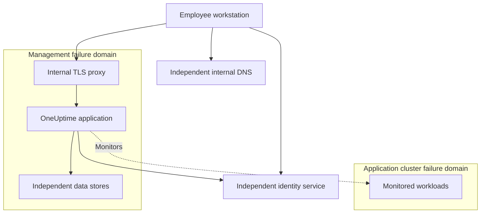

# Keep an Internal Status Page Available During a Kubernetes Outage

Author: [nawazdhandala](https://www.github.com/nawazdhandala)

Tags: Air-Gapped, Kubernetes, Status Page, Incident Management

Description: Separate your internal status page from the cluster it reports on, identify shared dependencies, and rehearse fresh access and incident updates during an outage.

A status page hosted inside the cluster it describes can disappear at exactly the moment people need it. Moving its web server elsewhere helps, but the page can still depend on the failed cluster for DNS, sign-in, storage, or the route used by employees.

Design for a concrete outcome: while the application cluster is unavailable, an employee can open the status page from a normal workstation, and a responder can sign in and publish a new update. A screenshot of yesterday's green status is not enough.

## Define the failure you need to survive

A failure domain is a group of components that one event can disable together. Two namespaces share a cluster. Two clusters might share a storage array, firewall, hypervisor, or power supply. Decide which outage your design promises to survive before choosing where to install OneUptime.

For a cluster-level outage, a separate management cluster or independently hosted virtual machines may be sufficient. A site-level outage needs another site and a reachable network path. Do not describe a separate namespace as independent infrastructure.

The [OneUptime architecture guide](https://oneuptime.com/docs/en/self-hosted/architecture) shows that status pages are served by the application behind its ingress. PostgreSQL holds configuration and state, ClickHouse stores telemetry, and Valkey handles caching and queues. Move and protect the deployed system's dependencies, rather than assuming a detached status-page container is a supported replacement.



The diagram is a dependency map, not an installation topology. In your inventory, include the actual load balancer, database endpoints, storage backends, and routing devices that implement each box.

## Find the dependencies that cross back into the cluster

Review both the reader path and the publisher path. A public-to-employees page might not require reader authentication, while publishing always needs an authorized operator. A private page may require both paths to reach identity services.

| Dependency | Common hidden coupling | Evidence to collect |
| --- | --- | --- |
| DNS | Status name resolves through a server in the application cluster | Resolver and authoritative-server locations |
| HTTPS entry point | Both clusters share the failed ingress or load balancer | Address ownership and upstream route |
| Storage | Independent app uses volumes backed by the same failed storage system | Database and volume failure domains |
| Identity | Fresh sign-in redirects to the failed cluster | Login redirects and identity service location |
| Reader access | VPN, proxy, or workstation routing depends on the cluster | Test from normal employee networks |
| Recovery | Replacement images exist only in the failed registry | Offline artifacts and registry recovery plan |

Kubernetes creates DNS records for Services and Pods through its cluster DNS configuration. An internal corporate name does not automatically make that DNS independent. Check the full lookup chain, including any corporate resolver forwarding to cluster DNS. The [Kubernetes DNS documentation](https://kubernetes.io/docs/concepts/services-networking/dns-pod-service/) explains the cluster records and resolver behavior.

Document shared infrastructure honestly. If the management cluster shares a power circuit with the application cluster, the design can survive some Kubernetes failures without surviving a building power loss. That is a useful, bounded claim.

## Configure the internal hostname and certificate deliberately

Use a stable employee-facing name, such as `status.internal.example`, and keep its DNS and TLS termination in the management failure domain. TLS is the protocol that authenticates the server and encrypts browser traffic. Distribute trust for your internal certificate authority before the outage.

For OneUptime custom domains, follow the CNAME target displayed by your installation; do not copy a hosted-service target blindly. Verify the record from the OneUptime runtime as well as employee networks. Preserve the original hostname through your supported proxy configuration so requests reach the correct page.

On a self-hosted installation without a Let's Encrypt account key, the documented custom-domain flow allows HTTPS at your own proxy or an uploaded certificate. An isolated internal name should not depend on an internet certificate-ordering service. These behaviors are documented under [status-page domains and certificates](https://oneuptime.com/docs/en/status-pages/branding-and-domains#ssl-certificates).

Keep the certificate renewal process outside the failed cluster too. A currently valid certificate can hide a dependency until renewal day. Retain the key securely, monitor expiry, and rehearse replacement without disabling verification.

## Separate name resolution from endpoint health

The following read-only checks use curl 8.x and a PEM file containing your trusted internal CA certificates. Run them from a representative employee workstation. Replace the hostname, CA path, and example address with your actual values; `192.0.2.20` is a documentation address, not a working server.

First, test the normal route:

```bash
curl --silent --show-error --fail \
  --connect-timeout 5 --max-time 15 \
  --cacert ./internal-ca.pem \
  --output /dev/null \
  --write-out 'HTTP %{http_code}; peer %{remote_ip}\n' \
  https://status.internal.example/
```

Expect the intended page's HTTP response, normally 200, and the approved endpoint address. A redirect or a successful login page still needs investigation; this command does not prove the status content is current. It intentionally does not follow redirects.

If name resolution is suspected, test the known endpoint directly while retaining hostname and certificate checks:

```bash
curl --silent --show-error --fail \
  --connect-timeout 5 --max-time 15 \
  --noproxy status.internal.example \
  --resolve status.internal.example:443:192.0.2.20 \
  --cacert ./internal-ca.pem \
  --output /dev/null \
  --write-out 'HTTP %{http_code}; peer %{remote_ip}\n' \
  https://status.internal.example/
```

Use the second command only where direct access is permitted. `--noproxy` avoids a configured forward proxy; `--resolve` supplies the address for this command without editing DNS. curl still checks the certificate against `status.internal.example`. Its [official manual](https://curl.se/docs/manpage.html) documents these options.

If the direct check works and the normal check fails, investigate DNS or the normal proxy route. If both fail, inspect connectivity, TLS, and the serving application. Neither result replaces a browser test of the complete page.

## Rehearse loss of the application cluster safely

Start in staging. Agree on the isolated test boundary, expected impact, evidence, and the exact reversal procedure with the platform team. Block only the staged dependencies or routes under test. Do not improvise a production cluster shutdown from a tutorial.

Before the exercise, record the baseline status content and publish a harmless rehearsal update. Keep one reader outside the application cluster and one authorized publisher available.

During the simulated failure, perform these checks in order:

1. Open the page in a fresh browser session from a normal employee network. Confirm DNS and certificate trust without relying on an already loaded tab.
2. Sign in again as an ordinary authorized publisher. An existing session can conceal a failed identity provider.
3. Publish a clearly labeled rehearsal update with a unique timestamp. Read it from the independent workstation and confirm the page changes.
4. Check that loss of monitoring input is visible to responders. A missing probe must not be mistaken for proof that workloads are healthy.
5. Exercise the approved restart procedure for the staging status service. Verify that required images, configuration, keys, and storage remain accessible.

Record time to first readable page and time to visible update. Set your acceptable limits before testing. Include the tested outage boundary in the result, so a successful ingress-isolation test is not mistaken for a full storage-loss rehearsal.

## Keep communication useful when automation is impaired

Prepare a short operator runbook: who can publish, how they authenticate, what to say when telemetry is unavailable, and where employees find the page. Store it somewhere reachable without the application cluster. Keep emergency access controlled and audited rather than weakening the page's normal authentication.

A fallback static notice can help if OneUptime itself fails, but label it with the last update time and a contact route. Do not present a cached green dashboard as live status. Restoring incident data is a separate recovery procedure that needs consistent backups and tested keys.

After the rehearsal, close every dependency that unexpectedly crossed into the failed domain, then repeat the affected check. The useful deliverable is a proven reader-and-publisher path with an explicit failure boundary and a dated test record.
