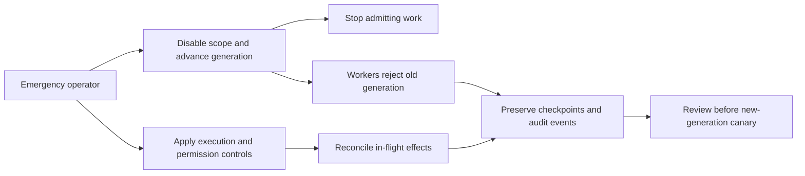

# Build a Cloud Automation Kill Switch That Preserves the Audit Trail

Author: [nawazdhandala](https://www.github.com/nawazdhandala)

Tags: Cloud Automation, AWS, Incident Management

Description: Stop new automation work, constrain in-flight actions, preserve evidence, and resume through a new admission generation instead of replaying stale jobs.

A cleanup job starts targeting more resources than expected. Disabling its schedule helps, but a queue already contains work and several workers are running. Deleting the queue might discard the evidence needed to understand what happened.

A useful kill switch is a tested containment procedure with several controls. It must distinguish stopping admission, stopping future mutations, and reconciling actions already accepted by external services. It should leave operators with an accurate record of what stopped and what remains uncertain.

## Define the scope before an incident

Give each automation family an explicit control scope, such as `sandbox-cleanup`. Map that scope to its schedulers, queues, workers, workflow executions, deployment roles, and resource inventory.

The emergency operator should use a separately governed identity. The automation being stopped must not be the only system capable of changing its own control state. Protect the audit destination and recovery tools from the same broad permissions used by the workload automation.

| Control | What it addresses | What remains to verify |
| --- | --- | --- |
| Disable admission | Prevents new approved work | Existing queue and worker activity |
| Mutation gate | Cooperative workers check before another action | Requests already sent or racing the check |
| Execution controls | Stops or throttles supported execution paths | Provider-side operations already running |
| Permission containment | Restricts further API actions | Propagation, alternate credentials, and affected services |
| Reconciliation | Establishes the actual resource state | Explicit recovery decisions |

Document which controls are available for each scope. A universal “stop everything” button without that mapping can disable observability and recovery along with the faulty job.

## Use a control generation to reject stale work

A durable control record should include whether mutations are enabled, an increasing admission generation, who changed it, when, and why. A run records the generation under which it was admitted.

When stopping, disable the scope and advance its generation. When resuming, issue a new generation through the approved recovery process. Old queued jobs must not silently adopt the new value and continue. Revalidate their request and resource state before deliberately readmitting them.



This generation separates old work from newly approved work. It is not automatically a fencing token that a cloud API will enforce.

## A fail-closed worker gate

The following helper uses Python 3.11 and Boto3 **1.40.76**, matching local tests. It assumes a single-Region DynamoDB control table with string partition key `scope`, boolean `enabled`, and numeric integer `epoch`. The worker has read access; a separate authorized control path owns updates and audit metadata.

Call it before each new mutation using the epoch persisted with the run. It performs a strongly consistent table read. Missing or disabled control state, an invalid admission epoch, or a mismatch blocks the worker. Read failures propagate, so the caller must not catch them and proceed anyway.

```python
class AutomationPaused(RuntimeError):
    pass


def require_enabled(dynamodb, table, scope, admitted_epoch):
    if type(admitted_epoch) is not int or admitted_epoch < 1:
        raise AutomationPaused('Invalid admission epoch')
    item = dynamodb.get_item(
        TableName=table,
        Key={'scope': {'S': scope}},
        ConsistentRead=True,
    ).get('Item', {})
    if item.get('enabled', {}).get('BOOL') is not True:
        raise AutomationPaused('Automation is disabled or control is missing')
    if item.get('epoch', {}).get('N') != str(admitted_epoch):
        raise AutomationPaused('Run belongs to an earlier admission epoch')
    return admitted_epoch
```

Provide a configured DynamoDB client, actual table name, known scope, and the run's admitted epoch. A successful return means that control state permitted this run at the instant of the read. DynamoDB's [GetItem documentation](https://docs.aws.amazon.com/amazondynamodb/latest/APIReference/API_GetItem.html) defines the strongly consistent read option and missing-item behavior.

There is still a gap between this read and the subsequent cloud API call. The switch can change during that gap, and an uncooperative worker can ignore it entirely. Keep the check close to each action, but describe it honestly as a cooperative gate. Stronger enforcement requires a mechanism at the destination or a separately controlled execution boundary.

Avoid long-lived caches of an enabled flag. If caching is necessary, define and test the maximum delay before a worker observes a stop. Include that delay in the containment objective instead of promising an instantaneous stop.

## Stop execution paths without erasing evidence

First stop new admissions and the relevant schedule or event intake. Preserve the prior configuration so restoration does not depend on memory. Pending queue messages need an explicit disposition; pausing intake does not make them disappear.

For Lambda, reserved concurrency can be set to zero to intentionally throttle a function. Treat that as control over further processing, not proof that already-submitted external operations were canceled. Capture the original concurrency setting and inspect actual invocation activity. See [Lambda reserved concurrency](https://docs.aws.amazon.com/lambda/latest/dg/configuration-concurrency.html).

For a supported Step Functions Standard execution, `StopExecution` provides an execution-level stop action; the API is not supported for Express state machines. Record the exact execution ARN and incident reference. See [StopExecution](https://docs.aws.amazon.com/step-functions/latest/apireference/API_StopExecution.html).

Stopping a workflow is not a transaction rollback. For `.sync` integrations, cancellation is best-effort and may fail, leaving the integrated job running. Inspect the provider's operation or resource state using the recorded identifiers. AWS describes these limits in its [service integration patterns](https://docs.aws.amazon.com/step-functions/latest/dg/connect-to-resource.html).

If permission containment is necessary, scope it to the automation identity and affected actions while preserving the recovery path. Revoking older role sessions affects sessions issued before the cutoff; new sessions after it are not denied by that particular revocation policy. Review both credential issuance and permissions, following [IAM session revocation](https://docs.aws.amazon.com/IAM/latest/UserGuide/id_roles_use_revoke-sessions.html).

IAM changes can take time to become visible. Observe real results rather than treating a successful policy update as instantaneous containment everywhere. See [IAM consistency troubleshooting](https://docs.aws.amazon.com/IAM/latest/UserGuide/troubleshoot.html#troubleshoot_general_eventual-consistency).

## Preserve a useful audit trail

Record the stop request, actor, incident reference, scope, old and new generation, control actions, responses, and observed effects. Keep the original failure separate from later containment failures.

Preserve queue identities, workflow history, operation journals, and resource IDs. Do not purge queues or delete logs merely to stop retries. Decide whether waiting work should remain paused, move through a controlled failure path, or be canceled with an auditable record. Retention limits still apply, so snapshot the metadata needed for investigation before it expires.

The control record should retain enough change evidence to reconstruct an emergency action even if the normal audit export is unavailable. Do not make safety depend on one failing log sink. Use a durable local control journal or transactional audit record and reconcile exports afterward, with clear access restrictions.

## Resume through a small, reviewed path

Before re-enabling mutations, reconcile every uncertain in-flight action. Verify whether resources were created, changed, or deleted; do not infer the answer solely from the worker's last log line.

Fix the triggering defect, review pending work against current state, and restore controls deliberately. Start a narrowly scoped canary under a new admission generation. Observe it before reopening ordinary scheduling, and prevent the backlog from immediately flooding workers on resume.

Local validation exercised ten gate scenarios, including disabled and missing controls, wrong types, stale generations, read errors, and invalid admission values. It did not operate a real kill switch. In staging, trigger the stop while workers are active, while a request is in flight, and while audit export is unavailable. Measure the containment delay and verify that old-generation jobs stay blocked after recovery.
