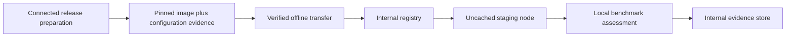

# Run kube-bench Offline with Pinned Images and CIS Configs

Author: [nawazdhandala](https://www.github.com/nawazdhandala)

Tags: Kubernetes, Security, Air-Gapped

Description: Prepare a verified kube-bench image and matching benchmark bundle, import it into an internal registry, and rehearse assessments on uncached offline nodes.

An air-gapped kube-bench deployment needs more than an image tag copied into a Job. The node must pull the image from an internal source, the image must contain the intended benchmark files and audit tools, and the assessment must avoid external publishing paths.

Treat the scanner image, configuration, manifest, and expected assessment scope as one reviewed release. This makes an offline run reproducible and makes it possible to explain which controls were evaluated months later.

This walkthrough pins **kube-bench v0.14.0** and **Crane v0.20.6**, using one `linux/amd64` image. Crane copies container images without requiring a Docker daemon. Examples assume authenticated access where required, trusted registry certificates, Bash, and GNU `sha256sum`. Replace the internal registry hostname with your own.

## Decide the offline assessment scope first

Inventory the node operating systems and CPU architectures, then choose the benchmark and target appropriate to the distribution. The examples use `cis-1.11` and `node` for an already approved worker assessment. A successful image import does not establish that this profile applies to every cluster version or managed service.

For ARM64 workers, prepare the corresponding platform deliberately. A single AMD64 archive does not become a multi-platform image merely because the upstream tag has several architectures. Keep platform-specific records or use a separately reviewed multi-platform transfer workflow.

Include the scanner’s required host mounts, admission approval, image-pull credentials, registry CA trust, and evidence destination in the readiness review. The registry certificate must be trusted by the node’s image-pulling runtime; adding a certificate inside the scanner container cannot repair a pull that fails before that container exists.

## Resolve and save the exact image

On the connected preparation machine, resolve the chosen platform’s digest and pull by that digest:

```bash
set -euo pipefail
mkdir kube-bench-bundle
cd kube-bench-bundle
source_image=docker.io/aquasec/kube-bench
source_digest=$(crane digest --platform linux/amd64 "$source_image:v0.14.0")
printf '%s\n' "$source_digest" > source.digest
crane manifest "$source_image@$source_digest" > source-manifest.json
crane pull --platform linux/amd64 --format=tarball \
  "$source_image@$source_digest" kube-bench-amd64.tar
crane validate --tarball kube-bench-amd64.tar
```

The digest fixes the content selected after release approval. It does not, by itself, authenticate the publisher; apply your organization’s provenance and release-approval process before accepting the artifact.

The [Crane pull reference](https://github.com/google/go-containerregistry/blob/v0.20.6/cmd/crane/doc/crane_pull.md) documents the explicit tarball format. This produces an image archive suitable for Crane push. The [validation command](https://github.com/google/go-containerregistry/blob/v0.20.6/cmd/crane/doc/crane_validate.md) checks image structure and content consistency, not whether its benchmark matches your environment.

## Retain the configuration tree from the image

The pinned kube-bench [Dockerfile](https://github.com/aquasecurity/kube-bench/blob/v0.14.0/Dockerfile) copies the `cfg` tree into `/opt/kube-bench/cfg` and includes the scanner, kubectl, and supporting utilities. Those files should travel with the approved image rather than being downloaded during an offline Job.

For an auditable copy of the bundled configuration, export the image filesystem and extract only its configuration directory into an empty review directory:

```bash
crane export - rootfs.tar < kube-bench-amd64.tar
mkdir reviewed-files
tar -xf rootfs.tar -C reviewed-files opt/kube-bench/cfg
sha256sum kube-bench-amd64.tar source.digest source-manifest.json rootfs.tar > SHA256SUMS
```

[Crane export](https://github.com/google/go-containerregistry/blob/v0.20.6/cmd/crane/doc/crane_export.md) creates a filesystem archive. **Do not import `rootfs.tar` as the container image.** It lacks the image manifest and configuration that `kube-bench-amd64.tar` carries. The two tar files serve different purposes.

Retain the complete `cfg` tree, including the global configuration, profile-specific overrides, target files, and mappings. Copying just `node.yaml` can omit information needed to select and run it. kube-bench’s [run command](https://github.com/aquasecurity/kube-bench/blob/v0.14.0/cmd/run.go) resolves targets through that configuration.

If you customize paths or controls, version the complete change and either build a reviewed derivative image before transfer or provide a separately versioned configuration artifact. Do not overwrite the image’s configuration directory with an incomplete ConfigMap. Record the resulting image digest and configuration revision together.

## Transfer and import inside the boundary

Transfer the archive, digest record, checksum file, configuration evidence, reviewed Job manifest, and required tooling through the approved process. Protect the checksum manifest through an independently trusted approval or signature channel. A checksum copied beside a malicious replacement cannot establish authenticity on its own.

Inside the environment, verify file integrity and import the image:

```bash
set -euo pipefail
sha256sum -c SHA256SUMS
internal_image=registry.internal.example/security/kube-bench:v0.14.0-amd64
crane push kube-bench-amd64.tar "$internal_image"
internal_digest=$(crane digest "$internal_image")
printf '%s\n' "$internal_digest" > internal.digest
crane validate --remote "$internal_image@$internal_digest"
crane manifest "$internal_image@$internal_digest" > internal-manifest.json
```

The [Crane push reference](https://github.com/google/go-containerregistry/blob/v0.20.6/cmd/crane/doc/crane_push.md) distinguishes image tarballs from OCI image-layout directories. Keep the pull/push format pair consistent. Authenticate through the approved credential mechanism and install the registry CA; do not disable TLS verification to get the transfer through.

Compare the destination digest with the source platform digest. In the local test, the tarball round trip converted the OCI manifest representation to Docker schema 2, changing the manifest digest while preserving the image configuration and compressed layer digests. Retain both manifests with [Crane manifest](https://github.com/google/go-containerregistry/blob/v0.20.6/cmd/crane/doc/crane_manifest.md) and verify their content identities:

```python
import json

with open("source-manifest.json") as handle:
    source = json.load(handle)
with open("internal-manifest.json") as handle:
    destination = json.load(handle)
def content_identity(manifest):
    descriptors = [manifest["config"]] + manifest["layers"]
    return [(item["digest"], item["size"]) for item in descriptors]
if content_identity(source) != content_identity(destination):
    raise SystemExit("Image configuration or ordered layers changed")
print("Configuration and ordered layer identities match")
```

This checks content identities, not publisher authenticity. Review the remaining manifest differences and approve the source-to-internal digest mapping through your release process. If exact manifest preservation is required, use a reviewed OCI-layout transfer instead of this image-tarball workflow. Never replace a failed digest check with unconditional acceptance.

## Use only the internal image in the reviewed Job

Merge this fragment into the existing validated scanner Pod specification, preserving its required host mounts and intended node placement:

```yaml
nodeSelector:
  kubernetes.io/os: linux
  kubernetes.io/arch: amd64
imagePullSecrets:
  - name: internal-registry-pull
containers:
  - name: kube-bench
    image: registry.internal.example/security/kube-bench@sha256:REPLACE_WITH_VERIFIED_INTERNAL_DIGEST
    imagePullPolicy: IfNotPresent
    command: [kube-bench]
    args:
      - run
      - --benchmark
      - cis-1.11
      - --targets
      - node
      - --config
      - /opt/kube-bench/cfg/config.yaml
      - --config-dir
      - /opt/kube-bench/cfg
      - --json
      - --exit-code
      - "3"
```

The digest placeholder replaces only the hexadecimal portion after `sha256:`. The image-pull Secret must already exist in the same namespace; omit that reference only if your approved registry access does not require it. Kubernetes documents [digest references and pull policies](https://kubernetes.io/docs/concepts/containers/images/).

`IfNotPresent` allows a cached image, but it does not eliminate the need for registry access on a fresh node. Do not switch to `Never` unless you have deliberately preloaded the correct image into every eligible node’s actual container runtime.

## Rehearse without relying on public access or caches

Use a dedicated staging node with no cached scanner image and controlled external egress restrictions. Do not clear production image caches or disconnect a production cluster to simulate the test. Confirm the pull uses the internal registry and that image authentication and CA trust work from the node.



Inspect the admitted Pod for injected containers or init containers that introduce additional images. Review custom audit commands for runtime downloads or external APIs. Explicit benchmark selection does not guarantee every custom check is network-free. Do not enable `--asff` in a disconnected assessment expecting AWS delivery to work.

A passing rehearsal includes the expected control IDs, node attribution, retained JSON and diagnostics, and an explained process status. Failed controls can be valid evidence; missing tools, files, or reports are collection problems.

Local validation pulled the pinned AMD64 image, checked its archive, compared key bundled configuration files with tagged source, and imported it through Crane into a local test registry. No Linux container, air-gapped cluster, runtime CA trust, or real node assessment was exercised. Rehearse those remaining dependencies before scheduling regular offline scans.
