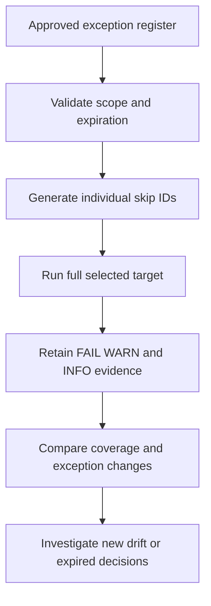

# Track kube-bench Skip Exceptions Without Hiding New Drift

Author: [nawazdhandala](https://www.github.com/nawazdhandala)

Tags: Kubernetes, Security, Compliance

Description: Keep kube-bench exceptions narrow, approved, and time-limited while preserving skipped-control evidence and detecting unexpected changes in assessment coverage.

An approved security exception should explain why a requirement is temporarily unmet. It should not make the requirement disappear from everyone’s view. With kube-bench, adding a control to `--skip` changes the scanner’s behavior, but it does not create an approval record or prove that the risk is acceptable.

A useful workflow keeps three things separate: the raw assessment, the organization’s exception decision, and the scan configuration that implements that decision. This separation makes it possible to discover both new failures and accidental expansion of the skip list.

The examples below use **kube-bench v0.14.0** and its default JSON output. They assume an existing approved benchmark and a scanner environment that can inspect the intended node. The example exception is fictional and must not be treated as authorization to skip a real control.

## Understand what skipping actually does

The `--skip` option accepts comma-separated check or group IDs. A check ID selects one control; a group ID skips all selected controls in that group. In this release, skipped checks receive INFO, not PASS. This behavior is documented in the [official flag reference](https://github.com/aquasecurity/kube-bench/blob/v0.14.0/docs/flags-and-commands.md).

The implementation first applies the check/group selection filter, then applies skips to the checks that remain. A control excluded by a filter will not appear simply because it was also named in `--skip`. Group-level and control-level skip declarations in the benchmark YAML can also affect results. Review the [control execution logic](https://github.com/aquasecurity/kube-bench/blob/v0.14.0/check/controls.go) when investigating unexpected coverage.

Prefer specific control IDs for exceptions. A group exception can silently cover a newly added control when a future benchmark revision expands that group. If a group-wide exception is unavoidable, preserve the exact membership at approval time and require review before changing the benchmark.

## Record the decision before changing the command

A defensible exception record identifies the benchmark revision, control, node scope, risk owner, approving authority, reason, compensating protection, evidence, and review deadline. “This makes the pipeline green” is not a risk decision.

For example, a scoped maintenance exception might reference a tracked change to correct a file permission on a particular node. The approval must explain why the existing permission is tolerable until that change, and what limits exposure during the interval.

The following JSON illustrates the shape of a small register. Save it as `exceptions.json` only after replacing every example value with an approved record:

```json
{
  "scanner": "v0.14.0",
  "benchmark": "cis-1.11",
  "target": "node",
  "node_uid": "REPLACE_WITH_APPROVED_NODE_UID",
  "exceptions": [
    {
      "check": "4.1.1",
      "ticket": "EXAMPLE-123",
      "approved_by": "REPLACE_WITH_APPROVER",
      "expires": "2026-12-20",
      "reason": "REPLACE_WITH_APPROVED_RISK_DECISION",
      "compensating_control": "REPLACE_WITH_VERIFIABLE_PROTECTION"
    }
  ]
}
```

The date is illustrative, not a recommended exception duration. Choose a duration consistent with your risk process. Keep the register under review controls and link supporting evidence from the ticket. A person’s name in JSON is not proof that the person approved it.

## Generate a narrow skip argument from the register

This Python 3 helper checks the expected assessment context and rejects duplicate IDs, missing fields, unresolved placeholders, and expired entries. Save it as `approved-skips.py`:

```python
import datetime
import json
import re
import sys

with open("exceptions.json", encoding="utf-8") as handle:
    record = json.load(handle)
if len(sys.argv) != 2:
    raise SystemExit("Usage: python3 approved-skips.py VERIFIED_NODE_UID")
if (record["scanner"], record["benchmark"], record["target"]) != (
    "v0.14.0", "cis-1.11", "node"
):
    raise SystemExit("Exception scope does not match this scan")
if record["node_uid"] != sys.argv[1] or "REPLACE_" in record["node_uid"]:
    raise SystemExit("Node UID does not match the approved scope")
today = datetime.datetime.now(datetime.timezone.utc).date()
ids = []
for item in record["exceptions"]:
    for field in ("check", "ticket", "approved_by", "reason", "compensating_control"):
        value = item.get(field, "")
        if not value.strip() or "REPLACE_" in value or "EXAMPLE" in value:
            raise SystemExit("Incomplete exception: " + field)
    if not re.fullmatch(r"[0-9]+(?:\.[0-9]+){2,}", item["check"]):
        raise SystemExit("Expected an individual CIS check ID")
    if datetime.date.fromisoformat(item["expires"]) <= today:
        raise SystemExit("Exception has expired: " + item["check"])
    if item["check"] in ids:
        raise SystemExit("Duplicate exception: " + item["check"])
    ids.append(item["check"])
print(",".join(sorted(ids)))
```

The helper deliberately accepts the numeric check format used by this example. It is not a universal parser for every benchmark family, and it does not prove the ID exists. Verify membership against the pinned control YAML or baseline report. Obtain the node UID from trusted inventory and independently confirm that the scanner will run on that node; passing a string to this helper does not schedule a Pod.

An expiration on today’s UTC date is rejected. This defines a clear boundary for unattended runs. A rejected exception should trigger review, not an automatic extension or fallback to an old skip string.

## Run the assessment and retain the skipped records

In an authorized Bash scanner session with the matching binary and configuration tree in the current directory:

```bash
set -euo pipefail
node_uid='REPLACE_WITH_VERIFIED_NODE_UID'
skip_ids=$(python3 approved-skips.py "$node_uid")
bundle_dir="$PWD"
scan_status=0
./kube-bench run --benchmark cis-1.11 --targets node \
  --config "$bundle_dir/cfg/config.yaml" \
  --config-dir "$bundle_dir/cfg" \
  --skip "$skip_ids" --json --exit-code 3 \
  > assessment.json 2> assessment.log || scan_status=$?
printf 'Assessment process exit: %s\n' "$scan_status"
```

This runs an actual assessment. The helper must succeed before kube-bench starts. The command continues capturing evidence if checks fail; your automation must still evaluate the resulting process status and report before declaring success.

Keep the exact register revision, generated skip list, scanner configuration, node identity, and report together. Do not strip INFO records when uploading evidence. The [check runner](https://github.com/aquasecurity/kube-bench/blob/v0.14.0/check/check.go) treats a skipped check as unevaluated; its previous FAIL has not been repaired.

## Detect changes in coverage as well as failures

Compare these dimensions with the previous assessment of the same node and benchmark:

| Change | Review action |
|---|---|
| New FAIL outside the exception list | Investigate as a new finding |
| New INFO without a matching approval | Inspect command arguments and benchmark skip declarations |
| Approved ID missing from the report | Check target, filters, and benchmark membership |
| Previously passing ID absent | Treat as lost coverage until explained |
| Exception reaches its deadline | Reassess, remediate, or obtain a new explicit decision |

Some controls are already skipped in the benchmark definition. Distinguish those baseline skips from command-line exceptions rather than demanding that every INFO record correspond to a new ticket. Preserve the baseline configuration so an unexpected increase can be explained.



When safe and authorized, periodically assess the excepted controls without the command-line skips and store those observations alongside the exception decision. An accepted risk can worsen even while its approval remains valid. Do not edit the benchmark to force PASS or remove controls from the saved report.

Local synthetic v0.14.0 tests confirmed that skipping one failing check changed it to INFO and removed its failure exit status, while skipping the group changed all six selected records to INFO. An unknown skip ID had no effect. These tests did not assess a cluster. They demonstrate why a green process result must be accompanied by coverage checks and a separate, current exception record.
