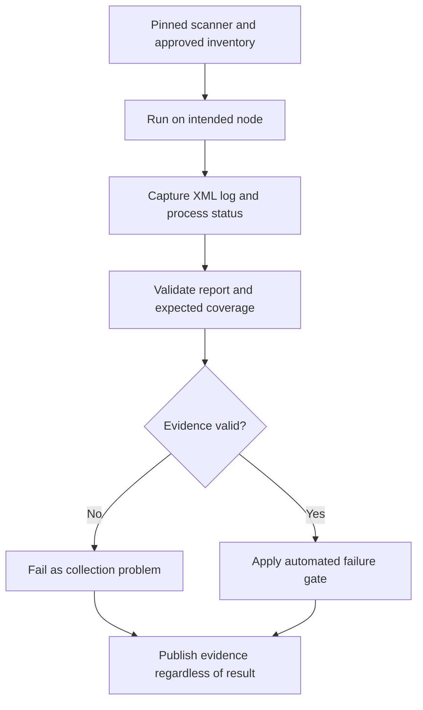

# Gate CI on kube-bench Results with JUnit and Explicit Exit Codes

Author: [nawazdhandala](https://www.github.com/nawazdhandala)

Tags: Kubernetes, Security, CI/CD

Description: Capture kube-bench JUnit evidence without losing failure status, reject empty or incomplete reports, and distinguish failed controls from scanner execution errors.

A continuous integration job can appear successful even when kube-bench finds failed controls. By default, kube-bench v0.14.0 uses exit code zero for findings. A second trap appears when a shell pipeline reports the success of a log-copying command instead of the scanner. A third is a valid but empty report caused by the wrong selection filter.

A reliable gate checks both the process result and the evidence. It must also preserve the evidence when the gate fails, so an engineer can determine whether the problem is a security finding, missing coverage, or a broken scanner environment.

This example pins **kube-bench v0.14.0**, uses JUnit XML for test-report integration, and runs a small Python 3 verifier. It is intended for an already authorized node-assessment environment, not an ordinary hosted CI runner with no access to your cluster’s host files.

## Define what the gate promises

JUnit is an XML test-report format understood by many CI systems. kube-bench maps each selected control into a test case. In the pinned release, FAIL creates a failure element; WARN and INFO create skipped elements; PASS has neither. The full check JSON is also included inside each case’s `system-out`. These details come from the [JUnit serializer](https://github.com/aquasecurity/kube-bench/blob/v0.14.0/check/controls.go).

A pipeline that rejects only JUnit failures therefore does not establish that every control passed. Manual checks and skipped controls remain unresolved or separately assessed. Choose and document a policy for those records instead of letting the test-report interface imply a complete compliance decision.

The gate below has a deliberately narrow promise: the expected controls were reported, the scanner’s exit status agrees with the automated failures, and no automated FAIL is present. Manual assessment and exception approval remain separate obligations.

## Fix the scan scope before wiring CI

Keep the binary or image pinned, retain its matching configuration tree, and select an approved benchmark and target. Record the node name and UID outside the XML so reports from different nodes cannot be confused. For this example, the assessment is one authorized worker node using `cis-1.11` and target `node`.

Create `expected-ids.json` from the reviewed control inventory for that exact scope. It is a JSON array of check IDs. A focused two-control test could use `["4.1.1", "4.1.2"]`, but a full target requires its complete approved inventory. Do not derive the expected list from the same new report you are trying to validate: that would accept missing checks by construction.

Version this inventory alongside the scan configuration. When adopting a new benchmark, review additions, removals, and approved filters explicitly. Reusing an old list without review is as misleading as accepting any new list automatically.

## Capture the scanner’s process result immediately

Save this Bash script as `scan.sh`. Run it from the directory containing the pinned `kube-bench` binary, its `cfg` tree, the expected inventory, and the verifier shown next:

```bash
#!/usr/bin/env bash
set -euo pipefail
bundle_dir="$PWD"
report_dir=$(mktemp -d "$PWD/kube-bench-report.XXXXXX")
printf 'Report directory: %s\n' "$report_dir"
scanner_status=0
./kube-bench run --benchmark cis-1.11 --targets node \
  --config "$bundle_dir/cfg/config.yaml" \
  --config-dir "$bundle_dir/cfg" --junit --exit-code 3 \
  > "$report_dir/results.xml" 2> "$report_dir/scanner.log" \
  || scanner_status=$?
printf '%s\n' "$scanner_status" > "$report_dir/scanner-exit.txt"
cp expected-ids.json "$report_dir/expected-ids.json"
python3 verify-report.py "$report_dir" "$scanner_status"
```

The unique directory prevents an old report from being mistaken for this run’s output. Redirection keeps diagnostic stderr separate from XML, and the conditional captures the scanner status even with `set -e` enabled. The final verifier determines the script’s result.

This runs a real scan. Maintain the host mounts, process visibility, and permissions required by your approved deployment. If CI launches a Kubernetes Job instead, collect its actual container termination status and report artifacts; a successful `kubectl create` operation only proves that the API accepted a request.

The explicit `--exit-code 3` overrides the default zero for FAIL results. The [flag definition](https://github.com/aquasecurity/kube-bench/blob/v0.14.0/cmd/root.go) and [exit selection logic](https://github.com/aquasecurity/kube-bench/blob/v0.14.0/cmd/common.go) establish this behavior. Do not specify both `--json` and `--junit` expecting two outputs; in this release the JUnit branch takes precedence.

## Reject incomplete evidence before counting failures

Save this verifier as `verify-report.py`. It uses Python’s standard library and reads only files created by the scan workflow:

```python
import json
from pathlib import Path
import sys
import xml.etree.ElementTree as ET

try:
    directory = Path(sys.argv[1])
    scanner_status = int(sys.argv[2])
    expected = json.loads((directory / "expected-ids.json").read_text())
    if not isinstance(expected, list) or not expected:
        raise ValueError("Expected inventory must be a nonempty list")
    if len(expected) != len(set(expected)):
        raise ValueError("Expected inventory contains duplicate IDs")
    root = ET.parse(directory / "results.xml").getroot()
    if root.tag != "testsuites":
        raise ValueError("Unexpected JUnit root element")
    cases = root.findall("./testsuite/testcase")
    ids = []
    failures = 0
    skipped = 0
    for case in cases:
        detail = json.loads(case.findtext("system-out", ""))
        ids.append(detail["test_number"])
        failures += case.find("failure") is not None
        skipped += case.find("skipped") is not None
        if case.find("error") is not None:
            raise ValueError("JUnit contains an execution error")
    if len(ids) != len(set(ids)) or set(ids) != set(expected):
        raise ValueError("Reported IDs differ from the expected inventory")
    if scanner_status not in (0, 3):
        raise ValueError("Scanner did not complete normally")
    if (scanner_status == 3) != (failures > 0):
        raise ValueError("Scanner status and JUnit failures disagree")
except (OSError, ValueError, KeyError, TypeError, ET.ParseError) as error:
    print("Invalid assessment evidence:", error, file=sys.stderr)
    raise SystemExit(2)

print(f"Cases={len(ids)} failures={failures} skipped={skipped}")
raise SystemExit(3 if failures else 0)
```

The result is deterministic for the evidence provided: zero means the narrow gate passed, 3 means automated failures, and 2 means invalid or incomplete evidence. A nonzero status still fails an ordinary CI step, while the number helps classify the incident.

This verifier is scoped to one target and node. For multiple targets, check IDs may need additional context to remain unique. Keep separate node artifacts or extend the identity model deliberately rather than concatenating XML files.

## Publish evidence even when the gate fails

Configure your CI system’s test-report and artifact steps to run after a failed scan step. Upload the XML, scanner log, captured status, expected inventory, and node/configuration metadata. Restrict access according to the sensitivity of host configuration details. Keep artifact-upload success separate from assessment success.



Test the integration before depending on it. Include a passing fixture, a failing fixture, an empty report, truncated XML, a mismatched exit status, and missing expected controls. Also verify that the CI interface displays skipped cases without calling them passed.

Local v0.14.0 synthetic checks produced six JUnit cases with one failure and four skips. The default exit was zero; `--exit-code 3` returned 3. A nonexistent check selection produced zero cases and exit zero, demonstrating the need for coverage validation. No Kubernetes node or hosted CI system was exercised. Validate the complete placement, collection, and publication path in your environment before using it as a release gate.
