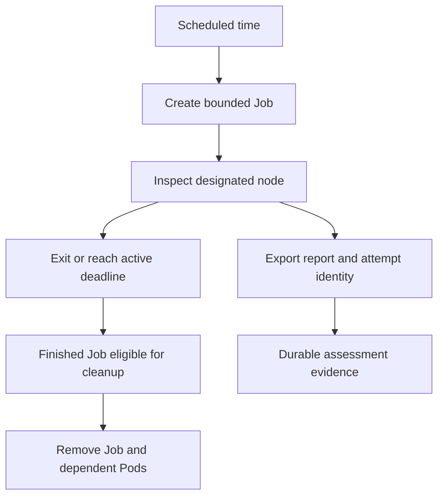

# Schedule kube-bench with Bounded Runtime and Pod Cleanup

Author: [nawazdhandala](https://www.github.com/nawazdhandala)

Tags: Kubernetes, Security, Automation

Description: Schedule short-lived kube-bench assessments with runtime limits, controlled overlap, retained evidence, and cleanup that does not hide missing node coverage.

A scheduled kube-bench assessment should inspect a node, export its evidence, and stop. Leaving a scanner Pod running indefinitely extends access to sensitive host information without improving the assessment. Deleting it too quickly creates the opposite problem: the evidence disappears before anyone collects it.

A Kubernetes CronJob provides scheduling, but runtime limits, coverage, and evidence retention still need explicit design. This guide uses **kube-bench v0.14.0** and a `batch/v1` CronJob example for one designated Linux worker. The manifest was checked against a local Kubernetes 1.34 API server; no scheduler or kubelet executed it during that validation.

## Start with a working one-shot assessment

Before scheduling, verify a normal Job can inspect the intended node using the approved benchmark and host paths. The [upstream node Job](https://github.com/aquasecurity/kube-bench/blob/v0.14.0/job-node.yaml) is a reference for kube-bench’s process visibility and mounts, not a reason to grant unrestricted access to every namespace.

The example below narrows the mount set to four directories commonly needed by a node assessment. Confirm them against your actual node layout and selected controls. A missing directory or insufficient permission requires investigation; creating empty directories just to satisfy the manifest would corrupt the evidence.

The container does not set `privileged: true`, but host PID visibility and host filesystem access are still sensitive privileges. Use a separately reviewed scanner namespace and admission policy. Do not relax the security policy of an application namespace merely to make this workload start.

## Use separate controls for scheduling, runtime, and cleanup

These settings solve different problems:

| Setting | Purpose |
|---|---|
| `concurrencyPolicy: Forbid` | Prevent overlapping Jobs from this same CronJob |
| `startingDeadlineSeconds` | Limit how late a missed schedule may start |
| Job `activeDeadlineSeconds` | Bound the Job’s active lifetime |
| `backoffLimit: 0` | Avoid retrying a failed assessment automatically |
| `restartPolicy: Never` | Avoid restarting the scanner container in place |
| `ttlSecondsAfterFinished` | Make completed or failed Jobs eligible for cleanup |

`Forbid` does not coordinate different CronJobs or manually created Jobs. It is also not an exactly-once guarantee. The [CronJob documentation](https://kubernetes.io/docs/concepts/workloads/controllers/cron-jobs/) explains that scheduling can occasionally produce duplicate or missed executions. Preserve attempt identities and tolerate duplicate evidence rather than assuming one file per scheduled time.

## Define a short-lived scan for one node

Save this as `kube-bench-cronjob.yaml`. Replace `REPLACE_WITH_NODE_NAME` with the verified worker name, and use a preapproved `security-audit` namespace. The example assumes `cis-1.11` is the approved profile for that node; choose the appropriate profile separately from validating the Kubernetes API schema.

```yaml
apiVersion: batch/v1
kind: CronJob
metadata:
  name: kube-bench-worker-a
  namespace: security-audit
spec:
  schedule: "17 2 * * *"
  timeZone: Etc/UTC
  suspend: true
  concurrencyPolicy: Forbid
  startingDeadlineSeconds: 300
  successfulJobsHistoryLimit: 2
  failedJobsHistoryLimit: 2
  jobTemplate:
    spec:
      backoffLimit: 0
      activeDeadlineSeconds: 600
      ttlSecondsAfterFinished: 86400
      template:
        metadata:
          labels:
            app.kubernetes.io/name: kube-bench
        spec:
          restartPolicy: Never
          automountServiceAccountToken: false
          hostPID: true
          terminationGracePeriodSeconds: 30
          nodeSelector:
            kubernetes.io/os: linux
          affinity:
            nodeAffinity:
              requiredDuringSchedulingIgnoredDuringExecution:
                nodeSelectorTerms:
                  - matchFields:
                      - key: metadata.name
                        operator: In
                        values: [REPLACE_WITH_NODE_NAME]
          containers:
            - name: kube-bench
              image: docker.io/aquasec/kube-bench:v0.14.0
              command: [kube-bench]
              args: [run, --benchmark, cis-1.11, --targets, node, --json, --exit-code, "3"]
              resources:
                requests:
                  cpu: 100m
                  memory: 128Mi
                limits:
                  cpu: "1"
                  memory: 512Mi
              volumeMounts:
                - {name: kubelet, mountPath: /var/lib/kubelet, readOnly: true}
                - {name: kubernetes, mountPath: /etc/kubernetes, readOnly: true}
                - {name: etc-systemd, mountPath: /etc/systemd, readOnly: true}
                - {name: lib-systemd, mountPath: /lib/systemd, readOnly: true}
          volumes:
            - name: kubelet
              hostPath: {path: /var/lib/kubelet, type: Directory}
            - name: kubernetes
              hostPath: {path: /etc/kubernetes, type: Directory}
            - name: etc-systemd
              hostPath: {path: /etc/systemd, type: Directory}
            - name: lib-systemd
              hostPath: {path: /lib/systemd, type: Directory}
```

The object starts suspended so applying it does not immediately enable recurring execution. Its daily time is UTC; `.spec.timeZone` is stable from Kubernetes 1.27. The CPU, memory, and ten-minute deadline are starting values for a rehearsal, not measured requirements for your cluster.

The required node affinity preserves normal scheduling checks while selecting a specific node. If that node disappears, the Pod cannot quietly assess a different worker. That creates a coverage failure you must handle when replacing nodes. One CronJob does not scan every node: use a reviewed per-node inventory or a separate orchestrator for fleet-wide coverage.

## Rehearse before enabling the schedule

With authorized cluster access, first use [server-side dry-run](https://kubernetes.io/docs/reference/kubectl/generated/kubectl_apply/) to validate the object without persisting it:

```bash
kubectl apply --dry-run=server -f kube-bench-cronjob.yaml
```

API acceptance does not test directory existence, image pulls, scanner permissions, or the admission of a future Pod. Apply the reviewed object and [create a one-time rehearsal Job](https://kubernetes.io/docs/reference/kubectl/generated/kubectl_create/kubectl_create_job/):

```bash
kubectl apply -f kube-bench-cronjob.yaml
kubectl -n security-audit create job kube-bench-rehearsal \
  --from=cronjob/kube-bench-worker-a
kubectl -n security-audit get pods \
  -l batch.kubernetes.io/job-name=kube-bench-rehearsal -o wide
```

Use a fresh Job name for another attempt. Check the assigned node, termination status, report content, and missing-file diagnostics. With `--exit-code 3`, automated FAIL findings can make the Job fail even when report collection worked. A failed Job is therefore not automatically a scheduling or image problem.

Only after evidence export and cleanup behavior have been rehearsed should you enable recurring runs:

```bash
kubectl -n security-audit patch cronjob kube-bench-worker-a \
  --type=merge -p '{"spec":{"suspend":false}}'
```

## Export evidence before deleting objects

Use your existing trusted log collection or an external collector to retain each attempt’s report, stderr, node identity, Job UID, Pod UID, and termination details. Verify that it captures the complete JSON and can distinguish stdout from diagnostics. Avoid adding a long-running sidecar simply to keep the report accessible.

The Job deadline limits active execution; TTL cleanup begins only after the Job finishes. Kubernetes documents these separately in [Job termination behavior](https://kubernetes.io/docs/concepts/workloads/controllers/job/) and [TTL-after-finished cleanup](https://kubernetes.io/docs/concepts/workloads/controllers/ttlafterfinished/). History limits can also remove old Jobs, so neither the history count nor the TTL is a guaranteed minimum evidence-retention period.



Deadlines and cleanup depend on functioning controllers and node communication. An unreachable node can prevent prompt confirmation that a process stopped. Monitor overdue scans and lingering terminating Pods rather than treating a deadline as an absolute physical kill guarantee.

To pause scheduling, set `suspend: true`. Existing Jobs continue; suspension is not a stop command for active scans. Monitor missing reports, stalled Jobs, and node-inventory changes as distinct operational failures. A quiet CronJob with no recent evidence is not proof that the cluster remains assessed.
