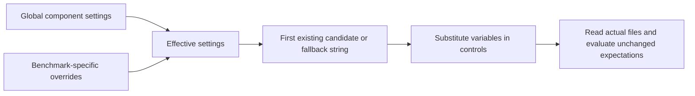

# Customize kube-bench Paths Without Weakening the Checks

Author: [nawazdhandala](https://www.github.com/nawazdhandala)

Tags: Kubernetes, Security, Configuration

Description: Point kube-bench at real component files on nonstandard nodes, account for configuration overrides, and verify path selection without changing benchmark expectations.

A kubelet configuration file exists on the node, but kube-bench reports that it cannot find the expected file. The node may use a custom directory, a packaged distribution may store configuration beneath its own data root, or the scanner container may mount that directory somewhere different.

The useful correction is to make the scanner inspect the actual evidence. Changing a permission threshold, skipping a check, or creating an empty placeholder file does not solve a path-discovery problem.

This guide uses **kube-bench v0.14.0** and an illustrative Linux worker whose custom configuration lives under `/srv/kubernetes-node`. That path is a placeholder for a verified local layout, not a standard location recommended for Kubernetes. Choose the appropriate distribution benchmark before adapting its paths.

## Identify the active files, not just plausible filenames

Start with the node's approved configuration inventory and service definition. Record the actual kubelet configuration, service unit or drop-in, kubeconfig, and CA certificate paths. A kubeconfig is a client connection configuration; it is not the same file as the kubelet's component settings.

Also determine how the component runs. A standalone kubelet process, a wrapper executable, and a distribution that packages several components together can require different process matching. Do not copy the name of an installer into the running-process candidates.

Keep a small evidence map:

| Evidence | Illustrative verified location | kube-bench setting |
|---|---|---|
| Kubelet settings | `/srv/kubernetes-node/kubelet/config.yaml` | `confs` |
| Service drop-in | `/etc/systemd/system/kubelet.service.d/20-local.conf` | `svc` |
| Kubelet client configuration | `/srv/kubernetes-node/kubelet/kubeconfig` | `kubeconfig` |
| Trusted CA certificate | `/srv/kubernetes-node/pki/ca.crt` | `cafile` |

Each location must represent the active installation. Old backups and abandoned configuration files can exist at otherwise plausible paths. A file's existence alone does not prove that the running component uses it.

## Work on a complete copy of the matching configuration tree

Extract the release bundle and retain its original `cfg` directory. Create a separate working copy before editing:

```bash
cp -R cfg cfg-site
```

This command assumes that `cfg-site` does not already exist. Use a new directory for each reviewed revision. Keep the binary and source configuration at v0.14.0 rather than mixing one release's executable with arbitrary development-branch controls.

The global `config.yaml` provides component settings and mappings. A selected benchmark's own `config.yaml` can override corresponding settings. The [tagged controls documentation](https://github.com/aquasecurity/kube-bench/blob/v0.14.0/docs/controls.md) describes this configuration layering, and the [loading implementation](https://github.com/aquasecurity/kube-bench/blob/v0.14.0/cmd/run.go) shows the benchmark-specific merge before checks run.

Do not replace the global file with a small path fragment. That would remove required mappings and other component definitions. Likewise, do not overwrite an entire distribution-specific override file merely because you need to change one component.

## Use the exact keys consumed by the release

For v0.14.0, the service candidate key is **`svc`**, singular. Some explanatory documentation uses `svcs`, but the tagged [configuration](https://github.com/aquasecurity/kube-bench/blob/v0.14.0/cfg/config.yaml) and [source key mapping](https://github.com/aquasecurity/kube-bench/blob/v0.14.0/cmd/util.go) use `svc`. Verify spelling against the installed release rather than assuming unknown YAML keys will cause an error.

The following fragment belongs under `node.kubelet` in the effective configuration. Replace its example paths with your verified ones:

```yaml
node:
  kubelet:
    bins:
      - kubelet
    confs:
      - /srv/kubernetes-node/kubelet/config.yaml
    defaultconf: /srv/kubernetes-node/kubelet/config.yaml
    svc:
      - /etc/systemd/system/kubelet.service.d/20-local.conf
    defaultsvc: /etc/systemd/system/kubelet.service.d/20-local.conf
    kubeconfig:
      - /srv/kubernetes-node/kubelet/kubeconfig
    defaultkubeconfig: /srv/kubernetes-node/kubelet/kubeconfig
    cafile:
      - /srv/kubernetes-node/pki/ca.crt
    defaultcafile: /srv/kubernetes-node/pki/ca.crt
```

This fragment is not a full configuration file or Kubernetes resource. Preserve the existing `node.components` list and unrelated settings. If your chosen benchmark overrides `node.kubelet`, make the corresponding narrow change in your copied benchmark configuration so it does not replace your global edit later.

The `bins` list identifies a running process candidate; it is not a directory search path for launching the component. Keep `kubelet` only if that matches the actual process representation. Prefer the distribution's reviewed profile when its components use a different architecture.

## Understand candidate order and fallback behavior

For a file category, kube-bench chooses the first existing candidate. If you retain several candidates, put the intended active path first and remove stale alternatives from the site-specific list. Otherwise, a leftover file can win before the desired one is considered.

A `defaultconf` value is a fallback string, not proof that the file exists. Setting it does not create the file, mount it, or establish read permission. The same distinction applies to the other default path fields. These behaviors are implemented by `getFiles` and `findConfigFile` in the [tagged path-selection source](https://github.com/aquasecurity/kube-bench/blob/v0.14.0/cmd/util.go).

Selected values are substituted into control variables such as `$kubeletconf`, `$kubeletsvc`, `$kubeletkubeconfig`, and `$kubeletcafile`. Review the actual control definition to understand which variable it uses. Some checks inspect process arguments or hard-coded paths instead, so editing a candidate list does not necessarily affect every failing check. The [substitution implementation](https://github.com/aquasecurity/kube-bench/blob/v0.14.0/cmd/common.go) shows this boundary.



## Make the files visible at the expected paths

When running directly on the node, the configured paths refer to that host's filesystem. Inside a container, they refer to its mounted view. A correct host path is useless if it is absent from that view.

For example, the relevant mount fragment for the custom data directory is:

```yaml
volumes:
  - name: node-config
    hostPath:
      path: /srv/kubernetes-node
      type: Directory
containers:
  - name: kube-bench
    volumeMounts:
      - name: node-config
        mountPath: /srv/kubernetes-node
        readOnly: true
```

Merge this into the approved scanner Job alongside the other required mounts. It does not supply the separate `/etc/systemd` evidence or the scanner's complete configuration. The [upstream running guide](https://github.com/aquasecurity/kube-bench/blob/v0.14.0/docs/running.md) describes the host process and filesystem access requirements.

Using the same host and container path reduces confusion when process arguments contain absolute paths. If you intentionally remap paths, review every affected check and reference. Do not mount a copied configuration snapshot and claim that its file ownership proves the ownership of the original node file.

## Run a narrow check and inspect its evidence

For an approved ordinary worker assessment using the copied `cis-1.11` controls, a targeted example is:

```bash
bundle_dir="$PWD"
./kube-bench run --benchmark cis-1.11 --targets node --check 4.1.1 \
  --config "$bundle_dir/cfg-site/config.yaml" \
  --config-dir "$bundle_dir/cfg-site" --v=2 --logtostderr
```

In the tagged [node controls](https://github.com/aquasecurity/kube-bench/blob/v0.14.0/cfg/cis-1.11/node.yaml), check 4.1.1 inspects kubelet service-file permissions through `$kubeletsvc`. The example performs a real check, so run it only on the authorized node or its approved scanner workload. Diagnostic output can expose paths and component details; retain it with appropriate access restrictions.

Confirm that the selected service path is the active file you intended. Then review other affected checks, their actual evidence, and any remaining warnings before running the full assessment. A passing permission check does not prove that all kubelet settings were evaluated correctly.

Keep a diff of the path configuration, the original control files, and the resulting report. Do not change expected values to compensate for a different layout. If the distribution genuinely requires different control semantics, document that as a reviewed benchmark adaptation rather than hiding it inside a path repair.
