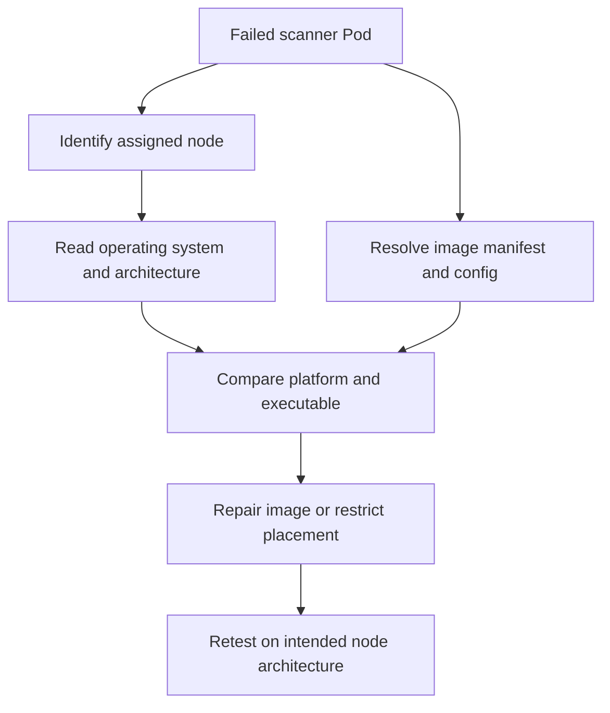

# Fix kube-bench Exec Format Errors by Matching Node Architecture

Author: [nawazdhandala](https://www.github.com/nawazdhandala)

Tags: Kubernetes, Security, Troubleshooting

Description: Diagnose kube-bench startup failures by comparing node architecture, image manifests, and executable formats before repairing your image or scheduling policy.

A kube-bench Job fails before printing a single benchmark result. Its container status mentions `exec format error`. Changing the benchmark version or granting more privileges is unlikely to help: first establish whether the node can execute the program inside the image.

This guide uses kube-bench **v0.14.0** and **crane v0.20.6**, a command-line tool for inspecting container registries. The registry inspection was performed against the published image; no Kubernetes startup failure was reproduced. Run the cluster commands with read access to the affected namespace and nodes, and use an approved workstation with registry access for image inspection.

## Locate the failure before changing anything

Save the failed Pod's description and JSON. Replace the two values below; these commands do not modify the workload.

```bash
set -eu
namespace='REPLACE_NAMESPACE'
pod='REPLACE_FAILED_POD'
kubectl -n "$namespace" describe pod "$pod"
kubectl -n "$namespace" get pod "$pod" -o json > failed-pod.json
jq '{node: .spec.nodeName,
     requested: [.spec.containers[] | {name, image, command, args}],
     observed: .status.containerStatuses}' failed-pod.json
```

The output associates the requested image and command with the assigned node and container state. Record the exact error, container name, and available `imageID`; a tag alone can change after the failure. If an init container failed, inspect `initContainers` and `initContainerStatuses` instead. Kubernetes documents Pod descriptions and status inspection in its [running-Pod debugging guide](https://kubernetes.io/docs/tasks/debug/debug-application/debug-running-pod/).

Use the stage of failure to choose the next investigation:

| Evidence | Investigation |
|---|---|
| No matching platform during image pull | Does the registry reference contain an image for this node? |
| Image pulled, executable rejected | Does the binary or its interpreter match the node's operating system and architecture? |
| kube-bench prints benchmark or file errors | Startup succeeded; investigate configuration and host access separately. |

An architecture mismatch is a strong hypothesis, not a diagnosis based solely on one error string. A custom entrypoint with an invalid executable format can fail similarly.



## Read the node's actual platform

Use the node name from the saved Pod. An unscheduled Pod has no node name and needs scheduling investigation first.

```bash
set -eu
node=$(jq -er '.spec.nodeName | select(length > 0)' failed-pod.json)
kubectl get node "$node" -o json > scanner-node.json
jq '{name: .metadata.name,
     os: .status.nodeInfo.operatingSystem,
     architecture: .status.nodeInfo.architecture,
     runtime: .status.nodeInfo.containerRuntimeVersion,
     osLabel: .metadata.labels["kubernetes.io/os"],
     archLabel: .metadata.labels["kubernetes.io/arch"]}' scanner-node.json
```

For an ordinary Linux x86-64 node, expect `linux` and `amd64`; a Linux ARM64 node reports `arm64`. Compare the status with the labels used for scheduling. Unexpected disagreement deserves investigation rather than changing a label to make an incompatible image appear compatible. Kubernetes defines the [standard operating-system and architecture labels](https://kubernetes.io/docs/reference/labels-annotations-taints/).

Your laptop's architecture is not evidence about the node. It matters only if your packaging process selected a laptop-specific image and then promoted that single image to the cluster.

## Inspect the registry reference, not just its tag

A multi-platform image index is a list of references to platform-specific manifests. Each child manifest identifies one image's configuration and layers. Pinning an index digest can retain platform selection; pinning an `amd64` child digest selects that particular image. The [OCI image-index specification](https://github.com/opencontainers/image-spec/blob/v1.1.1/image-index.md) describes these platform entries.

With crane v0.20.6 and jq installed, inspect the exact failing reference. This public release is a reproducible starting example; replace it with the internal reference for the actual diagnosis.

```bash
set -eu
image='docker.io/aquasec/kube-bench:v0.14.0'
crane manifest "$image" > manifest.json
jq -r '.manifests[]? |
  [.platform.os, .platform.architecture,
   (.platform.variant // ""), .digest] | @tsv' manifest.json
crane config --platform linux/amd64 "$image" > image-config.json
jq '{os, architecture, entrypoint: .config.Entrypoint,
     command: .config.Cmd}' image-config.json
```

The commands use crane's documented [manifest](https://github.com/google/go-containerregistry/blob/v0.20.6/cmd/crane/doc/crane_manifest.md) and [config](https://github.com/google/go-containerregistry/blob/v0.20.6/cmd/crane/doc/crane_config.md) interfaces. Change `linux/amd64` to the observed node platform. Authentication and certificate trust must already work; do not disable verification to get a result.

During review, this release's index listed Linux `amd64`, `arm64`, `ppc64le`, and `s390x` images. It also listed `unknown/unknown` entries annotated as attestations. Those entries carry build evidence rather than another runnable operating system. Docker documents this [attestation-storage convention](https://docs.docker.com/build/metadata/attestations/attestation-storage/).

If the first jq command prints nothing, inspect the document's `mediaType`: the reference may already resolve to a single-image manifest. That is not proof that the registry is broken. Read its configuration and compare the platform explicitly.

## Check what your mirror or custom build changed

Compare the source and internal references using the same procedure. A registry copy that retained only `linux/amd64` cannot support ARM64 nodes merely because its destination tag has the same name. Docker explains how [multi-platform manifests select images for the host](https://docs.docker.com/build/building/multi-platform/).

Also inspect custom binaries and wrappers. Image configuration can say `arm64` while a build step accidentally copies an x86-64 executable into it. The tagged [kube-bench Dockerfile](https://github.com/aquasecurity/kube-bench/blob/v0.14.0/Dockerfile) provides the upstream build layout; compare your modifications with that source. For a trusted, already extracted root filesystem, `file usr/local/bin/kube-bench` can identify the executable format without running it. Do not execute a suspect artifact just to learn its architecture.

Review custom script interpreter paths and line endings as well. A missing interpreter commonly produces a different startup error, so preserve the original message rather than grouping all entrypoint failures together. Adding `chmod +x` changes permissions; it does not translate machine instructions between architectures.

## Repair placement without silently losing coverage

If the approved image supports only AMD64, the following fragment belongs under a Job's `spec.template.spec`:

```yaml
nodeSelector:
  kubernetes.io/os: linux
  kubernetes.io/arch: amd64
```

Keep the rest of the reviewed Job, including its host mounts and benchmark arguments. This fragment prevents selection of ARM64 nodes; it does not inspect those nodes. Record the resulting coverage gap and provide a separately approved compatible image and Job for each required architecture. For a mixed fleet, retaining the complete approved image index is often simpler than managing separate references.

Create a fresh staging Job with the corrected reference. Verify the assigned node, resolved image, successful kube-bench startup, and expected check IDs. A successful process on one architecture does not establish compatibility on another. Rehearse on an uncached staging node when validating a mirror so a previously downloaded image cannot conceal missing registry content.

Close the incident with the node platform, source and destination digests, selected child manifest, and scan evidence. The resolution is complete when the intended nodes can run the approved scanner and remain represented in the assessment inventory.
