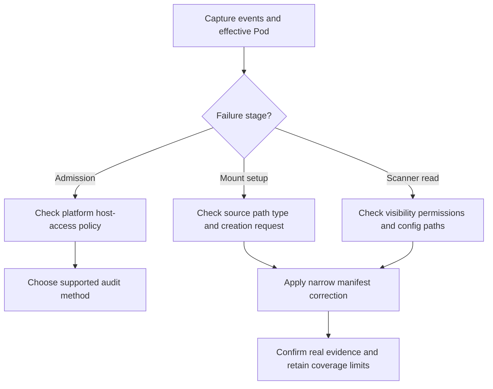

# Fix kube-bench HostPath Failures on Read-Only Nodes

Author: [nawazdhandala](https://www.github.com/nawazdhandala)

Tags: Kubernetes, Security, Troubleshooting

Description: Diagnose kube-bench host-path failures without creating fake evidence, weakening node permissions, or assuming managed platforms allow host inspection.

A kube-bench Pod can be assigned to the correct node and still fail before the scanner starts. Its host directories may not exist, a requested directory creation may hit a read-only filesystem, or the platform may prohibit host access entirely.

These failures are different from a benchmark finding. Until the scanner can read the intended host evidence, a missing report says nothing about the node's compliance. Repair the access path without modifying the configuration you are trying to audit.

This guide uses kube-bench **v0.14.0** manifests and Kubernetes **1.34** API behavior. The examples focus on Linux worker nodes with a conventional kubelet layout. Distribution-specific and managed-node layouts require checking the platform's documented paths and access rules first.

## Identify where the failure occurs

Inspect the Job and Pod separately. Replace the example names with your audit's objects:

```bash
kubectl describe job kube-bench-node -n security-audit
kubectl get pods -n security-audit -o wide
kubectl describe pod REPLACE_WITH_POD_NAME -n security-audit
kubectl get pod REPLACE_WITH_POD_NAME -n security-audit -o json > failed-pod.json
```

No Pod plus a `FailedCreate` event usually points to admission or another creation-time restriction. An assigned Pod reporting `FailedMount` points to volume setup. A running container reporting permission errors has progressed further: the mount may exist, but the scanner cannot read the required evidence. Use the actual event text and container state, as described in [Kubernetes Pod debugging](https://kubernetes.io/docs/tasks/debug/debug-application/debug-running-pod/).

Record the node name, volume name, source path, and exact error. A message about `/var/lib/kubelet` is not interchangeable with one about `/etc/kubernetes`, even if both appear in the same template.



## Compare the host path with the container path

A `hostPath.path` is a location on the node. A `volumeMount.mountPath` is the location visible to the container. The two need not be identical, but kube-bench's configuration must refer to the location that the container can actually read.

Inspect both sides of the saved Pod:

```bash
jq '.spec.volumes[] | select(.hostPath != null) |
    {name, hostPath}' failed-pod.json
jq '.spec.containers[] | {name, volumeMounts}' failed-pod.json
```

The [tagged kube-bench node Job](https://github.com/aquasecurity/kube-bench/blob/v0.14.0/job-node.yaml) supplies several read-only mounts. Those are examples for supported layouts, not evidence that every node has every directory. Its optional host-binary mount supports version detection; the source comment explains when an explicit version removes that need.

The [v0.14.0 configuration](https://github.com/aquasecurity/kube-bench/blob/v0.14.0/cfg/config.yaml) lists candidate kubelet configuration, service, kubeconfig, and CA paths. Compare those candidates with the node's real installation. A bind mount at a convenient but different container path will not automatically update every configured or process-discovered reference.

Use your approved node inspection channel to confirm paths. For example, on the actual Linux node, these shell checks distinguish an existing directory from a missing or different object:

```bash
for path in /var/lib/kubelet /etc/kubernetes /etc/systemd; do
  if test -d "$path"; then
    printf 'Directory exists: %s\n' "$path"
  else
    printf 'Missing or not a directory: %s\n' "$path"
  fi
done
```

This does not prove that the scanner's identity can read every file. It also must not be run in an ordinary container and mistaken for a host inventory. If the platform does not offer an authorized node-inspection method, record that boundary instead of inventing evidence.

## Separate read-only mounting from path creation

Two settings control different behavior:

| Setting | Meaning |
|---|---|
| `volumeMounts[].readOnly: true` | Requests read-only access through that container mount |
| `hostPath.type: Directory` | Requires an existing directory at the source path |
| `hostPath.type: DirectoryOrCreate` | Allows kubelet to create a missing source directory |
| `hostPath.type: File` | Requires an existing file rather than a directory |

A read-only container mount does not prevent kubelet's earlier `DirectoryOrCreate` request from attempting a host write. On an immutable node that write can fail. Conversely, reading an existing directory does not inherently require changing the node filesystem. Kubernetes documents these [hostPath type semantics](https://kubernetes.io/docs/concepts/storage/volumes/#hostpath).

For a confirmed existing kubelet directory, the relevant fragment in the Pod template is:

```yaml
volumes:
  - name: var-lib-kubelet
    hostPath:
      path: /var/lib/kubelet
      type: Directory
containers:
  - name: kube-bench
    volumeMounts:
      - name: var-lib-kubelet
        mountPath: /var/lib/kubelet
        readOnly: true
```

This is a fragment to merge into the reviewed Job, not a complete runnable Pod. Preserve the existing image, command, remaining required mounts, and scheduling settings. It makes the directory requirement explicit; it does not repair a directory that is genuinely absent.

Do not create an empty `/var/lib/kubelet` merely to satisfy the mount. The scanner needs the real configuration and ownership information. Similarly, changing a file mount to `DirectoryOrCreate` can replace a useful type error with misleading empty input.

## Keep corrections narrow

A typical repair is to correct a source-path typo, use the distribution's actual path, or remove a mount that the selected checks genuinely do not use. Removing required evidence just to start the container leaves an incomplete audit. Keep an explicit mapping of checks to the files and processes they inspect.

If a container starts but reading fails, inspect its effective user, file permissions, and applicable security controls. A host file can legitimately be readable only by an approved privileged inspection identity. Do not make kubelet credentials world-readable or recursively change host ownership to accommodate the scanner. Arrange the sanctioned audit identity and policy instead.

Read-only mounts still expose their contents. Keep mounts narrow and avoid exposing unrelated credentials. Also, ordinary read-only mounts are not recursively read-only for nested mounts on Linux; Kubernetes documents that distinction in its [read-only mount guidance](https://kubernetes.io/docs/concepts/storage/volumes/#read-only-mounts). Do not describe `readOnly: true` as complete isolation from every host risk.

If only report output needs a writable location, send output to logs or a separately reviewed workload volume. That is not a reason to make host configuration directories writable.

## Recognize managed-platform limits

A generic kube-bench manifest is not portable to every managed execution mode. For example, ordinary GKE Autopilot workloads are restricted to read-only `/var/log` host-path access; kubelet and Kubernetes configuration mounts fall outside that default permission. See [Autopilot security measures](https://docs.cloud.google.com/kubernetes-engine/docs/concepts/autopilot-security).

Where a provider offers an approved privileged-workload allowlist process, eligibility and exact workload matching still matter. An [Autopilot workload allowlist](https://docs.cloud.google.com/kubernetes-engine/docs/how-to/autopilot-privileged-allowlists) is a separate reviewed platform capability, not an automatic exemption obtained by setting the container's privileged flag.

Choose a provider-supported assessment route when direct node inspection is unavailable. Separate evidence you can collect from provider-owned control-plane or host checks you cannot execute. API-level policy checks can supplement that evidence, but do not replace filesystem checks while retaining the same coverage claim.

## Verify the corrected run

Create a separately named reviewed Job so the original failure evidence remains available. A server dry run can validate the manifest, but it does not inspect directories on the future node. The local API checks for this article likewise cannot establish mount success.

After scheduling, confirm that the container starts, the expected files are visible to the scanner, and the selected checks produce meaningful output. Save the effective Pod, node identity, image reference, benchmark configuration, events, and report. A started Pod with missing configuration warnings is not equivalent to a completed assessment.

The repair is complete when the scanner reads the intended host evidence under an approved access model. If that access is unavailable, the accurate result is a documented coverage limitation rather than an empty directory and an apparently successful Job.
