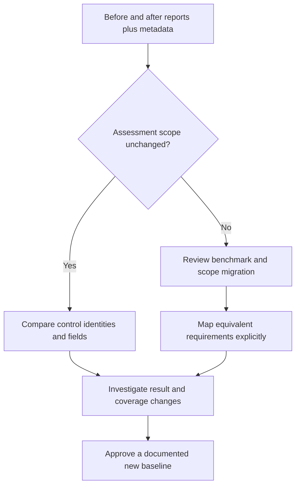

# Track kube-bench JSON Drift Across Cluster Releases

Author: [nawazdhandala](https://www.github.com/nawazdhandala)

Tags: Kubernetes, Security, Compliance

Description: Compare kube-bench reports by control identity, preserve node and benchmark context, and separate real security drift from changed assessment coverage.

A cluster upgrade changes more than its Kubernetes version. Node images, kubelet defaults, file locations, and the applicable security benchmark can change too. If yesterday’s kube-bench report has ten failures and today’s has eight, that difference alone does not prove an improvement. Two controls might simply be absent from the new assessment.

Useful drift tracking compares individual controls and coverage, with enough context to explain why the reports are comparable. “Drift” means a change from the recorded baseline; deciding whether that change is a regression requires reviewing the evidence.

This tutorial uses the **kube-bench v0.14.0** JSON schema and Python 3. The parser was exercised with locally generated synthetic reports and modified fixtures. It does not claim findings from an upgraded cluster.

## Preserve the report and its provenance

Save the unmodified JSON, stderr log, and process status for each assessment. Store a separate metadata record containing the cluster identity, node name and UID, node pool, operating-system image, Kubernetes version, scanner version or image digest, benchmark selection, configuration revision, timestamp, and filters or exceptions.

The node UID matters during rolling replacement: a familiar node name does not guarantee that it represents the same machine. When comparing a replacement node with its predecessor, label the relationship explicitly. Pool-level comparisons should also report how many expected nodes were actually assessed.

Do not rely on the JSON to provide all of this metadata. Its [control structure](https://github.com/aquasecurity/kube-bench/blob/v0.14.0/check/controls.go) includes fields such as `version`, `detected_version`, and `node_type`, but it is not a complete provenance envelope. Record the selected benchmark directory separately rather than assuming the reported version string uniquely identifies every distribution-specific profile.

## Use a stable JSON format

By default, v0.14.0 returns an object with `Controls` and `Totals`. Each control set contains `tests`, and each group contains `results`. Individual result records include `test_number`, `status`, `test_desc`, `scored`, `type`, `actual_value`, and `expected_result`.

The `--nototals` option changes the root to an array. Pick one format and reject the other in your parser rather than silently accepting an unexpected shape. The [JSON writer](https://github.com/aquasecurity/kube-bench/blob/v0.14.0/cmd/common.go) defines the two forms.

For an approved node assessment, a capture command looks like this:

```bash
bundle_dir="$PWD"
scanner_status=0
./kube-bench run --benchmark cis-1.11 --targets node \
  --config "$bundle_dir/cfg/config.yaml" \
  --config-dir "$bundle_dir/cfg" --json --exit-code 3 \
  > after.json 2> after.log || scanner_status=$?
printf '%s\n' "$scanner_status" > after-exit.txt
```

This performs a real scan and assumes the matching binary and configuration tree are in the current directory. Use the benchmark approved for your distribution, with the same host visibility as the baseline. A parseable report does not prove that all expected nodes or controls were inspected.

## Compare identities before comparing counts

The following helper compares two default-format reports for one reviewed node scope. Save it as `compare-reports.py`, and use it only after checking their external metadata for compatible scanner, benchmark, configuration, and selection settings:

```python
import json
import sys

FIELDS = ("status", "type", "scored", "test_desc", "expected_result")

def load_report(path):
    with open(path, encoding="utf-8") as handle:
        report = json.load(handle)
    if not isinstance(report, dict) or not isinstance(report.get("Controls"), list):
        raise ValueError("Expected default Controls/Totals JSON object")
    rows = {}
    scopes = set()
    for control in report["Controls"]:
        scope = (control["version"], control["node_type"])
        scopes.add(scope)
        for group in control.get("tests") or []:
            for item in group.get("results") or []:
                key = scope + (item["test_number"],)
                if key in rows:
                    raise ValueError("Duplicate control identity: " + str(key))
                if item["status"] not in {"PASS", "FAIL", "WARN", "INFO"}:
                    raise ValueError("Unknown status: " + item["status"])
                rows[key] = item
    if not rows:
        raise ValueError("No result records; investigate missing coverage")
    return scopes, rows

old_scope, old = load_report(sys.argv[1])
new_scope, new = load_report(sys.argv[2])
if old_scope != new_scope:
    raise ValueError("Target or benchmark version changed; review scope first")
changes = []
for key in sorted(old.keys() | new.keys()):
    identity = dict(zip(("version", "target", "check"), key))
    if key not in old:
        changes.append({**identity, "change": "added", "after": new[key]["status"]})
    elif key not in new:
        changes.append({**identity, "change": "missing", "before": old[key]["status"]})
    else:
        delta = {field: {"before": old[key].get(field), "after": new[key].get(field)}
                 for field in FIELDS if old[key].get(field) != new[key].get(field)}
        if delta:
            changes.append({**identity, "change": "modified", "fields": delta})
print(json.dumps(changes, indent=2))
```

Run it with the retained baseline and new report:

```bash
python3 compare-reports.py before.json after.json > drift.json
```

An empty output array means no changes in the fields this helper compares. It does not mean the whole cluster is compliant or that underlying observed values are identical. The script reports changes without assigning severity or automatically failing a release.

The helper intentionally rejects changed target/version scopes. It also rejects duplicate identities, which can indicate that reports from multiple nodes were combined without preserving node context. Keep one node per comparison or add node identity explicitly to the key.

## Interpret transitions using the original evidence

| Observed change | Initial interpretation |
|---|---|
| PASS to FAIL | Possible regression; inspect observed values and collection errors |
| FAIL to PASS | Possible remediation; verify unchanged assessment meaning |
| PASS or FAIL to INFO | Check skip configuration and exception decisions |
| PASS or FAIL to WARN | Investigate manual assessment, execution, or scoring changes |
| Control missing | Lost coverage or changed selection until explained |
| Control added | Newly covered requirement, not automatically new insecurity |

Retrieve `reason`, `actual_value`, and remediation details from the original reports when investigating a transition. A permission error or missing host mount can change a result without a corresponding change to the node’s intended security setting.

Do not hash the JSON result and call that a complete control-definition fingerprint. The [check structure](https://github.com/aquasecurity/kube-bench/blob/v0.14.0/check/check.go) excludes its `Tests` definition from JSON serialization. Preserve the source YAML and configuration revision if you need to establish that the automated test itself stayed the same.

## Handle benchmark changes as an assessment migration

When an upgrade requires a new benchmark, first compare the control definitions. Build a reviewed mapping for requirements that remain equivalent. Mark renamed, split, merged, added, and removed requirements explicitly. A matching numeric ID is insufficient evidence of equivalence.

The bundled [version and target mappings](https://github.com/aquasecurity/kube-bench/blob/v0.14.0/cfg/config.yaml) help select profiles, but they are not a semantic migration map between benchmark editions. Record why the new profile applies to the upgraded distribution.



After review, retain both assessments and the mapping rather than overwriting history. Report automated failures, unresolved manual checks, exceptions, missing controls, and node coverage separately. This gives the release review a concrete explanation of what changed, what improved, and what still lacks evidence.
