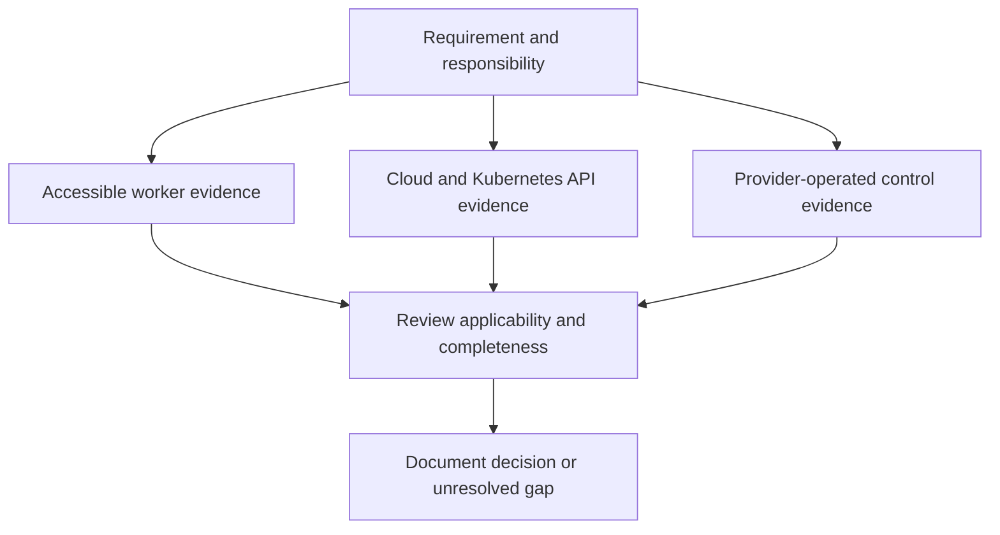

# Audit Managed Kubernetes Beyond kube-bench Control-Plane Access

Author: [nawazdhandala](https://www.github.com/nawazdhandala)

Tags: Kubernetes, Security, Compliance

Description: Combine kube-bench worker assessments, cloud configuration evidence, and provider attestations without mistaking an inaccessible control plane for a passing scan.

On a managed Kubernetes service, a worker Pod cannot normally inspect the provider’s control-plane filesystem. Giving that Pod more host mounts or a broader Kubernetes role does not make the provider’s API-server manifest appear on the worker.

The right response is to change the evidence plan. Assess the infrastructure you can inspect, collect cloud and Kubernetes API evidence for customer-controlled settings, and obtain provider evidence for provider-operated controls. Record gaps explicitly rather than converting inaccessible checks into passes.

This guide uses **kube-bench v0.14.0** and its `eks-1.7.0` profile to illustrate that boundary. The profile must still be approved for your EKS version and assessment. The principles apply to other managed services, but their responsibility splits and benchmark mappings differ.

## Separate ownership from visibility

AWS’s [EKS shared-responsibility guidance](https://docs.aws.amazon.com/eks/latest/best-practices/security.html) assigns management of the Kubernetes control plane, including its nodes and etcd database, to AWS. Customers retain responsibilities such as identity, workload security, and many network settings. Worker responsibilities also vary between self-managed nodes, managed node groups, and serverless execution models.

Two questions therefore belong beside every requirement: who controls the setting, and where can the assessor obtain evidence? A requirement can remain relevant even when the scanner cannot read its underlying configuration file.

| Assessment area | Typical evidence source | Boundary to record |
|---|---|---|
| Accessible worker configuration | kube-bench report and node-specific evidence | Covers only assessed nodes and applicable worker controls |
| Kubernetes permissions and workloads | Authorized Kubernetes API reads | Depends on complete read access and workload scope |
| Customer-selectable managed settings | Cloud API responses and operational verification | Configuration state alone may not prove delivery or effectiveness |
| Provider-operated control-plane internals | Provider documentation, attestations, or support evidence | Confirm service, benchmark, version, and evidence date |

Do not apply a provider’s statement to a different service tier or cluster version. Microsoft’s [AKS benchmark guidance](https://learn.microsoft.com/en-us/azure/aks/cis-kubernetes), for example, distinguishes not-applicable, environment-dependent, and equivalent-control results. Those categories need documented reasoning; they are not interchangeable with an automated PASS.

## Inspect what the selected profile actually contains

A target named `master` does not guarantee that the selected profile runs host-level control-plane checks. In v0.14.0, the EKS profile’s [master file](https://github.com/aquasecurity/kube-bench/blob/v0.14.0/cfg/eks-1.7.0/master.yaml) contains no check groups. Its [controlplane file](https://github.com/aquasecurity/kube-bench/blob/v0.14.0/cfg/eks-1.7.0/controlplane.yaml) contains two manual logging checks.

Consequently, a zero-failure result from the first target does not establish anything about API-server file permissions. The second target directs an assessor to gather logging evidence; it does not automatically verify the provider’s logging configuration.

Local executions using the pinned binary confirmed zero result records for `master` and two WARN records for `controlplane`. These invocations did not inspect a real cluster. They demonstrate the profile’s assessment coverage, not the security of any EKS installation.

## Run the accessible worker assessment with explicit scope

For an authorized scanner environment on an applicable EKS worker, capture the node target separately:

```bash
bundle_dir="$PWD"
scan_status=0
./kube-bench run --benchmark eks-1.7.0 --targets node \
  --config "$bundle_dir/cfg/config.yaml" \
  --config-dir "$bundle_dir/cfg" --json --exit-code 3 \
  > worker-report.json 2> worker-scan.log || scan_status=$?
printf 'Worker assessment exit: %s\n' "$scan_status"
```

This is a real scan command. It assumes the matching binary and configuration tree are in the current directory, and the scanner has approved visibility into the intended worker. Use the appropriate containerized adaptation if scanning through a Job.

Record node name, UID, node-group membership, image version, and assessment time alongside the report. Reconcile results against the expected worker inventory. A successful scan on one convenient node says nothing about an unscanned node group or a replacement node with a different image.

If the service prevents host-level inspection, record that limitation and use the provider-supported assessment path. Do not bypass its isolation model to recreate a self-managed-node workflow.

## Gather cloud configuration evidence without changing it

For EKS, an authorized AWS CLI profile with `eks:DescribeCluster` can capture the cluster’s current configuration. Replace the profile, Region, and cluster name:

```bash
set -euo pipefail
aws --profile audit-reader --region us-east-1 eks describe-cluster \
  --name REPLACE_WITH_CLUSTER_NAME --output json --no-cli-pager \
  > eks-cluster.json
jq '.cluster | {
  arn, version, platformVersion,
  endpointPublicAccess: .resourcesVpcConfig.endpointPublicAccess,
  endpointPrivateAccess: .resourcesVpcConfig.endpointPrivateAccess,
  publicAccessCidrs: .resourcesVpcConfig.publicAccessCidrs,
  logging: .logging.clusterLogging
}' eks-cluster.json
```

The [describe-cluster reference](https://docs.aws.amazon.com/cli/latest/reference/eks/describe-cluster.html) defines these returned fields. Keep the full response as evidence; the jq projection is a readable review view. This operation does not change endpoint access or enable logging.

For a logging requirement, inspect which log types are enabled and then verify the expected records reach the destination with the required access and retention. AWS’s [control-plane logging documentation](https://docs.aws.amazon.com/eks/latest/userguide/control-plane-logs.html) describes API, audit, authenticator, controller-manager, and scheduler logs and notes that delivery is best effort. An enabled flag alone is not evidence of successful collection over the required period.

## Verify API visibility before trusting policy checks

Kubernetes policy checks may inspect objects such as role bindings through kubectl. Use a dedicated, reviewed read-only assessment identity and confirm that the actual reads succeed. For a role-binding review, use an authorized [kubectl get](https://kubernetes.io/docs/reference/kubectl/generated/kubectl_get/) request:

```bash
set -euo pipefail
kubectl --context REPLACE_WITH_AUDIT_CONTEXT \
  get clusterrolebindings -o json > clusterrolebindings.json
jq -e '.items | type == "array"' clusterrolebindings.json >/dev/null
```

Keep command errors and report validity separate from the policy conclusion. A forbidden read must not be interpreted as “no excessive bindings found.” This matters especially when a control’s shell command includes fallback output after an error; inspect the [pinned policy definitions](https://github.com/aquasecurity/kube-bench/blob/v0.14.0/cfg/eks-1.7.0/policies.yaml) before relying on a quiet result.

The example reads only cluster role bindings. It is not a complete authorization audit: namespace role bindings, aggregated roles, cloud identities, and workload access require their own scoped evidence.

## Assemble a reviewable assessment record

For each requirement, record its benchmark and ID, responsible party, evidence source, observed result, assessor decision, date, and remaining work. Link the raw worker report rather than rewriting it. Attach manual decisions and provider evidence as separate records.



If evidence is unavailable, leave the requirement unresolved with an owner and follow-up. If it is not applicable or implemented through an equivalent control, record the rationale and approval. Use a risk exception only when that is the actual decision; inability to inspect a provider host does not automatically constitute an accepted risk.

Present worker coverage, automated findings, manual assessments, provider evidence, and unresolved gaps separately. That gives reviewers an honest picture of the managed cluster without pretending that a worker-side scanner can see every part of the service.
