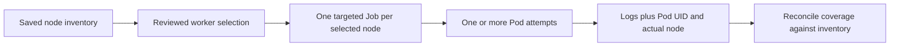

# Run kube-bench Per Node and Keep Results Attributable

Author: [nawazdhandala](https://www.github.com/nawazdhandala)

Tags: Kubernetes, Security, Compliance

Description: Create a finite kube-bench Job for each selected node, preserve Pod and node identities with the reports, and distinguish missing coverage from passing checks.

Applying the standard kube-bench Job once does not audit every node. It starts a workload that examines the host where Kubernetes schedules it. Increasing the Job's completion count does not guarantee that each completion lands on a different host.

For a finite audit, take a node inventory, create one targeted Job per selected node, and preserve every execution attempt with its actual node identity. This gives you an auditable coverage record instead of an anonymous collection of passing and failing checks.

Here, “once per node” means one intended Job per node in an inventory snapshot. Kubernetes does not promise exactly-once execution: even a Job with one completion and `restartPolicy: Never` can sometimes start the program twice. Keep duplicate attempts rather than silently replacing one report. See the [Kubernetes Job execution semantics](https://kubernetes.io/docs/concepts/workloads/controllers/job/).

## Define the scope before creating Jobs

This example uses kube-bench **v0.14.0**, ordinary Linux worker nodes running Kubernetes **1.32**, and benchmark **cis-1.11**. The tagged [version mapping](https://github.com/aquasecurity/kube-bench/blob/v0.14.0/cfg/config.yaml) maps Kubernetes 1.32 to that benchmark. It is a reproducible example, not a recommendation to select that benchmark for every distribution or to remain on that Kubernetes release.

CIS stands for the Center for Internet Security. Its benchmark defines configuration checks; selecting the correct benchmark is part of interpreting their results. This run uses the `node` target, so it does not establish control-plane or cluster-policy compliance. Managed control planes may not be accessible at all.

You need kubectl, jq, Python 3 with PyYAML, permission to read nodes and Pod logs, and permission to create Jobs in an approved `security-audit` namespace. The scanner uses the host process namespace and read-only host paths. Baseline and Restricted Pod Security policies reject these settings; arrange a narrowly scoped approved audit environment instead of weakening application namespaces. Review the [Pod Security restrictions](https://kubernetes.io/docs/reference/access-authn-authz/psp-to-pod-security-standards/).

## Freeze the node inventory

Use a fresh directory for each audit. Capture the complete node objects before choosing a subset:

```bash
kubectl get nodes -o json > nodes.json
kubectl config current-context > context.txt
jq -r '.items[] | [.metadata.name, .metadata.uid,
  .status.nodeInfo.kubeletVersion, .status.nodeInfo.architecture] | @tsv' nodes.json
```

Review this list and put the exact approved worker names into `selected-nodes.txt`, one per line. Exclude Windows nodes and nodes requiring another benchmark or filesystem layout. Save the selection alongside the full inventory. Node names are useful labels, but the node UID distinguishes a replacement node that reuses an old name.

A snapshot does not include nodes added later. Record those as outside this run and schedule a new audit if needed. Do not report them as compliant merely because every selected Job finished.



## Generate targeted Jobs from the pinned example

Download the upstream template for the same release:

```bash
curl -fsSLo job-node.yaml \
  https://raw.githubusercontent.com/aquasecurity/kube-bench/v0.14.0/job-node.yaml
```

The [tagged node Job](https://github.com/aquasecurity/kube-bench/blob/v0.14.0/job-node.yaml) documents the required host access. Its image uses `latest`, so the generator below replaces that with the release tag. It also limits mounts to the conventional worker paths used here. Confirm those paths exist and match your kubelet configuration before running it; customized distributions need their own mounts and configuration.

Save this as `prepare.py`:

```python
import copy
import json
from pathlib import Path
import yaml

nodes = json.loads(Path("nodes.json").read_text())["items"]
by_name = {node["metadata"]["name"]: node for node in nodes}
selected = Path("selected-nodes.txt").read_text().splitlines()
assert selected and len(selected) == len(set(selected))
base = yaml.safe_load(Path("job-node.yaml").read_text())
out = Path("jobs")
out.mkdir(exist_ok=False)
keep = {"var-lib-kubelet", "etc-kubernetes", "etc-systemd", "lib-systemd"}
for index, name in enumerate(selected):
    node = by_name[name]
    assert node["status"]["nodeInfo"]["operatingSystem"] == "linux"
    job = copy.deepcopy(base)
    job["metadata"] = {
        "name": f"kb-audit-{index:04d}", "namespace": "security-audit",
        "annotations": {"audit.example.com/node-uid": node["metadata"]["uid"]}}
    job["spec"].update(completions=1, parallelism=1, backoffLimit=0)
    pod = job["spec"]["template"]["spec"]
    pod["automountServiceAccountToken"] = False
    pod["affinity"] = {"nodeAffinity": {
        "requiredDuringSchedulingIgnoredDuringExecution": {
            "nodeSelectorTerms": [{"matchFields": [{
                "key": "metadata.name", "operator": "In", "values": [name]}]}]}}}
    container = pod["containers"][0]
    container["image"] = "docker.io/aquasec/kube-bench:v0.14.0"
    container["command"] = ["kube-bench", "run", "--targets", "node",
                            "--benchmark", "cis-1.11", "--json"]
    container["volumeMounts"] = [m for m in container["volumeMounts"]
                                  if m["name"] in keep]
    pod["volumes"] = [v for v in pod["volumes"] if v["name"] in keep]
    for volume in pod["volumes"]:
        volume["hostPath"]["type"] = "Directory"
    (out / f"{index:04d}.yaml").write_text(yaml.safe_dump(job, sort_keys=False))
```

Run `python3 prepare.py` and review the generated directory. Required node affinity restricts each Job to the named node while keeping normal scheduling checks. The same `metadata.name` matching form appears in the [Kubernetes DaemonSet documentation](https://kubernetes.io/docs/concepts/workloads/controllers/daemonset/).

The template retains `hostPID: true`, read-only mounts, and `restartPolicy: Never`. `backoffLimit: 0` avoids routine retries after a failed attempt. It does not guarantee exactly-once execution. `Directory` requires existing host paths instead of creating missing directories. No tolerations are added automatically: a tainted node can remain Pending and needs a deliberate scheduling decision.

The node-only checks in this example use host evidence rather than an in-Pod API credential. If you change targets or checks to require Kubernetes API access, revisit the service account and permissions. Pin an approved image digest as well when your artifact policy requires immutable references.

## Run and preserve all attempts

Use a fresh audit namespace or ensure the generated Job names do not already exist there. Validate against the target API before creating the workload:

```bash
kubectl apply --dry-run=server -f jobs/
kubectl create -f jobs/
kubectl get jobs,pods -n security-audit -o wide
```

A Job dry run validates the submitted Job; it does not prove that the controller's future Pods will pass admission or that node mounts will succeed. Inspect actual Pod events and states. Pending, rejected, and image-pull-failed scans are coverage failures, not benchmark passes.

After the attempts reach terminal states, archive the objects and retrieve logs per Pod:

```bash
mkdir evidence
kubectl get jobs -n security-audit -o json > evidence/jobs.json
kubectl get pods -n security-audit -o json > evidence/pods.json
jq -r '.items[].metadata.name' evidence/pods.json |
while IFS= read -r pod; do
  if ! kubectl logs -n security-audit "$pod" -c kube-bench \
      > "evidence/$pod.log" 2> "evidence/$pod.log-error"; then
    printf 'Log retrieval failed: %s\n' "$pod" >&2
  fi
done
```

This assumes the dedicated namespace contains only this audit's Jobs. Retain the inventory, selection, generated manifests, and context record with the evidence. Pod JSON preserves the actual `spec.nodeName`, Pod UID, Job owner, container image ID, and termination status. Compare the actual node with the intended affinity and resolve the node UID against the inventory.

Do not use timestamp or prefix options on logs you intend to parse as JSON. The [kubectl logs reference](https://kubernetes.io/docs/reference/kubectl/generated/kubectl_logs/) explains those options. Keep raw logs when diagnostic messages prevent parsing; do not silently discard lines until a report looks valid.

## Separate execution success from compliance

In v0.14.0, the [default failure exit code is zero](https://github.com/aquasecurity/kube-bench/blob/v0.14.0/cmd/root.go). A Completed Job therefore does not mean every check passed. Read the report's findings and manual-review items. Missing or malformed output remains an incomplete audit regardless of Pod phase.

Build a coverage table with one row per selected node and links to every Pod attempt. Mark duplicates, unavailable reports, and nonterminal Jobs explicitly. Retain artifacts outside the cluster before deleting the Jobs; Pod logs are not durable audit storage. A useful audit ends with explainable findings and complete node coverage, not just a screen full of Completed Pods.
