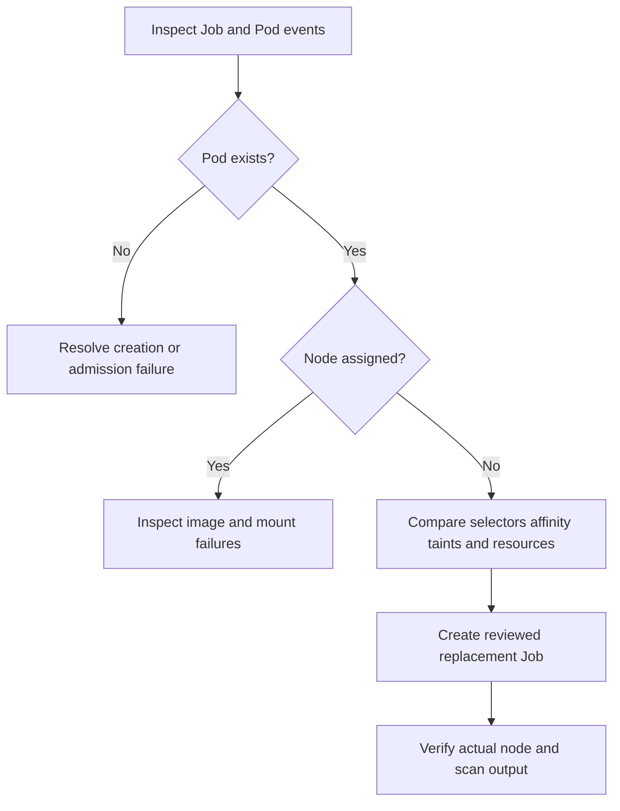

# Fix Pending kube-bench Jobs on Control-Plane Nodes

Author: [nawazdhandala](https://www.github.com/nawazdhandala)

Tags: Kubernetes, Security, Troubleshooting

Description: Diagnose unscheduled kube-bench Pods, correct control-plane label matching and taint tolerations, and preserve the evidence when creating a replacement Job.

A kube-bench Job exists, but its Pod stays Pending. Adding a toleration is a common response, yet it only fixes one possible barrier. The Pod might require a label that no node has, target an unavailable control plane, or already be assigned to a node and waiting for an image or mount.

Start with the actual Pod and scheduler events. Correct the requirement that prevents placement, then verify that the scanner runs on the intended host. Removing control-plane isolation from the whole cluster is unnecessary for a single audit workload.

This guide uses the kube-bench **v0.14.0** manifests and Kubernetes **1.34** scheduling behavior. It assumes a self-managed Linux control plane that permits an approved security audit. Provider-managed control planes generally cannot be made accessible by adding a selector to a Job in your workload cluster.

## Determine whether scheduling is the problem

Replace the namespace, Job name, and Pod name below with the actual objects:

```bash
kubectl describe job kube-bench-master -n security-audit
kubectl get pods -n security-audit \
  -l batch.kubernetes.io/job-name=kube-bench-master -o wide
kubectl describe pod REPLACE_WITH_POD_NAME -n security-audit
```

If there is no Pod, inspect Job events for `FailedCreate`, quota restrictions, admission rejection, or a missing service account. A selector does not fix an object that admission never allowed to exist.

If a Pod exists, examine its node assignment and `PodScheduled` condition. An empty node assignment with `FailedScheduling` events points toward scheduler constraints. An assigned Pod with `ImagePullBackOff`, `FailedMount`, or container configuration errors needs a different investigation. Pending is a broad lifecycle phase, not a precise diagnosis. Kubernetes' [Pod debugging guidance](https://kubernetes.io/docs/tasks/debug/debug-application/debug-running-pod/) explains how events reveal the failing stage.

Save the original Job and Pod YAML before editing. The effective Pod can contain settings injected by admission that were absent from the file you submitted.



## Inspect labels and taints separately

A label describes a node. A taint tells the scheduler to avoid placing workloads there unless they tolerate it. The strings may look similar, but they serve different purposes.

```bash
kubectl get nodes --show-labels
kubectl get node REPLACE_WITH_CONTROL_PLANE_NODE -o json |
  jq '{name: .metadata.name, labels: .metadata.labels,
       taints: .spec.taints, unschedulable: .spec.unschedulable}'
```

A kubeadm control-plane node commonly has an empty-valued label, `node-role.kubernetes.io/control-plane: ""`, and a `NoSchedule` taint with the same key. Kubernetes documents this in [kubeadm's control-plane initialization](https://kubernetes.io/docs/reference/setup-tools/kubeadm/implementation-details/).

A selector requiring the value `"true"` will not match that empty value. Likewise, a manifest requiring the legacy `node-role.kubernetes.io/master` label may match no nodes in a newer cluster. Inspect real labels rather than translating the ROLES column into an assumed key/value pair. The [well-known labels and taints reference](https://kubernetes.io/docs/reference/labels-annotations-taints/) describes the current control-plane marker and deprecated master taint.

Do not add a control-plane label to an ordinary worker merely to satisfy the audit Pod. It changes placement metadata without giving that worker the API server processes and configuration that the checks need.

## Match either role marker, then tolerate only its scheduling taint

The tagged [v0.14.0 master Job](https://github.com/aquasecurity/kube-bench/blob/v0.14.0/job-master.yaml) already handles both modern and legacy markers. If your copied or customized manifest lacks that logic, compare it with this scheduling fragment. Save the fragment as `scheduling.yaml`; it is not a standalone Kubernetes resource:

```yaml
nodeSelector:
  kubernetes.io/os: linux
affinity:
  nodeAffinity:
    requiredDuringSchedulingIgnoredDuringExecution:
      nodeSelectorTerms:
        - matchExpressions:
            - key: node-role.kubernetes.io/control-plane
              operator: Exists
        - matchExpressions:
            - key: node-role.kubernetes.io/master
              operator: Exists
tolerations:
  - key: node-role.kubernetes.io/control-plane
    operator: Exists
    effect: NoSchedule
  - key: node-role.kubernetes.io/master
    operator: Exists
    effect: NoSchedule
```

The two terms mean “modern marker OR legacy marker.” Putting both expressions inside one term would require both labels. `Exists` handles the empty label value correctly. The Linux selector must also match because Kubernetes combines `nodeSelector` and required node affinity. See [node affinity matching rules](https://kubernetes.io/docs/concepts/scheduling-eviction/assign-pod-node/).

The tolerations allow the two specific role-related `NoSchedule` taints. They do not force placement on those nodes, tolerate every taint, or solve insufficient resources. A custom dedicated-node taint requires its own reviewed match. A `NoExecute` taint has additional eviction semantics; it is not matched by a toleration explicitly limited to `NoSchedule`. Kubernetes explains these distinctions in [taints and tolerations](https://kubernetes.io/docs/concepts/scheduling-eviction/taint-and-toleration/).

Avoid a keyless `Exists` toleration that accepts every taint. It can admit the scanner onto nodes intentionally excluded for other reasons. Also avoid using `spec.nodeName` to bypass the scheduler's `NoSchedule` handling.

## Create a replacement from a complete reviewed manifest

For a reproducible starting point, download the complete release manifest:

```bash
curl -fsSLo job-master.yaml \
  https://raw.githubusercontent.com/aquasecurity/kube-bench/v0.14.0/job-master.yaml
```

Review its host paths and privileges for your environment. Host PID access and host-path volumes require an approved audit policy; correct affinity does not make those settings acceptable to Restricted Pod Security admission. Managed platforms can prohibit them entirely. The [kube-bench running guide](https://github.com/aquasecurity/kube-bench/blob/v0.14.0/docs/running.md) describes the host access requirement.

With Python 3 and PyYAML available, combine the reviewed files:

```python
from pathlib import Path
import yaml

job = yaml.safe_load(Path("job-master.yaml").read_text())
scheduling = yaml.safe_load(Path("scheduling.yaml").read_text())
job["metadata"]["name"] = "kube-bench-control-plane-review"
job["metadata"]["namespace"] = "security-audit"
pod = job["spec"]["template"]["spec"]
pod.update(scheduling)
pod["containers"][0]["image"] = "docker.io/aquasec/kube-bench:v0.14.0"
job["spec"]["backoffLimit"] = 0
Path("reviewed-job.yaml").write_text(yaml.safe_dump(job, sort_keys=False))
```

This uses a new Job name and pins the image that the upstream example otherwise labels `latest`. It retains the upstream command, host mounts, and restart policy. Before using this approach with your customized manifest, preserve any additional approved placement restrictions; replacing a selector must not discard a required zone or dedicated-node boundary.

Run a server dry run, then create the new Job during the approved audit window:

```bash
kubectl apply --dry-run=server -f reviewed-job.yaml
kubectl create -f reviewed-job.yaml
```

Ordinary existing Job templates cannot simply be rewritten. Kubernetes has limited mutable scheduling rules for suspended Jobs, but those are not a general repair mechanism for a Job that has already started. The [Job documentation](https://kubernetes.io/docs/concepts/workloads/controllers/job/) describes the version-dependent exceptions. A fresh named Job also keeps the previous attempt's evidence distinct.

## Verify placement before interpreting findings

Check the replacement Pod's actual node and events. If it remains unscheduled, inspect the remaining reason: cordon state, resource requests, another taint, scheduling gates, or an admission-injected constraint. Do not keep expanding tolerations when the event describes something else.

A successful placement only proves that the scheduler found an eligible node. Verify container startup, host access, benchmark selection, and useful scan output next. A single Job may choose any eligible control-plane node; it does not audit every control-plane host. Retain node-attributed results and run separate targeted Jobs when complete host coverage is required.

Archive the original failure evidence and the replacement result before removing obsolete audit Jobs. That record shows both why the scan was blocked and why the replacement's findings belong to the intended control-plane environment.
