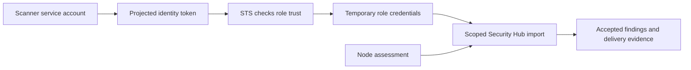

# Send kube-bench Findings to Security Hub with Scoped IRSA

Author: [nawazdhandala](https://www.github.com/nawazdhandala)

Tags: Kubernetes, AWS, Security

Description: Connect kube-bench to AWS Security Hub using a dedicated service-account role, scoped import permissions, node attribution, and explicit delivery checks.

Sending a kube-bench report to AWS Security Hub involves two separate successes: the scanner must produce meaningful findings, and AWS must accept them. A completed Pod alone does not establish either outcome.

This guide uses **kube-bench v0.14.0** on Amazon EKS, with IAM roles for service accounts, or **IRSA**. IRSA lets a Pod exchange its service-account identity for temporary AWS credentials. The scanner does not need static access keys or publishing permissions on the node’s IAM role.

The examples use illustrative account `123456789012`, Region `us-east-1`, namespace `security-audit`, and service account `kube-bench`. Replace these with your approved values. Local validation covered configuration and source-level behavior; no AWS account was accessed or findings submitted.

## Enable the integration in the receiving account

Enable Security Hub CSPM in the intended account and Region, then enable the kube-bench partner integration to accept findings. This is separate from granting IAM permission to the Pod. AWS documents that disabled service or provider integration can produce `InvalidAccess` entries in the import response’s failed-findings list. See [provider import prerequisites](https://docs.aws.amazon.com/securityhub/latest/userguide/finding-update-batchimportfindings.html).

Keep the configured finding account, the assumed role’s account, the EKS cluster ARN, and the receiving Region consistent. An ARN is an Amazon Resource Name identifying a particular AWS resource. Copy the real cluster ARN from verified inventory rather than constructing one from an uncertain name.

The kube-bench [integration guide](https://github.com/aquasecurity/kube-bench/blob/v0.14.0/docs/asff.md) describes `--asff`, which sends AWS Security Finding Format records. This is a delivery mode, not simply a flag that prints an offline JSON report.

## Scope the publishing permission

Attach a dedicated policy to the scanner’s IAM role. For the customer-hosted integration pattern, scope it to the enabled product subscription:

```json
{
  "Version": "2012-10-17",
  "Statement": [{
    "Effect": "Allow",
    "Action": "securityhub:BatchImportFindings",
    "Resource": "arn:aws:securityhub:us-east-1:123456789012:product-subscription/aqua-security/kube-bench"
  }]
}
```

Confirm the subscription ARN in the receiving account. This follows AWS’s [customer-hosted integration permissions](https://docs.aws.amazon.com/securityhub/latest/partnerguide/integration-use-cases.html). The subscription ARN used for authorization differs from the product ARN placed in each finding. Avoid replacing the resource with `*` merely because those strings differ.

This role does not need permission to administer Security Hub, change standards, or modify other products’ findings. Provisioning the integration is an administrator’s separate action; the runtime role only imports this product’s findings.

## Bind the role to one service account

The cluster must have an IAM OpenID Connect provider configured for IRSA. Its issuer identity appears in the role trust policy. Restrict both the token audience and subject, following AWS’s [service-account role procedure](https://docs.aws.amazon.com/eks/latest/userguide/associate-service-account-role.html):

```json
{
  "Version": "2012-10-17",
  "Statement": [{
    "Effect": "Allow",
    "Principal": {
      "Federated": "arn:aws:iam::123456789012:oidc-provider/oidc.eks.us-east-1.amazonaws.com/id/REPLACE_WITH_ISSUER_ID"
    },
    "Action": "sts:AssumeRoleWithWebIdentity",
    "Condition": {
      "StringEquals": {
        "oidc.eks.us-east-1.amazonaws.com/id/REPLACE_WITH_ISSUER_ID:aud": "sts.amazonaws.com",
        "oidc.eks.us-east-1.amazonaws.com/id/REPLACE_WITH_ISSUER_ID:sub": "system:serviceaccount:security-audit:kube-bench"
      }
    }
  }]
}
```

The subject ties the role to the exact namespace and service-account name. Do not wildcard the namespace for convenience. Create the role through your normal infrastructure workflow, attach the scoped import policy, and annotate the Kubernetes service account, including the [regional STS endpoint setting](https://docs.aws.amazon.com/eks/latest/userguide/configure-sts-endpoint.html):

```yaml
apiVersion: v1
kind: ServiceAccount
metadata:
  name: kube-bench
  namespace: security-audit
  annotations:
    eks.amazonaws.com/role-arn: arn:aws:iam::123456789012:role/kube-bench-security-hub
    eks.amazonaws.com/sts-regional-endpoints: "true"
```

IRSA relies on the workload using the AWS SDK credential chain and injected token configuration. kube-bench v0.14.0 uses the AWS SDK for Go v2 default configuration loader in its [Security Hub client](https://github.com/aquasecurity/kube-bench/blob/v0.14.0/cmd/securityHub.go). Allow the EKS identity webhook to inject its projected token and AWS environment variables. Do not copy a no-token Pod template without verifying that IRSA’s token projection remains present.

## Configure the scanner without copying stale defaults

Begin with an already reviewed one-shot EKS node Job and its correct host mounts. The tagged upstream examples contain older benchmark selections and a `latest` image, so select an approved profile deliberately. This example uses the bundled `eks-1.7.0` profile only after confirming it applies to the assessment.

Merge the following fields into that Job’s Pod specification. This is a fragment, not a standalone object; preserve the validated host mounts, placement, and container settings:

```yaml
serviceAccountName: kube-bench
containers:
  - name: kube-bench
    image: docker.io/aquasec/kube-bench:v0.14.0
    command: [kube-bench]
    args: [run, --benchmark, eks-1.7.0, --targets, node, --asff, --exit-code, "3"]
    env:
      - name: KUBE_BENCH_AWS_ACCOUNT
        value: "123456789012"
      - name: KUBE_BENCH_AWS_REGION
        value: us-east-1
      - name: KUBE_BENCH_CLUSTER_ARN
        value: arn:aws:eks:us-east-1:123456789012:cluster/REPLACE_WITH_CLUSTER_NAME
      - name: KUBE_BENCH_NODE_NAME
        valueFrom:
          fieldRef:
            fieldPath: spec.nodeName
      - name: AWS_EC2_METADATA_DISABLED
        value: "true"
```

Set the Job namespace to `security-audit` so the service account resolves correctly. Merge container fields by name; replacing the entire container list would discard required mounts. Keep the runtime bounded and avoid automatic retries that obscure separate delivery attempts.

The `KUBE_BENCH_` prefix is intentional. The [configuration initialization](https://github.com/aquasecurity/kube-bench/blob/v0.14.0/cmd/root.go) enables prefixed environment lookup, and the [finding builder](https://github.com/aquasecurity/kube-bench/blob/v0.14.0/check/controls.go) reads these settings through that configuration layer. In this version, use `KUBE_BENCH_NODE_NAME` for node attribution rather than assuming the upstream example’s unprefixed `NODE_NAME` reaches that lookup.

[Disabling SDK EC2 metadata lookup](https://docs.aws.amazon.com/sdkref/latest/guide/feature-imds-credentials.html) helps reveal missing workload credentials instead of falling back to the node role. It is not a network security boundary. AWS’s [IRSA guidance](https://docs.aws.amazon.com/eks/latest/userguide/iam-roles-for-service-accounts.html) also recommends restricting access to instance metadata. The Pod needs working DNS and access to the intended STS and Security Hub endpoints through approved network paths.



## Verify identity and delivery independently

After creating a fresh rehearsal Job, inspect its admitted Pod for the intended service account, `AWS_ROLE_ARN`, `AWS_WEB_IDENTITY_TOKEN_FILE`, and projected token volume. Do not print the token itself. Confirm the workload’s role through an approved identity diagnostic or CloudTrail evidence, then verify findings arrive under the intended account, Region, cluster, and node.

In v0.14.0, only FAIL and WARN results become findings; PASS and INFO are omitted. A later clean scan therefore does not automatically close previous findings. Keep a separate reconciliation process for resolved findings and retain the raw assessment history.

Check import counts and error messages even when the process exits normally. The [publisher implementation](https://github.com/aquasecurity/kube-bench/blob/v0.14.0/internal/findings/publisher.go) records per-finding failures without necessarily returning an SDK error. `--exit-code 3` concerns failed controls and does not establish successful delivery.

There is also a release-specific batching limitation: v0.14.0 loops in steps of 100 but submits the full findings slice each time. AWS’s [BatchImportFindings API](https://docs.aws.amazon.com/securityhub/1.0/APIReference/API_BatchImportFindings.html) accepts at most 100 findings per request. Keep this pinned direct-publishing path within that bound; for larger assessments, use a verified corrected publisher or an independently reviewed exporter that chunks findings properly. Do not truncate findings to make an import succeed.

Local tests confirmed prefixed configuration, node attribution, FAIL/WARN selection, partial-failure handling, and the batching limitation using a local HTTP fixture. They did not test IAM authorization, EKS injection, or AWS delivery. Those checks remain necessary before enabling recurring publication.
