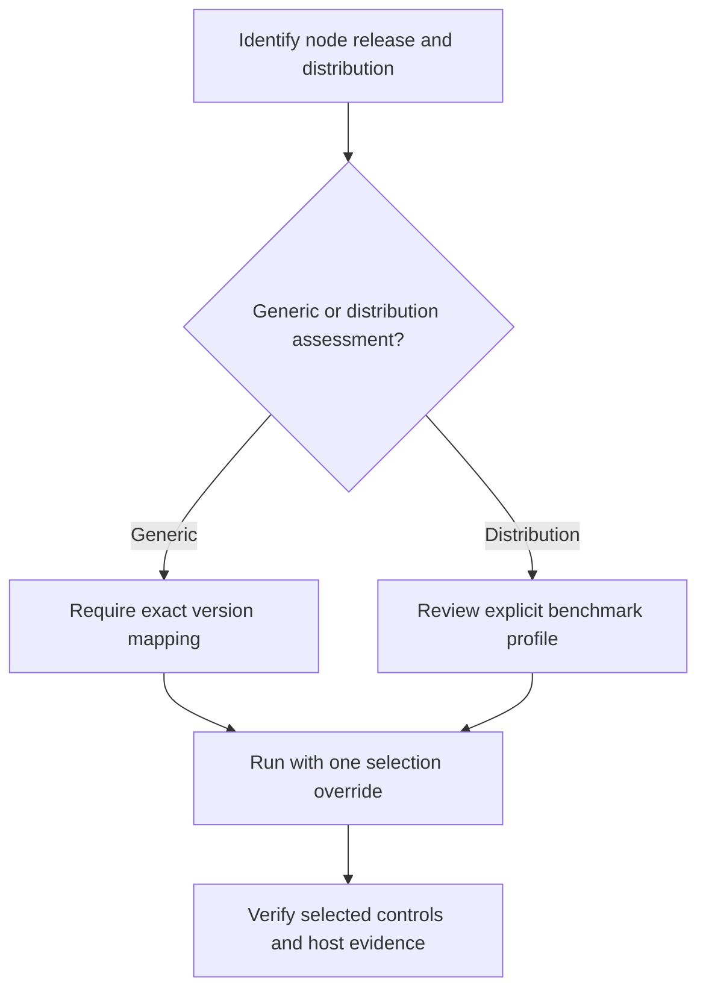

# Override kube-bench Version Detection Without Changing Scope

Author: [nawazdhandala](https://www.github.com/nawazdhandala)

Tags: Kubernetes, Security, Troubleshooting

Description: Override kube-bench version detection deliberately, check mapping fallbacks and environment precedence, and retain evidence of the benchmark actually selected.

A kube-bench container cannot locate kubelet or query the Kubernetes API, so its log suggests supplying a version. Adding `--version` can resolve benchmark selection, but the value must describe the system being assessed. It is not a switch that makes an incompatible profile appropriate.

There are two decisions: which Kubernetes version or distribution the assessment concerns, and which benchmark implements the agreed controls. Resolve both before treating a successful scan as evidence.

This guide pins **kube-bench v0.14.0**. Its selection behavior was checked in tagged source and with the official release binary. The concrete example concerns a conventional Kubernetes **1.32** Linux worker. Managed-service and distribution-specific profiles require a separate applicability decision.

## Separate the scanner version from the Kubernetes version

The `version` subcommand prints the kube-bench release:

```bash
./kube-bench version
```

For the pinned example, the expected output is `0.14.0`. In contrast, `--version 1.32` tells the scanner which Kubernetes version to use for benchmark selection. `--benchmark cis-1.11` directly selects a benchmark directory. These are not three spellings of the same setting.

The [v0.14.0 flag definitions](https://github.com/aquasecurity/kube-bench/blob/v0.14.0/cmd/root.go) document the selection options. The program rejects supplying both `--version` and `--benchmark` in one invocation. Choose one route and record why it fits the assessment.

## Determine what detection was trying to observe

Automatic detection can involve the API, local command-line tools, and distribution identification. In v0.14.0, the [discovery implementation](https://github.com/aquasecurity/kube-bench/blob/v0.14.0/cmd/util.go) tries several paths and can fall back to an assumed version when discovery fails. Treat a message about an assumed version as a coverage concern rather than a harmless startup detail.

A minimal container may lack kubelet and kubectl. A mounted host executable may be unusable because of its architecture or runtime dependencies. An API request can fail because the Pod lacks usable credentials or the endpoint is unreachable. These situations do not all require giving the scanner broad cluster permissions.

First obtain the intended node's version independently. From an authorized administration session:

```bash
kubectl get node REPLACE_WITH_NODE_NAME -o jsonpath='{.status.nodeInfo.kubeletVersion}{"\n"}'
kubectl version -o yaml
```

The first command reads the node's reported kubelet version; the second distinguishes client and server version information. Neither means the scanner is automatically examining that remote node's filesystem. Also record the node UID, distribution build, and image when preparing the audit.

During an upgrade, worker and server versions can differ. Decide which component's controls the run assesses and retain both versions. Do not use the workstation's kubectl client version as the worker's Kubernetes version.

## Check the exact mapping instead of guessing

The pinned [global configuration](https://github.com/aquasecurity/kube-bench/blob/v0.14.0/cfg/config.yaml) maps the plain minor `1.32` to `cis-1.11`. Use the exact supported mapping key, not a full decorated version string such as a vendor build suffix copied blindly from node output.

More subtly, v0.14.0 can decrement an unlisted version until it finds a mapping. In a local test, `--version 1.33` selected `cis-1.11` through that fallback even though the configuration has no direct `1.33` entry. This is implementation behavior, not proof of an approved assessment for Kubernetes 1.33. The [mapping function](https://github.com/aquasecurity/kube-bench/blob/v0.14.0/cmd/common.go) makes that distinction clear.

With Python 3 and PyYAML, check for an exact entry before deciding to run. Save this as `require-mapping.py`:

```python
import sys
from pathlib import Path
import yaml

root = Path(sys.argv[1]).resolve()
minor = sys.argv[2]
config = yaml.safe_load((root / "config.yaml").read_text())
mapping = config.get("version_mapping", {})
if minor not in mapping:
    raise SystemExit(f"No exact mapping for {minor}; review benchmark support")
benchmark = mapping[minor]
if not (root / benchmark / "node.yaml").is_file():
    raise SystemExit(f"Missing node controls for {benchmark}")
print(f"Exact mapping: {minor} -> {benchmark}")
```

Run it against the matching extracted configuration tree:

```bash
python3 require-mapping.py ./cfg 1.32
```

The expected result for v0.14.0 is `Exact mapping: 1.32 -> cis-1.11`. The helper intentionally rejects a missing key instead of reproducing the scanner's fallback. It checks the node target's file presence, not the correctness of every control or suitability for a managed distribution.

## Use a deliberate override for the intended target

Once the generic Kubernetes 1.32 worker assessment is approved, run from the complete bundle on the authorized target host:

```bash
bundle_dir="$PWD"
./kube-bench run --targets node --version 1.32 \
  --config "$bundle_dir/cfg/config.yaml" \
  --config-dir "$bundle_dir/cfg" --json
```

This is an actual scan. It assumes that the process can inspect the node's files and processes with the approved access. The override addresses benchmark selection; it does not add missing mounts, repair permissions, or turn workstation execution into a remote host audit.

For a distribution-specific assessment, use the reviewed benchmark identifier instead. For example, an EKS assessment explicitly approved against the bundled EKS 1.7.0 controls would replace `--version 1.32` with `--benchmark eks-1.7.0`. Do not infer that EKS selection solely from a plain Kubernetes minor.

The [selection logic](https://github.com/aquasecurity/kube-bench/blob/v0.14.0/cmd/common.go) uses platform-based selection when neither override is supplied. A numeric override can therefore change the path that would otherwise select distribution-specific controls. Preserve the profile decision, not just the command that happens to exit successfully.



## Inspect inherited environment settings

A service wrapper or scheduled job can supply a version through `KUBE_BENCH_VERSION`. In v0.14.0, an explicit command-line version takes precedence over that environment value. Inspect the one relevant setting without dumping the entire environment, which may contain unrelated secrets:

```bash
printf 'KUBE_BENCH_VERSION=%s\n' "${KUBE_BENCH_VERSION-<unset>}"
```

The behavior is implemented in [configuration initialization](https://github.com/aquasecurity/kube-bench/blob/v0.14.0/cmd/root.go). A locally reproduced test selected `cis-1.11` from environment value `1.32`, while an explicit `--version 1.28` selected `cis-1.10` despite that inherited value.

An inherited version can also conflict with a deliberate benchmark argument. Make the wrapper's intended configuration explicit and review its environment before rollout. Do not assume every setting named in a wrapper is recognized by kube-bench or that all flags have identical environment behavior.

Version overrides do not necessarily eliminate all discovery activity. The v0.14.0 command still obtains platform information before passing values into its selection function. Do not promise that adding the flag removes every API attempt, filesystem search, or discovery warning.

## Verify the selected assessment in the evidence

Retain the release, configuration checksum, selected benchmark, targets, node identity, and exact override. Read the report's benchmark information and startup diagnostics. A report that silently uses an older fallback should be reviewed before it enters a compliance dashboard.

If the intended benchmark is unavailable, obtain reviewed compatible controls or document the gap. Avoid rewriting the version map to point a new release at arbitrary older tests simply to make the error disappear.

Local validation for this article exercised explicit selection, fallback selection, conflicting flags, environment selection, and flag precedence using deliberately invalid targets that stopped before scans ran. The exact-mapping helper was also tested with accepted and rejected inputs. These checks establish selection behavior; no Linux node compliance result is claimed.
