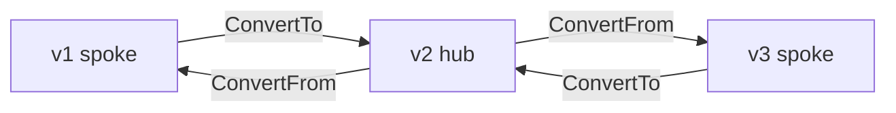

# Fix Multiple Conversion Hubs in Kubebuilder Webhooks

Author: [nawazdhandala](https://www.github.com/nawazdhandala)

Tags: Kubernetes, Kubebuilder, Troubleshooting

Description: Find duplicate conversion hubs in your manager scheme, repair version roles, and test the result without confusing hub selection with CRD storage versions.

You add a second API version, regenerate the project, and the manager refuses to configure conversion. Its error mentions multiple hubs for a group-kind. Changing the webhook certificate or CRD storage flag will not fix the underlying Go type configuration.

The useful question is: which registered versions of this resource implement the conversion hub interface? This guide answers that question with a small diagnostic helper, then checks the repaired arrangement using controller-runtime's own conversion check.

The examples and reproduction use controller-runtime **v0.22.1** and Go **1.25.0**. In that release, the reproduced error is `multiple(2) hubs defined for group-kind ''`. The empty group-kind in that message is a diagnostic limitation of this code path, not proof that your API group is empty. Inspect the registered types rather than relying on that field in the error. [Pinned conversion implementation](https://github.com/kubernetes-sigs/controller-runtime/blob/v0.22.1/pkg/webhook/conversion/conversion.go).

## Understand the three different version choices

A **group-kind** identifies a resource family, such as `platform.example.com/SyncTask`. Its versions might be `v1`, `v2`, and `v3`. A hub is the Go representation used as the common intermediate form for conversion. A spoke is another version that knows how to convert to and from that hub.

For a multiversion resource using controller-runtime's generic conversion handler, choose one hub per group-kind. Different resource kinds can have different hubs. The Go `Hub()` method marks the hub type; spoke types implement `ConvertTo` and `ConvertFrom`. [Conversion interfaces](https://github.com/kubernetes-sigs/controller-runtime/blob/v0.22.1/pkg/conversion/conversion.go).



Keep these settings separate:

| Setting | What it controls |
| --- | --- |
| Go `Hub()` method | The intermediate type selected by the conversion implementation |
| CRD version `storage: true` | The version used for newly persisted objects |
| CRD version `served: true` | Whether clients can request that API version |

A project commonly makes the hub its storage version, but these mechanisms are not the same switch. Changing `storage: true` does not remove a Go method. Existing stored objects also need a separate migration plan before removing an old version. [CRD versioning](https://kubernetes.io/docs/tasks/extend-kubernetes/custom-resources/custom-resource-definition-versioning/).

## Inventory the scheme used by the manager

A runtime scheme maps group-version-kind names to Go types. Use the same registration functions as the manager. A test that registers only the desired hub can accidentally hide the extra version causing production startup to fail.

First search your API packages for hub declarations. With ripgrep installed, run this from the repository root:

```bash
rg -n 'func .*Hub\(' api
```

Inspect matches for the affected kind, including files copied while adding another version. Also inspect embedded types: Go can promote an embedded type's methods, so an apparent spoke may satisfy the hub interface without a visibly declared `Hub()` method in its own file.

For a reliable view of compiled types, save this helper in a temporary diagnostic package named `hubcheck`. It creates each registered version of the requested group-kind and reports which interfaces it actually satisfies:

```go
package hubcheck

import (
	"fmt"
	"sort"

	"k8s.io/apimachinery/pkg/runtime"
	"k8s.io/apimachinery/pkg/runtime/schema"
	"sigs.k8s.io/controller-runtime/pkg/conversion"
)

// ConversionRoles reports the types registered for one group and kind.
func ConversionRoles(scheme *runtime.Scheme, group, kind string) ([]string, error) {
	var keys []schema.GroupVersionKind
	for gvk := range scheme.AllKnownTypes() {
		if gvk.Group == group && gvk.Kind == kind {
			keys = append(keys, gvk)
		}
	}
	sort.Slice(keys, func(i, j int) bool { return keys[i].Version < keys[j].Version })
	var lines []string
	for _, gvk := range keys {
		obj, err := scheme.New(gvk)
		if err != nil {
			return nil, err
		}
		_, hub := obj.(conversion.Hub)
		_, spoke := obj.(conversion.Convertible)
		lines = append(lines, fmt.Sprintf("%s: type=%T hub=%t convertible=%t",
			gvk.String(), obj, hub, spoke))
	}
	if len(lines) == 0 {
		return nil, fmt.Errorf("no registered types for %s/%s", group, kind)
	}
	return lines, nil
}
```

Call `ConversionRoles` after the manager's API registration functions have populated the scheme. Pass the API group and kind, not the plural resource name. For example, use `platform.example.com` and `SyncTask`, rather than `synctasks`.

The helper sorts versions for repeatable output. Two `hub=true` entries for the same group-kind identify the conflict. A type with both `hub=true` and `convertible=true` is still a hub for the controller-runtime check in this version; adding conversion methods does not cancel the hub marker.

In the local reproduction, two distinct fixture types registered as `v1/SyncTask` and `v2/SyncTask` both reported `hub=true`, and `IsConvertible` returned the multiple-hub error. Replacing the second fixture with a spoke made the same check succeed.

## Repair the roles without hiding a served version

Choose the hub based on the representation your conversion functions are designed to use. Do not simply retain whichever `Hub()` declaration appears first in a search. Review both directions of conversion and any fields that cannot be represented in an older version.

For example, if `api/v2.SyncTask` is the chosen hub, its marker can be this method in the `v2` package:

```go
func (*SyncTask) Hub() {}
```

Remove an accidentally copied hub method from the `v1` type. Then ensure `v1` implements both spoke methods against the chosen `v2` representation. The Kubebuilder tutorial explains the hub-and-spoke pattern and destination-object contract. [Implementing conversion](https://book.kubebuilder.io/multiversion-tutorial/conversion).

Do not remove `v1.AddToScheme` solely to make the error disappear if the webhook must still convert that version. That hides the type from the conversion machinery and can turn a startup failure into a failed read or write later. Likewise, changing the CRD to use no conversion is not a substitute for conversion logic when the schemas differ.

## Keep a small regression test

Add this assertion to a test after registering **all** of the resource's API versions in `scheme`. Here `platformv2` is your actual hub package; adjust the alias and import path to your project. Import the webhook package as `webhookconversion` to distinguish it from the interface package:

```go
ok, err := webhookconversion.IsConvertible(scheme, &platformv2.SyncTask{})
if err != nil {
    t.Fatalf("conversion registration is invalid: %v", err)
}
if !ok {
    t.Fatal("expected a multiversion hub-and-spoke resource")
}
```

The import is `sigs.k8s.io/controller-runtime/pkg/webhook/conversion`. Test the real registration sequence used at startup, including any shared scheme initialization. If a new API package is added later, this test should see it too.

This check establishes the shape of the conversion implementation. It does not prove that field mappings preserve data. Add separate round-trip cases with meaningful values, including metadata and fields introduced by newer versions. A spoke whose methods return success without copying anything can satisfy the interface check while destroying the object's meaning.

## Verify the deployed result in stages

After repairing the source, regenerate the normal project artifacts and run its tests. Inspect the generated CRD's served versions, storage choice, and conversion configuration independently. Rebuild and deploy the corrected manager image through your normal rollout process; ensure the running replicas actually use that image.

In a staging cluster, exercise reads and writes through each supported version and verify that the expected values survive conversion. Preserve an existing-object fixture as well as testing newly created objects. The scheme test catches duplicate hubs cheaply; the staging checks cover API-server routing, webhook reachability, certificates, and real conversion behavior.

The local checks for this article exercised the diagnostic helper and controller-runtime's registration check, including duplicate hubs, a corrected hub/spoke pair, and an absent group-kind. They did not exercise a deployed webhook or persisted-object migration. Those remain separate acceptance checks before releasing a version change.
