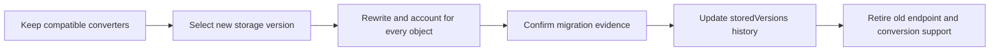

# Clear CRD storedVersions Only After Migrating Stored Objects

Author: [nawazdhandala](https://www.github.com/nawazdhandala)

Tags: Kubernetes, Kubebuilder, Troubleshooting

Description: Retire an old CRD version safely by separating object rewrites, storedVersions cleanup, client migration, and removal of conversion support.

You remove an old API version from your Kubebuilder project, regenerate the CRD, and Kubernetes rejects the update because that version still appears in `status.storedVersions`. Patching the status can remove the immediate error, but it does not rewrite a single custom resource.

Treat that field as a record that needs evidence before you change it. First migrate the stored objects. Then update the record. Finally retire the old served API and conversion support in a controlled release sequence.

This guide describes a manual migration workflow using Kubernetes **1.34** semantics. Its API behavior was checked with a local **1.34.0** envtest server. Production migration requires an inventory and recovery plan appropriate to your operator and cluster size.

## Separate storage, serving, and migration history

`spec.versions[].storage` selects the version used when objects are written. `served` controls which versioned endpoints clients can use. `status.storedVersions` records versions that have been used for storage; it is not a live count of objects remaining in each format.

Changing the storage version does not automatically rewrite existing objects. Reading through the new endpoint can return a converted object while leaving its stored representation unchanged. The manual upgrade procedure therefore includes listing and rewriting existing objects before removing an old stored-version entry. [Kubernetes 1.34 CRD versioning](https://v1-34.docs.kubernetes.io/docs/tasks/extend-kubernetes/custom-resources/custom-resource-definition-versioning/).



The final retirement includes migrating clients. You may test disabling an old endpoint earlier, but do not remove its schema or conversion support while old stored objects still need it.

## Capture the starting point

Use an explicitly selected staging context first. These examples assume a namespaced `SyncTask` resource, group `platform.example.com`, and migration from `v1` to `v2`. Replace those identifiers for your operator. You need kubectl, jq, and permissions to inspect the CRD and all affected custom resources.

```bash
CRD='synctasks.platform.example.com'
kubectl get crd "$CRD" -o json > crd-before.json
jq '{versions: [.spec.versions[] | {name, served, storage}],
     storedVersions: .status.storedVersions,
     conversion: .spec.conversion.strategy}' crd-before.json
```

Expect to see exactly one storage version. Save the current operator image reference, CRD manifests, conversion configuration, and an appropriate data backup. An API export is useful evidence, but is not automatically a complete cluster recovery backup.

In the Kubebuilder source, retain both API versions and a converter that understands both. Move the intended storage-version marker to the target type, regenerate manifests, and inspect the resulting CRD before applying it. Do not assume the generated file alone describes what is installed. [Kubebuilder CRD markers](https://book.kubebuilder.io/reference/markers/crd).

Deploy the compatible conversion implementation before introducing data that an older webhook replica cannot understand. Verify conversion reads and writes in both directions before beginning the rewrite phase.

## Rewrite objects with accountable progress

For a single staging object, this demonstrates the read-and-write operation after `v2` has become the installed storage version. It uses the explicit v2 endpoint, preserving the returned resource version for optimistic concurrency:

```bash
kubectl get --raw   '/apis/platform.example.com/v2/namespaces/migration-lab/synctasks/example'   > synctask-rewrite.json

kubectl replace --dry-run=server -f synctask-rewrite.json
```

The dry run asks the API server to evaluate the replacement without persisting it. Review the object and response. In the controlled staging exercise, perform the actual rewrite with:

```bash
kubectl replace -f synctask-rewrite.json
```

Do not add `--force`: that option deletes and recreates the resource. A conflict means the object changed after the read; fetch the current object and retry with bounded attempts instead of discarding its resource version. [kubectl replace reference](https://kubernetes.io/docs/reference/kubectl/generated/kubectl_replace/).

A production migration needs more than repeating this command by hand. Use a migration implementation that handles pagination, all namespaces or the resource's cluster scope, conflicts, transient failures, and objects deleted during the run. Record each object's UID and successful write outcome so a deleted and recreated object is not confused with its predecessor.

Coordinate the storage change across API-server instances before taking the migration inventory. Keep the target storage version stable throughout the run. Under that condition, new creations and concurrent successful writes use the target storage format. Account for every object in the migration inventory and investigate every unresolved failure before proceeding.

If your platform supplies a storage-version migration controller, use its version-specific completion contract instead. Its API and cleanup behavior vary across Kubernetes releases; do not copy a newer migration resource into a 1.34 cluster without checking support.

## Prepare a guarded status update

Only after the migration evidence is complete, fetch a fresh CRD. The following builds a JSON Patch that refuses to apply if the CRD changes after that fetch. It also checks that v2 is the sole storage version:

```bash
kubectl get crd "$CRD" -o json > crd-after-migration.json
jq --arg target v2 '
  if ([.spec.versions[] | select(.storage == true) | .name] != [$target])
  then error("target is not the sole storage version")
  else [
    {op: "test", path: "/metadata/resourceVersion",
     value: .metadata.resourceVersion},
    {op: "replace", path: "/status/storedVersions", value: [$target]}
  ] end
' crd-after-migration.json > stored-versions-patch.json

kubectl patch crd "$CRD" --subresource=status --type=json   --patch-file=stored-versions-patch.json --dry-run=server -o json
```

This example assumes every historical version has been migrated to v2. If another version still has unmigrated objects, stop; replacing the whole list would assert something you have not established. Never clear the list to empty.

The dry run checks whether the patch is accepted. It does not inspect the stored version of every custom resource or certify your migration. Once the migration record and dry-run result have been reviewed, apply the same patch:

```bash
kubectl patch crd "$CRD" --subresource=status --type=json   --patch-file=stored-versions-patch.json
```

If the resource-version test fails, reread the CRD and determine what changed before generating another patch. The status subresource is deliberate; updating ordinary CRD configuration is not the same operation. [kubectl patch reference](https://kubernetes.io/docs/reference/kubectl/generated/kubectl_patch/).

## Retire the old version without losing recovery options

Confirm the status now contains only the migrated storage version. Move remaining clients to v2, then disable serving v1 during a monitored release window. Investigate any clients that still call the old endpoint. Only after those checks should you remove v1 from `spec.versions` and later drop its conversion implementation.

Do not delete and recreate the CRD to bypass validation. Do not interpret a successful v2 GET as proof of storage migration: conversion can make that read succeed even when the stored object is older. Keep a rollback plan that understands the newly written format; reverting only the manager image may leave an older binary unable to decode or convert it.

The local test for this article created an object under v1 storage, switched to v2 storage, confirmed premature version removal was rejected, rewrote the object, and observed both entries still in storedVersions. After a guarded status patch, version removal and a v2 read succeeded. The fixture used identical schemas and `None` conversion. It did not test a production webhook, a multi-server rollout, or a full migration inventory, and did not inspect raw etcd bytes.
