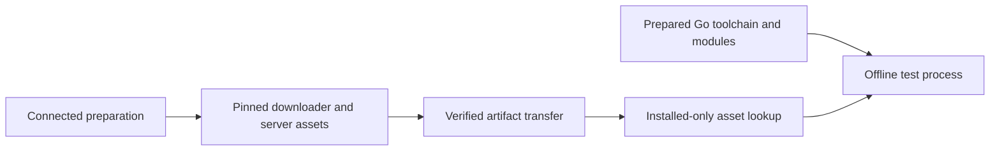

# Run Kubebuilder envtest in CI and Air-Gapped Builds

Author: [nawazdhandala](https://www.github.com/nawazdhandala)

Tags: Kubernetes, Kubebuilder, Testing, Air-Gapped

Description: Pin and package envtest binaries, restore them without downloads, and separate API-server assets from Go dependencies in reliable offline CI jobs.

A Kubebuilder test suite can compile successfully and still fail when it tries to start its API server. The Go dependencies are present, but `kube-apiserver` and etcd are missing. On a developer laptop, a download hides that dependency. On a restricted CI runner, it becomes the first visible failure.

Make the test environment an explicit artifact. Prepare the correct binaries while connected, transfer a verified package, and make the test job fail clearly if anything is missing. Keep the Go toolchain and module dependencies in the same plan, even though setup-envtest does not manage them.

## Pin the three independent inputs

This worked example uses Go **1.25.0**, a project with controller-runtime **0.22.1**, and Kubernetes envtest binaries **1.34.0**. The downloader is built from controller-runtime commit `7a1b16d039d204e7e4c5c8df57124d4e060a55f0`, the v0.22.4 repository revision. The downloader is a separate module; pinning it does not upgrade the application's controller-runtime dependency.

| Input | Why it needs its own record |
| --- | --- |
| Go toolchain and project modules | Compile the test and controller code |
| setup-envtest executable | Selects and manages binary assets |
| Kubernetes assets for an OS and architecture | Run the local API server and etcd |

Use a test Kubernetes version appropriate for your supported cluster versions. An exact patch pin makes a failing CI run reproducible. An unconstrained latest version or wildcard with a remote refresh can silently change the test environment. [setup-envtest documentation](https://github.com/kubernetes-sigs/controller-runtime/blob/v0.22.4/tools/setup-envtest/README.md).



## Prepare on the target platform

For the simplest workflow, use a connected preparation machine or build container with the same operating system and architecture as the disconnected runner. The local checks for this article used macOS arm64. A Linux amd64 runner needs Linux amd64 executables; copying the macOS package will not work.

Run the following in a dedicated preparation directory with Go installed and network access. The commands require a POSIX shell, tar, and `shasum` for the later transfer checksum:

```bash
mkdir -p offline-envtest/bin
GOBIN="$PWD/offline-envtest/bin" go install   sigs.k8s.io/controller-runtime/tools/setup-envtest@7a1b16d039d204e7e4c5c8df57124d4e060a55f0

go env GOOS GOARCH
./offline-envtest/bin/setup-envtest use   --bin-dir "$PWD/offline-envtest/assets" -p path 1.34.0
```

The last command downloads the native platform's assets and prints their directory. Keep the tool's default download verification enabled. Record the printed platform, downloader revision, Kubernetes version, and artifact checksum alongside the CI configuration.

The tool has `--os` and `--arch` selection flags for assets, but changing those flags does not transform the setup-envtest executable itself. If preparing cross-platform packages, supply a downloader executable built for the destination too. A same-platform preparation job avoids this extra moving part.

Package the entire dedicated store and downloader so directory metadata remains together:

```bash
tar -czf envtest-assets.tar.gz -C offline-envtest .
shasum -a 256 envtest-assets.tar.gz > envtest-assets.tar.gz.sha256
```

Give the uploaded artifact a versioned name containing the operating system and architecture. Transfer its checksum through your trusted artifact process. A checksum detects changed bytes only when the expected checksum is itself trustworthy.

## Restore without falling back to a download

On the destination, verify the received archive before extracting it. Use an empty destination for this package rather than merging it into an untracked collection of old binaries:

```bash
set -eu
shasum -a 256 -c envtest-assets.tar.gz.sha256
mkdir -p .ci/envtest
tar -xzf envtest-assets.tar.gz -C .ci/envtest

assets="$(./.ci/envtest/bin/setup-envtest use -i   --bin-dir "$PWD/.ci/envtest/assets" -p path 1.34.0)"
export KUBEBUILDER_ASSETS="$assets"
test -x "$KUBEBUILDER_ASSETS/kube-apiserver"
test -x "$KUBEBUILDER_ASSETS/etcd"
```

The `-i` flag selects installed assets only. Missing assets should fail the job rather than initiate an internet request. In a CI shell, enable its normal fail-on-error behavior, such as `set -eu`, so a failed lookup or executable check cannot be ignored.

Use the lookup result instead of hard-coding the store's internal leaf directory. Keep the export and test command in the same shell step, or pass the value through your CI system's documented environment mechanism. A normal shell export does not configure a later independent job.

`--use-env` is a different convenience: it can accept an already-set `KUBEBUILDER_ASSETS` path instead of looking in the selected store. That does not independently establish the binaries' version. For this pinned workflow, use explicit store lookup and set the variable from its result. [Envtest asset configuration](https://book.kubebuilder.io/reference/envtest).

## Prepare Go dependencies separately

The server-assets package is not a complete offline build environment. Before disconnecting, prepare the project dependencies, code generators, generated CRDs, and exact Go toolchain through your organization's dependency process. Use the same project revision and dependency lock information that the CI job will test.

For a project using a prepopulated module cache, this command makes missing dependencies fail instead of downloading them:

```bash
GOPROXY=off GOSUMDB=off GOTOOLCHAIN=local   go test ./... -count=1
```

`GOPROXY=off` disables module lookup. `GOSUMDB=off` avoids online checksum-database queries; it is not a substitute for verifying dependencies during preparation. Preserve the reviewed module files and trusted cache artifact. A vendored project should use its deliberate vendor-mode workflow instead. [Go modules reference](https://go.dev/ref/mod#environment-variables).

`GOTOOLCHAIN=local` prevents Go from selecting and downloading a newer toolchain automatically. The installed toolchain must already satisfy the project. [Go toolchain selection](https://go.dev/doc/toolchain).

These settings constrain Go's dependency mechanisms, not arbitrary network calls made by tests. A true offline acceptance run also needs controlled egress restrictions on its dedicated test runner. Local API-server traffic must still work.

## Audit the Makefile and cache behavior

Read your generated `test` target before assuming it respects an exported assets path. A Makefile may run its own setup-envtest lookup or install tools before invoking Go. Add installed-only selection to that path, or invoke the prepared test command directly after generation has completed. Keep required generated-file checks in a separate, fully provisioned step.

Treat a CI cache as an optimization. On a cache miss, restore the approved artifact from the internal store; if that artifact is unavailable, fail with a useful message. Do not silently switch to a public download. Include platform, Kubernetes asset version, and downloader revision in the cache key.

Troubleshoot failures by stage. An installed-only lookup failure means the requested version/platform is absent. An executable-format error suggests the wrong platform. A permission error suggests lost executable bits or a filesystem execution restriction. A module lookup failure belongs to dependency preparation. API-server startup errors require its logs rather than another dependency download.

The local validation packaged and restored the assets, verified the archive checksum, found 1.34.0 with installed-only lookup, and rejected an absent 1.33.0 version. A real envtest suite then passed using restored assets with Go downloads disabled and an already-populated module cache. This was not a network-isolated Linux CI run; use that final runner-level rehearsal to establish your own offline acceptance evidence.
