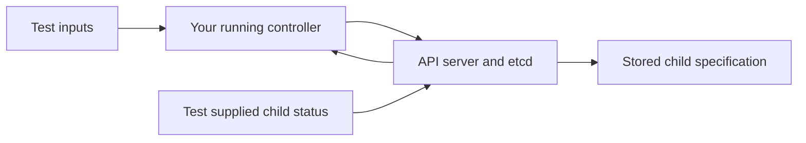

# Test Controller Intent in envtest, Not Pod Scheduling

Author: [nawazdhandala](https://www.github.com/nawazdhandala)

Tags: Kubernetes, Kubebuilder, Testing

Description: Write envtest assertions for child specifications, ownership, status inputs, and finalizers without waiting for absent schedulers or garbage collectors.

Your controller creates a Pod in an envtest suite. The Pod exists, but a readiness assertion times out. Another test deletes its owner and waits for the child to disappear. That also times out. Increasing the timeout makes both tests slower without supplying the missing Kubernetes components.

Default local envtest starts an API server and etcd. It does not start the normal cluster controllers, scheduler, or kubelet. Your manager runs only if the test starts it. Tests using an existing cluster or additional processes have a different boundary, so establish which environment your suite actually uses. [Envtest configuration](https://book.kubebuilder.io/reference/envtest).

## Assign each expectation to its owner

A successful API write means the server accepted and stored an object. It does not mean a container started. In a full cluster, the scheduler selects a node and the kubelet manages containers on that node. Controllers also supply behaviors such as creating Pods for Deployments. [Kubernetes components](https://kubernetes.io/docs/concepts/overview/components/).

Use this distinction when choosing assertions:

| What your controller does | Useful local envtest assertion | Separate cluster assertion |
| --- | --- | --- |
| Creates a Pod | Image, arguments, resources, labels, owner reference | Pod runs and becomes ready |
| Creates a Deployment | Desired replicas, selector, Pod template | ReplicaSet and Pods appear |
| Sets an owner reference | Correct owner UID, kind, name, controller flag | Child is garbage-collected |
| Reacts to Pod readiness | Inject status, then observe your controller's response | Kubelet reports actual readiness |
| Cleans an external resource | Cleanup call completes before its finalizer is removed | External system is actually cleaned |



There is no scheduler or kubelet in this diagram. Add real cluster testing when those actors are part of the requirement.

## Run a small environment-boundary test

The complete test below uses controller-runtime **0.22.1**, Kubernetes Go libraries **0.34.0**, Go **1.25.0**, and envtest binaries **1.34.0**. Put it in a separate package such as `internal/boundary/boundary_test.go` in a project with those dependencies. Set `KUBEBUILDER_ASSETS` to your already-installed, platform-compatible envtest binary directory before running it.

It deliberately creates the owner and child directly. It demonstrates API behavior and useful assertions; it does not claim to exercise your reconciler. In an operator test, let your reconciler create the child, then apply the same ownership and specification checks to its result.

```go
package boundary

import (
	"context"
	"testing"
	"time"

	corev1 "k8s.io/api/core/v1"
	metav1 "k8s.io/apimachinery/pkg/apis/meta/v1"
	"k8s.io/apimachinery/pkg/runtime"
	"sigs.k8s.io/controller-runtime/pkg/client"
	"sigs.k8s.io/controller-runtime/pkg/controller/controllerutil"
	"sigs.k8s.io/controller-runtime/pkg/envtest"
)

func TestEnvtestBoundary(t *testing.T) {
	ctx := context.Background()
	useExisting := false
	env := &envtest.Environment{UseExistingCluster: &useExisting}
	cfg, err := env.Start()
	if err != nil {
		t.Fatal(err)
	}
	t.Cleanup(func() {
		if err := env.Stop(); err != nil {
			t.Error(err)
		}
	})
	scheme := runtime.NewScheme()
	if err := corev1.AddToScheme(scheme); err != nil {
		t.Fatal(err)
	}
	c, err := client.New(cfg, client.Options{Scheme: scheme})
	if err != nil {
		t.Fatal(err)
	}
	ns := &corev1.Namespace{ObjectMeta: metav1.ObjectMeta{Name: "boundary-test"}}
	if err := c.Create(ctx, ns); err != nil {
		t.Fatal(err)
	}
	owner := &corev1.ConfigMap{ObjectMeta: metav1.ObjectMeta{Name: "owner", Namespace: ns.Name}}
	if err := c.Create(ctx, owner); err != nil {
		t.Fatal(err)
	}
	pod := &corev1.Pod{
		ObjectMeta: metav1.ObjectMeta{Name: "worker", Namespace: ns.Name},
		Spec:       corev1.PodSpec{Containers: []corev1.Container{{Name: "worker", Image: "registry.k8s.io/pause:3.10.1"}}},
	}
	if err := controllerutil.SetControllerReference(owner, pod, scheme); err != nil {
		t.Fatal(err)
	}
	if err := c.Create(ctx, pod); err != nil {
		t.Fatal(err)
	}
	key := client.ObjectKeyFromObject(pod)
	stored := &corev1.Pod{}
	if err := c.Get(ctx, key, stored); err != nil {
		t.Fatal(err)
	}
	ref := metav1.GetControllerOf(stored)
	if ref == nil || ref.UID != owner.UID || ref.Kind != "ConfigMap" || ref.Name != owner.Name {
		t.Fatalf("wrong controller reference: %#v", ref)
	}
	if stored.Spec.Containers[0].Image != "registry.k8s.io/pause:3.10.1" {
		t.Fatal("wrong image intent")
	}
	if stored.Spec.NodeName != "" {
		t.Fatal("unexpected node assignment")
	}

	// A test-controlled observation; no container actually runs.
	stored.Status.Conditions = []corev1.PodCondition{{Type: corev1.PodReady, Status: corev1.ConditionTrue, LastTransitionTime: metav1.Now()}}
	if err := c.Status().Update(ctx, stored); err != nil {
		t.Fatal(err)
	}
	if err := c.Get(ctx, key, stored); err != nil {
		t.Fatal(err)
	}
	if len(stored.Status.Conditions) != 1 || stored.Status.Conditions[0].Status != corev1.ConditionTrue {
		t.Fatal("status fixture not stored")
	}

	if err := c.Delete(ctx, owner, client.PropagationPolicy(metav1.DeletePropagationBackground)); err != nil {
		t.Fatal(err)
	}
	// Observe persistence for a bounded interval; the environment has no GC controller.
	deadline := time.Now().Add(500 * time.Millisecond)
	for time.Now().Before(deadline) {
		if err := c.Get(ctx, key, stored); err != nil {
			t.Fatalf("child unexpectedly disappeared: %v", err)
		}
		time.Sleep(50 * time.Millisecond)
	}
	if err := c.Delete(ctx, stored, client.GracePeriodSeconds(0)); err != nil {
		t.Fatal(err)
	}
}
```

Run the isolated test with:

```bash
go test ./internal/boundary -run '^TestEnvtestBoundary$' -count=1 -v
```

Expected outcome: `PASS`. No container image is pulled by this test. The image reference is stored as desired configuration because there is no kubelet to act on it. The final zero-grace deletion is explicit cleanup of a test Pod in the private local control plane, not a production deletion recommendation.

The local run passed, including the saved owner reference, empty node assignment, test-supplied Ready condition, and child persistence during the bounded observation after owner deletion. A short observation does not prove that something can never happen; the documented absence of the garbage-collection controller explains the result.

## Assert ownership instead of waiting for garbage collection

An owner reference links a dependent object to its owner using the owner's UID, not just its name. The example creates the owner before setting the reference, so the API server has assigned that UID. `SetControllerReference` supplies the controller ownership relationship and checks constraints such as namespace compatibility. [Tagged controllerutil source](https://github.com/kubernetes-sigs/controller-runtime/blob/v0.22.1/pkg/controller/controllerutil/controllerutil.go).

In your test, inspect the stored child, not merely the in-memory object passed to Create. This catches failures to persist the reference. Also check the exact child configuration your controller owns rather than comparing the entire object, which includes API defaults and server-managed metadata.

Garbage collection is a controller-driven process. A valid reference is a necessary input, not an instruction the API server executes synchronously when the owner is deleted. A background delete therefore leaves the child behind in this local environment. [Garbage collection](https://kubernetes.io/docs/concepts/architecture/garbage-collection/).

Do not add production cleanup code solely to make this envtest assertion pass if the intended design delegates child deletion to Kubernetes. Prove the reference locally and test actual cascading deletion in a disposable full cluster.

## Supply external status as a deliberate input

If your reconciler waits for a child to become ready, the test must supply that observation. Update the child's status subresource using a fresh copy, then allow the running controller to observe the update. The Ready condition in the example is synthetic: it checks status storage, not runtime health.

For a real reconciliation test, first assert the waiting state. Then inject the minimum realistic status fields your controller reads and assert the resulting parent condition. Include negative cases such as Ready false or missing status. Do not set the parent's final expected status yourself and then claim the controller produced it.

When using a manager cache, reads can lag writes. Use bounded polling for the controller's observable result, and ensure the manager and watches are running before creating inputs. Directly calling Reconcile can test its logic, but it does not validate event routing or cache behavior.

## Keep finalizer and cleanup tests focused

Finalizers delay deletion until the responsible component removes its key. If your controller owns a finalizer, start that controller or invoke its deletion path explicitly, supply a controlled external-cleanup response, and assert that its own key is removed only after success. Include cleanup failure and retry cases. [Finalizers](https://kubernetes.io/docs/concepts/overview/working-with-objects/finalizers/).

Do not expect the namespace controller to empty a namespace in default envtest. Avoid relying on namespace deletion as the only cleanup between cases. Use unique names, remove test-owned objects explicitly when needed, and stop the private control plane at suite teardown. Remove only finalizers your fixture owns when cleaning a failed test; broadly stripping them can conceal the behavior being tested.

Keep a smaller full-cluster suite for actual scheduling, image pulls, readiness, namespace termination, and cascading deletion. Envtest remains useful precisely because it gives real API semantics without running all those components. A test stays reliable when its assertion names the actor that is present to satisfy it.
