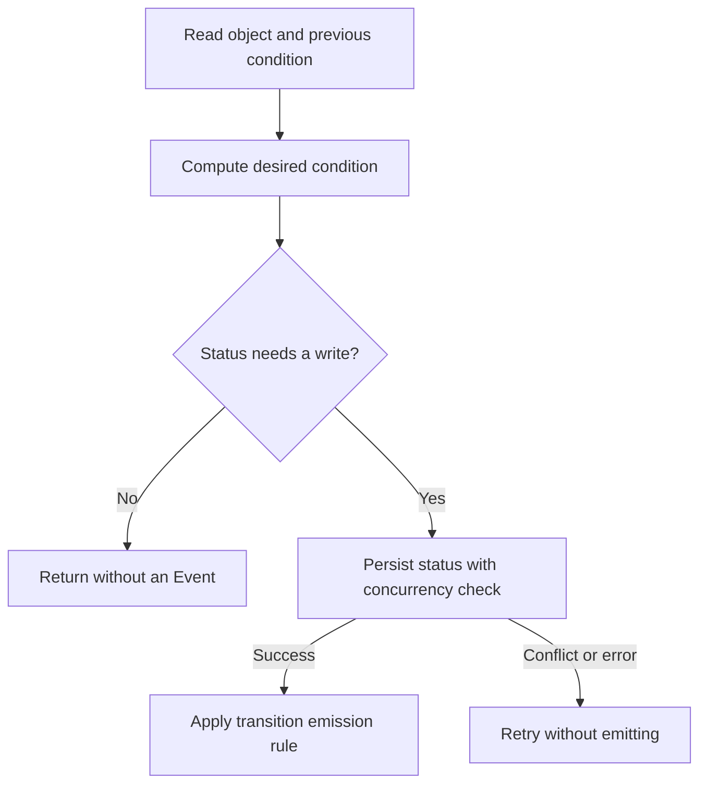

# Record Kubebuilder Events on Meaningful State Transitions

Author: [nawazdhandala](https://www.github.com/nawazdhandala)

Tags: Kubernetes, Kubebuilder, Observability

Description: Emit useful readiness Events without repeating them on every reconcile, using persisted conditions, a tested transition helper, and explicit delivery limits.

A controller can reconcile the same object many times without anything meaningful changing. If every successful pass records a “configured” Event, normal cache updates and retries produce noise. If every failed pass records the same warning, one persistent failure can dominate the object's history.

Choose the state changes operators need to see, then emit Events for those transitions. Keep detailed retry information in logs and current health in status conditions. Kubernetes Events are useful observations with limited retention and best-effort delivery, not a durable audit trail. [Kubernetes Event API](https://kubernetes.io/docs/reference/kubernetes-api/core/event-v1/).

## Decide what counts as a transition

This example reports changes to a `Ready` condition. It treats a change in either condition status or reason as meaningful. A change in message text or observed generation alone does not emit another Event.

| Before and after | Event policy |
| --- | --- |
| No previous Ready condition | Report the initial state |
| Ready true becomes false | Warning: NotReady |
| Ready false becomes true | Normal: Ready |
| False remains false, but reason changes | Report the new failure category |
| Same status and reason, different detail | No new Event |
| Same state after another reconcile | No new Event |

That is an application policy, not a Kubernetes requirement. A job controller might instead report a completed operation, while a configuration controller might report acceptance of a new generation. Define the policy before writing the comparison so tests can verify the intended behavior.

## Use the manager's recorder

For controller-runtime **0.22.1**, a manager exposes `GetEventRecorderFor`, returning the client-go `record.EventRecorder` interface. Add a recorder field to your reconciler and initialize it once during setup:

```go
recorder := mgr.GetEventRecorderFor("synctask-controller")
```

Use the same recorder throughout that controller. The source name should identify the component, not contain an object name or random run ID. [Pinned manager cluster interface](https://github.com/kubernetes-sigs/controller-runtime/blob/v0.22.1/pkg/cluster/cluster.go).

The classic recorder used here writes core API Events. Its sink creates new Events and patches correlated ones, so include appropriate permissions in your generated role:

```go
// +kubebuilder:rbac:groups="",resources=events,verbs=create;patch
```

Regenerate the role using your project's normal manifest target and verify the deployed binding for the controller's service account. This marker belongs with the project's other RBAC markers. Adding it to source alone does not change cluster permissions. [client-go v0.34.0 recording implementation](https://github.com/kubernetes/client-go/blob/v0.34.0/tools/record/event.go).

## Keep the emission rule small

The following helper was compiled and tested with Go **1.25.0**, client-go **0.34.0**, and controller-runtime **0.22.1** dependencies. Save it in an `eventtransition` package. Its `before` condition must come from the previously persisted state, and `after` must be the state whose write just succeeded.

```go
package eventtransition

import (
	corev1 "k8s.io/api/core/v1"
	metav1 "k8s.io/apimachinery/pkg/apis/meta/v1"
	"k8s.io/apimachinery/pkg/runtime"
	"k8s.io/client-go/tools/record"
)

// Call only after successfully persisting the desired Ready condition.
func EmitReadyTransition(recorder record.EventRecorder, obj runtime.Object,
	before *metav1.Condition, after metav1.Condition) {
	if after.Type != "Ready" {
		return
	}
	if before != nil && before.Type == after.Type && before.Status == after.Status && before.Reason == after.Reason {
		return
	}
	eventType := corev1.EventTypeNormal
	reason := "ReadinessUnknown"
	switch after.Status {
	case metav1.ConditionTrue:
		reason = "Ready"
	case metav1.ConditionFalse:
		eventType = corev1.EventTypeWarning
		reason = "NotReady"
	case metav1.ConditionUnknown:
	default:
		return
	}
	recorder.Eventf(obj, eventType, reason, "Readiness is %s (%s)", after.Status, after.Reason)
}
```

The helper keeps Event reasons in a small fixed set and uses the condition reason to describe the category. Keep condition reasons similarly bounded, such as `DependencyMissing` or `Configured`. Do not populate them with request IDs, timestamps, raw error strings, or user-controlled payloads.

The message intentionally excludes the condition's detailed message. That reduces accidental disclosure and avoids turning every changing diagnostic detail into a new Event identity. Put richer, appropriately redacted context in structured logs.

## Persist the condition before emitting

The reconciler should follow this sequence:



Deep-copy the original object before changing its condition slice. Preserve the previous condition separately, set the desired condition, and compare status semantically. Do not reset transition timestamps on every pass; an unchanged condition should remain unchanged.

Use an update or an optimistic-locking status patch so a stale reader does not silently overwrite another status writer. In controller-runtime, `client.MergeFromWithOptions(base, client.MergeFromWithOptimisticLock{})` adds the resource-version precondition to a merge patch. Handle a conflict by fetching current state and recomputing before trying again. [Pinned patch options](https://github.com/kubernetes-sigs/controller-runtime/blob/v0.22.1/pkg/client/patch.go).

Only call the helper after a successful write. If the write fails, emitting a recovery Event would announce a transition that status does not yet record. On the next ordinary reconcile, the persisted condition supplies the comparison baseline, including after a process restart.

Do not compare the desired condition with the same object after you have already overwritten its old condition. That makes every change look unchanged. Conversely, do not compare against a zero-value condition on every pass; that makes every pass look like an initial transition.

## Understand the delivery gap

Status persistence and Event recording are separate operations. If the process exits after saving status but before recording the Event, the transition may have no Event. Emitting first reverses the problem: a failed status write or retry can produce duplicate announcements.

This pattern reduces repeated calls during normal reconciliation; it does not provide exactly-once delivery. The recorder's method does not return a durable delivery receipt to your reconciler. Concurrent processing, stale reads, retries, broadcaster filtering, and process failure remain relevant.

Client-go also correlates, aggregates, and rate-limits Events. That is a protection against excessive output, not a substitute for deciding when your controller should call the recorder. A repeated Event may appear as an increased count rather than a separate row. [Event correlation implementation](https://github.com/kubernetes/client-go/blob/v0.34.0/tools/record/events_cache.go).

If every transition must be retained for audit or downstream processing, use an appropriate durable record with explicit delivery and retry semantics. Do not make an Event count the authoritative business state.

## Test emission separately from delivery

Use `record.NewFakeRecorder` with a sufficiently buffered channel to test the helper's calls. Verify that initial state, failure, recovery, and a changed failure reason emit the expected type and reason. Verify silence for unchanged state, message-only changes, generation-only changes, and unrelated condition types.

Those cases passed locally for the exact helper above. The fake recorder checks what your code attempted to emit; it does not run the real broadcaster's correlation or persist an Event through Kubernetes.

Add reconciliation tests around the status-write boundary: failed writes must not emit, unchanged persisted status must not emit, and a successful transition must invoke the helper. Then use a staging cluster to verify service-account permissions and visible Events. Check both recorder errors in logs and the persisted condition when an expected Event is absent.

The operator should remain diagnosable even when Events expire or are dropped. Current conditions answer what is wrong now; logs explain retries and detailed causes; transition Events provide a concise history of meaningful changes.
