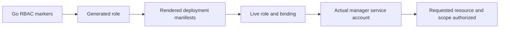

# Trace Kubebuilder Forbidden Watches from Markers to Live RBAC

Author: [nawazdhandala](https://www.github.com/nawazdhandala)

Tags: Kubernetes, Kubebuilder, RBAC

Description: Diagnose forbidden controller watches by tracing the service account, generated role, rendered binding, and actual namespace scope before changing permissions.

A controller's Go file contains an RBAC marker for `list` and `watch`, yet its logs still report forbidden access. The marker is only the beginning of the permission path. It must be processed by the generator, included in the deployed manifests, bound to the correct service account, and valid for the scope of the actual request.

Work through that chain instead of granting a wildcard role to make the error disappear. This guide uses Kubernetes 1.34-era APIs and **controller-gen v0.19.0** for a reproducible local marker-generation example. The generated role was checked locally; the cluster commands below are an investigation procedure, not reported live results.

## Read the denied request precisely

An error such as “cannot list resource certificates in API group cert-manager.io at the cluster scope” gives several useful facts: the requested verb is `list`, the plural resource is `certificates`, the group is `cert-manager.io`, and the request covers the cluster rather than a single namespace.

Record the reported user too. A service account typically appears as `system:serviceaccount:NAMESPACE:NAME`. Compare that identity with the deployed Pod, not merely a local manifest you expected to use.

An informer generally needs list and watch access to populate and maintain its cache. A successful single-object `get` does not establish that list/watch access exists. Likewise, a failure before cache synchronization can prevent useful reconciliation even if the controller process remains running.



Each arrow is a possible break. Fixing source code at the first step does not change the last step until the deployment process carries the change through.

## Confirm the running identity and watch scope

Substitute the manager's actual namespace and Pod name:

```bash
kubectl -n operator-system get pod controller-manager-REPLACE \
  -o jsonpath='{.spec.serviceAccountName}{"\n"}'
kubectl -n operator-system get deployment controller-manager -o yaml
```

The first command reports the running Pod's service account. The Deployment output lets you inspect the template identity, manager arguments, environment, and image. A rollout can leave an older Pod running temporarily, so comparing both is useful.

Check how the manager's cache is configured. A namespaced resource can still be listed across all namespaces. A RoleBinding in `payments` authorizes namespaced access there; it does not authorize an all-namespaces list. Restrict the cache to intended namespaces when that matches the controller's purpose, or provide the appropriate broader binding when cluster-wide observation is intentional.

The [Kubernetes RBAC guide](https://kubernetes.io/docs/reference/access-authn-authz/rbac/) distinguishes RoleBinding scope from ClusterRoleBinding scope. A RoleBinding may reference a ClusterRole while still granting access only in its own namespace.

## Verify what the markers generate

The following markers cover three read-only watch dependencies. Put them in a Go package included by your project's generator paths, as a standalone comment block separated from the next declaration by a blank line:

```go
// +kubebuilder:rbac:groups=apps,resources=deployments,verbs=get;list;watch
// +kubebuilder:rbac:groups="",resources=configmaps,verbs=get;list;watch
// +kubebuilder:rbac:groups=cert-manager.io,resources=certificates,verbs=get;list;watch
```

Use the API group, not the API version: `apps`, not `apps/v1`. Core resources such as ConfigMaps use the empty group. Resource names are the plural REST names, not Go kinds. Status updates are separate permissions on a resource such as `certificates/status`; these watch markers do not grant status writes.

The [Kubebuilder RBAC marker reference](https://book.kubebuilder.io/reference/markers/rbac) documents these fields. After changing a marker, run your project's usual `make manifests` workflow and review the generated role diff.

For an isolated Go module containing only these markers, this pinned command generates a reviewable role into a separate directory:

```bash
go run sigs.k8s.io/controller-tools/cmd/controller-gen@v0.19.0 \
  rbac:roleName=manager-role paths=./... \
  output:rbac:artifacts:config=generated
```

Run it from that module's root with a compatible Go toolchain; v0.19.0 requires Go 1.24 or newer. It writes local manifests and does not apply them. In a real project, keep the project's configured generator version and output locations consistent rather than introducing a second generation workflow.

The generated ClusterRole should contain rules for exactly the three groups/resources above with `get`, `list`, and `watch`. If a rule is missing, verify that the marker's package falls under `paths`, that the marker syntax parsed, and that you inspected the output actually used by deployment. In the local v0.19.0 check, attaching this comment block directly to a function produced no role; separating it from the function with a blank line produced the expected package-level rules.

## Follow rendering into the live binding

Kustomize overlays, Helm templates, and release tooling can rename objects or omit an RBAC file. If the project uses Kubebuilder's conventional Kustomize layout, render it locally:

```bash
kubectl kustomize config/default > rendered.yaml
```

Inspect the final service account, role, and binding names in that file. Check the binding's `roleRef` and its service-account subject namespace. Rendering proves what the local overlay produces; it does not prove that the cluster runs that revision.

Find live ClusterRoleBindings for the manager account with this read-only query. It requires permission to list bindings and jq:

```bash
kubectl get clusterrolebindings -o json > bindings.json
jq --arg ns operator-system --arg sa controller-manager '
  .items[] |
  select(any(.subjects[]?;
    .kind == "ServiceAccount" and .namespace == $ns and .name == $sa)) |
  {binding: .metadata.name, roleRef: .roleRef}
' bindings.json
```

Then inspect each referenced role with `kubectl get clusterrole ROLE_NAME -o yaml`, replacing the placeholder. For namespace-scoped access, also inspect RoleBindings in the relevant namespaces; the ClusterRoleBinding query alone does not describe all effective permissions.

Watch for a binding that references the right role but the wrong service account, an old generated role left behind after a rename, or a release that never applied the new role. Fix the source manifests and deploy them through the usual controlled process so the next release preserves the correction.

## Ask authorization about the actual operation

With permission to impersonate the manager service account, test the denied verb and scope directly:

```bash
kubectl auth can-i list certificates.cert-manager.io --all-namespaces \
  --as=system:serviceaccount:operator-system:controller-manager
kubectl auth can-i watch certificates.cert-manager.io --all-namespaces \
  --as=system:serviceaccount:operator-system:controller-manager
```

For a cache limited to one namespace, use `--namespace=payments` instead of `--all-namespaces`. A `no` identifies an authorization gap for that request. A `yes` is not proof that the manager is using that identity, cluster, or scope. The [kubectl command reference](https://kubernetes.io/docs/reference/kubectl/generated/kubectl_auth/kubectl_auth_can-i/) documents impersonated checks and scope selection.

Avoid casually adding `resourceNames` restrictions to informer permissions: list/watch requests must satisfy the associated name-selection requirements. Also remember that event predicates run after watch observation; filtering namespaces in a predicate does not reduce the authorization needed to start an all-namespaces informer.

After deploying the narrow fix, confirm that forbidden errors stop, the cache synchronizes, and an intended resource change reaches reconciliation. Keep the generated and rendered role diff with the incident record. That evidence shows which link was broken and prevents the same marker-to-deployment mismatch from recurring.
