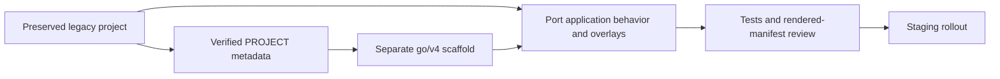

# Migrate Kubebuilder go/v3 to go/v4 Without Losing Custom Code

Author: [nawazdhandala](https://www.github.com/nawazdhandala)

Tags: Kubernetes, Kubebuilder, Go

Description: Regenerate a pinned go/v4 scaffold separately, port controller and webhook behavior, preserve deployment identity, and verify Kustomize overlays before rollout.

Changing `go.kubebuilder.io/v3` to `go.kubebuilder.io/v4` in PROJECT does not migrate an operator. Your controller logic, webhook implementations, dependency versions, and deployment manifests still need to fit together. A project that compiles can still lose an overlay or deploy under a different name.

Use a fresh scaffold as the migration destination and port behavior deliberately. The legacy migration guide recommends creating a go/v4 project and carrying application code across; current tooling also offers separate-directory regeneration for inspection. [Legacy migration guide](https://book-v3.book.kubebuilder.io/migration/migration_guide_gov3_to_gov4), [regeneration guidance](https://book.kubebuilder.io/reference/commands/alpha_generate.html).

## Pin the source and destination

The rehearsal for this guide started with a **Kubebuilder 3.14.0 go/v3** fixture and regenerated it using **Kubebuilder 4.9.0 go/v4**. The target scaffold selected controller-runtime **0.22.1**, controller-tools **0.19.0**, and Kustomize **5.7.1**. These are concrete tested versions, not a recommendation to substitute an arbitrary latest dependency.

The old fixture's generator worked with Go **1.20.14**; it failed when run under Go 1.25. The target was built with Go **1.25.0**. Keep a working legacy toolchain available long enough to establish the baseline, rather than diagnosing an old generator failure as an application migration failure.

Also separate three version numbers: the Kubebuilder executable release, its Go plugin layout, and the PROJECT file format. In this migration, PROJECT's format remained `version: "3"` while the layout changed to `go.kubebuilder.io/v4`.

## Inventory what regeneration cannot infer

Before changing anything, capture a recoverable copy of the project, including uncommitted work and required local files. Record the current tests and rendered production overlays. Review PROJECT against the actual APIs, controllers, and webhooks; regeneration uses that metadata, not an analysis of all your application behavior. [Kubebuilder migration overview](https://book.kubebuilder.io/migrations.html).

The inventory should include:

| Area | Preserve or deliberately change |
| --- | --- |
| API | Group, kind, plural, scope, versions, JSON fields and validation markers |
| Controllers | Reconcile behavior, watches, indexes, predicates, finalizers and RBAC |
| Webhooks | Defaults, validation, conversion, registration and operations |
| Deployment | Namespace, names, service account, leader election and image settings |
| Overlays | Resource patches, security settings, certificates, metrics and network policy |

A missing PROJECT resource entry is a reason to repair the metadata before regeneration. It is not a reason to accept a new scaffold that silently omits that API.



## Generate into a new directory

Install the verified **4.9.0** executable as `kubebuilder` on PATH, then run this from the legacy project root. Replace the candidate directory name if needed, but keep it outside the source project and initially absent:

```bash
set -eu
kubebuilder version
candidate_dir="$PWD/../operator-go-v4"
test ! -e "$candidate_dir"
kubebuilder alpha generate --plugins=go/v4   --input-dir="$PWD"   --output-dir="$candidate_dir"
```

The explicit output directory matters. The pinned command's help warns that in-place generation cleans existing files. Do not omit that flag on a working project. Also keep the pinned executable on PATH: this release invokes `kubebuilder` internally while rebuilding resources, so launching only an absolute executable path is insufficient if the subprocess cannot find it.

Expect dependency downloads and generation, formatting, vetting, and linting work in the candidate. A successful command establishes a generated baseline, not a completed migration. [Kubebuilder 4.9.0 release](https://github.com/kubernetes-sigs/kubebuilder/releases/tag/v4.9.0).

In the rehearsal, the original project files remained byte-for-byte unchanged. The candidate did not contain the custom API field or staging overlay. That is why the next step is a code port, not an immediate deployment.

## Port code into the new interfaces

For these pinned scaffolds, the entry point moved from root `main.go` to `cmd/main.go`, controllers moved from `controllers/` to `internal/controller/`, and admission implementations were generated under `internal/webhook/v1/` instead of methods in the API package.

Preserve API data structures and markers first. For example, the fixture's custom field was retained with its wire name and required constraint:

```go
// +kubebuilder:validation:MinLength=1
Target string `json:"target"`
```

Port controller behavior into the generated reconciler, then restore setup behavior: owned-resource watches, external watches, predicates, field indexes, concurrency options, and finalizer handling. Copying only the Reconcile body misses those dependencies.

For webhooks, adapt business rules to the destination's generated interfaces. The old fixture used `Default()` and `ValidateCreate() error` methods on the API type. The target generated separate custom defaulter and validator types with context and runtime-object arguments, and validation returns warnings plus an error. Copying the old webhook file unchanged would retain the wrong implementation shape.

Check old/new object handling in update validation and retain conversion support for every version still needed. Keep validation error semantics and default precedence intact. A Go plugin upgrade alone is not a storage-version migration.

The local port preserved a custom default, rejection of an empty target on create and update, and a fixture-specific reconcile delay. Targeted tests checked those behaviors after the move. A real operator needs equivalent tests for its actual business rules.

## Review deployment identity before overlays

The separate-directory generation in this rehearsal derived a new project name from the output directory. That changed the generated namespace and name prefix. Restore the intended project metadata and deployment identity deliberately before comparing manifests.

Do not copy the entire old `config/` tree over the new scaffold. That can restore obsolete scaffold assumptions along with the overlay you wanted. Port custom overlays and adapt their paths and patch targets to the target's Kustomize configuration. Verify the rendered result, since patches act on resources and names rather than on your intent. [Kustomize configuration](https://kubernetes.io/docs/tasks/manage-kubernetes-objects/kustomization/).

From the candidate directory, generate and render the relevant overlay:

```bash
make generate manifests kustomize
go build ./...
./bin/kustomize build config/overlays/staging > staging-rendered.yaml
```

Replace `staging` with a real overlay you have ported. Review the rendered namespace, Deployment name, image, service account, selectors, security context, resource limits, and volume mounts. Confirm both validating and mutating webhook configurations when applicable, their service references, and the certificate/CA injection path.

The target scaffold can enable or arrange webhook and metrics components differently from the legacy scaffold. Inspect those differences explicitly rather than assuming all additional resources are harmless. Rendering is a local composition check; it does not prove certificates, permissions, or admission calls work.

## Finish with behavior and rollout checks

Run unit and integration tests with the target's matching envtest assets. Test webhook defaults and rejection paths, conversion round trips, status updates, and cleanup behavior. Review generated CRD schema differences so required fields, defaults, served/storage versions, or pruning behavior do not change accidentally.

The local rehearsal passed target generation, build, focused controller/webhook tests, and a 21-object staging render. Checks confirmed the preserved required field, restored deployment identity, custom overlay annotation, and both admission webhook configurations. It did not perform a deployed upgrade or full end-to-end suite.

Before production, rehearse the upgrade with existing custom resources in staging. Confirm the new manager can read them, retain their behavior, and answer admission requests. Keep the previous image and manifests with a rollback assessment that accounts for any data-format changes. Finish the migration when behavior and deployment contracts are preserved, not merely when PROJECT names the new plugin.
