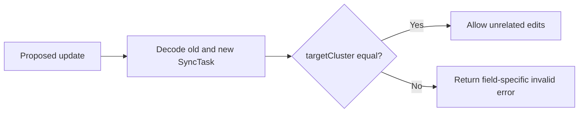

# Enforce Immutable CRD Fields with Kubebuilder ValidateUpdate

Author: [nawazdhandala](https://www.github.com/nawazdhandala)

Tags: Kubernetes, Kubebuilder, Validation

Description: Compare old and new custom resources in ValidateUpdate, return precise immutable-field errors, and test allowed edits without accidentally freezing the whole object.

Some API fields describe choices that cannot safely change after creation. A synchronization task's destination cluster is one example: silently redirecting an existing task could leave work or ownership behind in the original destination. The API should reject that change before the controller acts on it.

A required-field marker ensures a value is supplied; it does not make the value immutable. For programmatic enforcement, `ValidateUpdate` needs to compare the previous resource with the proposed resource and reject changes to the specific field you intend to freeze.

This example uses a **Kubebuilder v4.9.0** `go/v4` scaffold with **controller-runtime v0.22.1** and Kubernetes libraries v0.34.0. Those versions use the `runtime.Object` CustomValidator signatures shown below. Check your generated interface before adapting examples from newer releases.

## Define the policy before the comparison

Our hypothetical SyncTask has two spec fields:

```go
type SyncTaskSpec struct {
    // TargetCluster identifies the destination chosen at creation.
    // +kubebuilder:validation:MinLength=1
    TargetCluster string `json:"targetCluster"`
    // +optional
    Paused bool `json:"paused,omitempty"`
}
```

`targetCluster` must be present and nonempty, and cannot change afterward. `paused` remains mutable. Metadata changes should remain possible too. This is strict immutability from creation, not a “set once later” policy and not a condition that applies only after the controller reports Ready.

Regenerate the CRD and supporting code after changing the API definition. In the local scaffold check, the generated schema marked `targetCluster` required with `minLength: 1`. The schema constraint and update comparison solve different parts of the contract.



## Implement the validator

Replace the scaffold's validator implementation with the following, adjusting the API import path to your module. The example includes registration so the relationship between the method and the webhook is explicit.

```go
package v1

import (
	"context"
	platformv1 "example.com/projectrepair/api/v1"
	"fmt"
	apierrors "k8s.io/apimachinery/pkg/api/errors"
	"k8s.io/apimachinery/pkg/runtime"
	"k8s.io/apimachinery/pkg/runtime/schema"
	"k8s.io/apimachinery/pkg/util/validation/field"
	ctrl "sigs.k8s.io/controller-runtime"
	"sigs.k8s.io/controller-runtime/pkg/webhook"
	"sigs.k8s.io/controller-runtime/pkg/webhook/admission"
)

type SyncTaskCustomValidator struct{}

var _ webhook.CustomValidator = &SyncTaskCustomValidator{}

func (v *SyncTaskCustomValidator) ValidateCreate(_ context.Context, obj runtime.Object) (admission.Warnings, error) {
	task, ok := obj.(*platformv1.SyncTask)
	if !ok || task == nil {
		return nil, fmt.Errorf("expected SyncTask, got %T", obj)
	}
	if task.Spec.TargetCluster == "" {
		return nil, apierrors.NewInvalid(schema.GroupKind{Group: platformv1.GroupVersion.Group, Kind: "SyncTask"},
			task.Name, field.ErrorList{field.Required(field.NewPath("spec", "targetCluster"), "must be set at creation")})
	}
	return nil, nil
}

func (v *SyncTaskCustomValidator) ValidateUpdate(_ context.Context, oldObj, newObj runtime.Object) (admission.Warnings, error) {
	oldTask, okOld := oldObj.(*platformv1.SyncTask)
	newTask, okNew := newObj.(*platformv1.SyncTask)
	if !okOld || !okNew || oldTask == nil || newTask == nil {
		return nil, fmt.Errorf("expected old and new SyncTask objects")
	}
	if oldTask.Spec.TargetCluster != newTask.Spec.TargetCluster {
		return nil, apierrors.NewInvalid(schema.GroupKind{Group: platformv1.GroupVersion.Group, Kind: "SyncTask"},
			newTask.Name, field.ErrorList{field.Invalid(field.NewPath("spec", "targetCluster"),
				newTask.Spec.TargetCluster, "field is immutable; create a new SyncTask for another target")})
	}
	return nil, nil
}

func (v *SyncTaskCustomValidator) ValidateDelete(context.Context, runtime.Object) (admission.Warnings, error) {
	return nil, nil
}

// +kubebuilder:webhook:path=/validate-platform-example-com-v1-synctask,mutating=false,failurePolicy=fail,sideEffects=None,groups=platform.example.com,resources=synctasks,verbs=create;update,versions=v1,name=vsynctask-v1.kb.io,admissionReviewVersions=v1

func SetupSyncTaskWebhookWithManager(mgr ctrl.Manager) error {
	return ctrl.NewWebhookManagedBy(mgr).For(&platformv1.SyncTask{}).
		WithValidator(&SyncTaskCustomValidator{}).Complete()
}
```

`ValidateUpdate` checks both type assertions. Comparing only the new object can establish that a value is valid, but cannot establish that it stayed unchanged. The comparison does not mutate either object and does not fetch a second “old” copy from the API server: the admission request already supplies the old object for the update being evaluated.

The [versioned CustomValidator implementation](https://github.com/kubernetes-sigs/controller-runtime/blob/v0.22.1/pkg/webhook/admission/validator_custom.go) shows how old and new objects reach this method. Its interface is different from a controller's `Reconcile` method, which receives a key rather than an old/new pair.

`apierrors.NewInvalid` returns a Kubernetes-style error whose cause points to `spec.targetCluster`. That is more useful to clients than a generic “validation failed” message. The requested value here is a non-secret cluster identifier; avoid embedding sensitive values in validation errors for other fields.

Creation checks that the target is nonempty. Deletion is allowed by the implementation and is not included in this marker's configured operations. Do not add deletion blocking merely as a side effect of protecting an immutable field. A deliberate replacement object is often the supported way to select another destination, subject to your application's cleanup rules.

## Keep unrelated changes working

Do not compare the entire object, entire spec, or serialized JSON unless the API contract truly freezes all of it. That would reject pause/resume changes and can accidentally reject labels, annotations, defaulted values, or fields introduced by a future API version.

For a string identifier, direct equality is clear. Optional pointers, lists, and maps require a more precise policy. Decide whether nil and empty mean the same thing and whether order matters. A “set once” field needs explicit handling for absent-to-present transitions; the strict comparison here would reject that transition after creation.

Defaulting and conversion also affect what the validator sees. Keep the logical representation of an immutable value stable across served versions. If a new defaulter changes a previously omitted field, old objects may encounter validation failures during unrelated updates. Test stored objects from earlier releases before introducing a stricter policy.

Existing invalid objects are a migration problem, not a reason to silently invent a new destination. Inventory them and plan the intended repair or replacement workflow before enabling enforcement broadly.

## Consider a schema transition rule for simple invariants

Kubernetes also supports Common Expression Language, or CEL, transition rules that compare `self` with `oldSelf`. For a required scalar field, a schema rule can often express immutability without a network webhook. The [CRD transition-rule documentation](https://kubernetes.io/docs/tasks/extend-kubernetes/custom-resources/custom-resource-definitions/#transition-rules) explains their update-only semantics and restrictions.

A programmatic webhook remains useful when the invariant requires code or must integrate with existing validation logic. Avoid maintaining two subtly different versions of the same rule in CEL and Go without tests proving they agree. Optional field presence and defaulting are particularly easy places for implementations to diverge.

## Validate the method and its deployment separately

Local tests for this implementation check a valid creation, empty target rejection, unchanged updates, a changed target, a pause change, a label change, wrong old/new object types, and deletion. They also verify that the immutable-field error identifies `spec.targetCluster` and that the original object remains unchanged.

The tests run against the actual generated SyncTask Go type. They do not prove that a real API server invokes the webhook. Regenerate manifests, inspect that the validating rule includes `UPDATE` for `synctasks`, and deploy the registration, Service, and certificate configuration together.

In staging, test both a normal update and a PATCH to the root resource. Admission represents the PATCH as an update. An unchanged target with a changed `paused` value should succeed; a changed target should fail with the field-specific cause. A status-subresource write is a separate route and need not pass through this spec validator when the CRD correctly enables `/status`.

Use server-side dry-run for initial admission checks where the webhook's side-effect declaration supports it. Then verify the normal controller workflow still updates status and handles deletion as designed. A passing unit test proves the comparison logic; the admission test proves routing and deployment. Both are needed before users can rely on the immutable-field contract.
