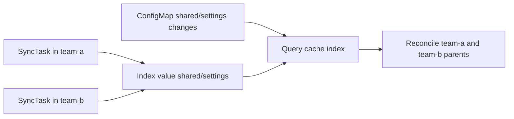

# Index Cross-Namespace References in Kubebuilder Controllers

Author: [nawazdhandala](https://www.github.com/nawazdhandala)

Tags: Kubernetes, Kubebuilder, Go

Description: Build a namespace-aware reference index for fast reverse lookups, query the manager cache correctly, and test updates with a real informer cache.

A ConfigMap changes, and your controller needs to find every custom resource that references it. Listing all custom resources and scanning their specifications works initially, but repeats the same work for every event. A cache index can maintain that relationship as objects change.

The tricky part is often namespace identity. If a custom resource can reference a ConfigMap in another namespace, indexing only its name mixes unrelated objects. Restricting the lookup to the ConfigMap's namespace can also miss every parent that lives elsewhere.

This example makes both namespaces explicit: the referenced object's namespace is part of the index value; the parent object's namespace remains part of the returned reconciliation key.

## Define the reference contract first

Assume a namespaced `platform.example.com/v1` resource named `SyncTask` with this application-specific field:

```yaml
spec:
  configMaps:
    - name: settings
      namespace: shared
    - name: local-options
```

An omitted namespace means the SyncTask's own namespace. The API schema must validate reference names and namespaces. This custom reference contract is not a claim that ordinary Pod ConfigMap references can cross namespaces.

The index should return `shared/settings` and, for a parent in `team-a`, `team-a/local-options`. Multiple references may produce multiple values. Repeated references should not create duplicate index values.



The index is an internal lookup structure, not a new API-server field. Controller-runtime allows multiple values from an index extractor, and equality means at least one extracted value matches. [FieldIndexer contract, v0.22.1](https://github.com/kubernetes-sigs/controller-runtime/blob/v0.22.1/pkg/client/interfaces.go).

## Extract stable keys and query the cache

This complete helper uses controller-runtime **0.22.1** and Kubernetes Go libraries **0.34.0**. It was compiled with Go **1.25.0** and tested against a real informer cache backed by envtest **1.34.0**.

The example uses `unstructured` objects so the code does not depend on a generated API package. An unstructured object stores its fields in maps and slices rather than a specific Go struct. In a normal typed Kubebuilder project, the equivalent extractor can read your generated `Spec.ConfigMaps` directly.

Save this in a package named `referenceindex` and change the group/version/kind to your actual resource if needed:

```go
package referenceindex

import (
	"context"
	"sort"

	"k8s.io/apimachinery/pkg/apis/meta/v1/unstructured"
	"k8s.io/apimachinery/pkg/runtime/schema"
	"sigs.k8s.io/controller-runtime/pkg/client"
)

const ConfigMapIndex = "references.configMap"

var taskGVK = schema.GroupVersionKind{Group: "platform.example.com", Version: "v1", Kind: "SyncTask"}

func TaskType() *unstructured.Unstructured {
	obj := &unstructured.Unstructured{}
	obj.SetGroupVersionKind(taskGVK)
	return obj
}

// The API schema must validate reference names and namespaces.
func ConfigMapKeys(obj client.Object) []string {
	task, ok := obj.(*unstructured.Unstructured)
	if !ok {
		return nil
	}
	refs, found, err := unstructured.NestedSlice(task.Object, "spec", "configMaps")
	if err != nil || !found {
		return nil
	}
	unique := map[string]struct{}{}
	for _, value := range refs {
		ref, ok := value.(map[string]interface{})
		if !ok {
			continue
		}
		name, _, err := unstructured.NestedString(ref, "name")
		if err != nil || name == "" {
			continue
		}
		namespace, _, err := unstructured.NestedString(ref, "namespace")
		if err != nil {
			continue
		}
		if namespace == "" {
			namespace = task.GetNamespace()
		}
		unique[namespace+"/"+name] = struct{}{}
	}
	keys := make([]string, 0, len(unique))
	for key := range unique {
		keys = append(keys, key)
	}
	sort.Strings(keys)
	return keys
}

// Pass the manager's cache, not its uncached API reader.
func FindTasks(ctx context.Context, reader client.Reader, namespace, name string) ([]client.ObjectKey, error) {
	list := &unstructured.UnstructuredList{}
	list.SetGroupVersionKind(taskGVK.GroupVersion().WithKind("SyncTaskList"))
	if err := reader.List(ctx, list, client.MatchingFields{ConfigMapIndex: namespace + "/" + name}); err != nil {
		return nil, err
	}
	keys := make([]client.ObjectKey, 0, len(list.Items))
	for i := range list.Items {
		keys = append(keys, client.ObjectKeyFromObject(&list.Items[i]))
	}
	return keys, nil
}
```

The extractor performs no API calls. It reads only the indexed object, fills in the default namespace, deduplicates keys, and returns a stable order. It tolerates malformed input without panicking, but returning no key is not validation. Reject invalid references in your API contract so malformed objects cannot silently disappear from reverse lookups.

The slash separator works here because Kubernetes namespace and object names cannot contain `/`. If you later index a reference with a different identity model, define its encoding deliberately rather than copying this string format.

## Register before the manager starts

During controller setup, register the index on the same cache that will answer lookups. In a project importing the helper package, this setup fragment belongs before manager startup:

```go
if err := mgr.GetFieldIndexer().IndexField(
    ctx,
    referenceindex.TaskType(),
    referenceindex.ConfigMapIndex,
    referenceindex.ConfigMapKeys,
); err != nil {
    return err
}
```

Fail setup if registration fails. A controller that continues without its index will fail later at the first lookup, farther away from the useful error context.

When a ConfigMap event arrives, call `FindTasks` with `mgr.GetCache()` and the ConfigMap's namespace and name. Convert the returned parent keys to reconcile requests. Passing the cache explicitly is intentional, especially with unstructured objects: it avoids accidentally making the synthetic field query through an uncached client.

The API server does not know what `references.configMap` means. In the local test, querying the same synthetic selector with a direct client failed, while querying the indexed cache succeeded. Do not add this selector to a normal kubectl command and expect it to work.

## Distinguish the two namespace dimensions

Controller-runtime automatically maintains namespace-qualified variants for the objects it indexes. Those namespaces belong to the **parents being listed**, not the target references stored in their specifications. [Informer index implementation](https://github.com/kubernetes-sigs/controller-runtime/blob/v0.22.1/pkg/cache/informer_cache.go).

That is why the extractor still includes the target namespace in its value. The helper deliberately omits `client.InNamespace`: parents in both `team-a` and `team-b` can reference `shared/settings`. Adding `InNamespace("shared")` would restrict the parents to `shared` and miss them.

If your controller intentionally serves one parent namespace, adding an appropriate parent-namespace filter can be correct. Name that restriction explicitly and test it. Do not infer it from where the referenced ConfigMap happens to live.

An index also sees only objects included in its cache. Namespace, label, or field restrictions on the cache can exclude parents before the extractor ever runs. A fast query over an incomplete cache still returns incomplete results.

## Test index maintenance, not just extraction

Start with small unit cases: implicit namespace, explicit namespace, repeated references, an empty list, and malformed entries. Then exercise the actual cache because a fake client's index does not establish informer behavior.

The local integration test used this sequence:

1. Start a private API server, install a SyncTask CRD, register the index, and start the cache.
2. Create parents in `team-a` and `team-b` referencing `shared/settings`.
3. Create another parent referencing its own `team-a/settings`.
4. Wait for the shared lookup to return two parents and the local lookup to return one.
5. Remove the shared reference from one parent and wait for the shared result to shrink to one.

Those checks passed. They show that the cache updates the reverse relationship when a specification changes; they do not benchmark performance or test a full event handler.

Allow bounded polling for cache propagation. An immediate read after a successful API write can precede the watch update. Check errors explicitly rather than treating them as an empty result, and ensure the initial cache synchronization finishes before making assertions.

## Keep lookup and authorization separate

Cross-namespace references require an explicit product and security policy. The index does not grant permission to read the target ConfigMap, authorize one tenant to reference another tenant's configuration, or prove that a target exists. Reconciliation must enforce the policy and report inaccessible or missing targets clearly.

Likewise, registering an index does not create a ConfigMap watch. Wire the watch and reverse mapping separately, including deletion handling. The useful result is a short set of affected parent keys; each reconciliation should reread current state rather than assuming the event object is still authoritative.

This keeps the optimization contained: the index answers which cached parents currently refer to a target, while reconciliation decides what those references mean and what work is allowed.
