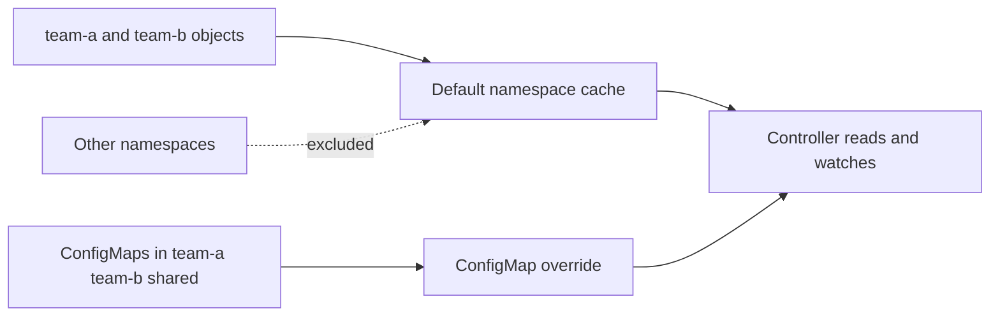

# Scope Kubebuilder Caches Without Losing Referenced Objects

Author: [nawazdhandala](https://www.github.com/nawazdhandala)

Tags: Kubernetes, Kubebuilder, Troubleshooting

Description: Configure namespace defaults and per-type cache overrides, preserve shared dependencies, and distinguish cache visibility from API permissions.

Your operator manages workloads in `team-a` and `team-b`, so you restrict its manager cache to those namespaces. Memory use becomes more predictable, but changes to a ConfigMap in `shared` stop reaching the controller. The configuration excluded an input the controller still depends on.

Cache scope should describe the objects each controller needs to observe, not just where its primary resources live. Start with a dependency inventory, then apply per-type namespace rules and test both included and excluded objects.

The example below uses controller-runtime **0.22.1** and Kubernetes Go libraries **0.34.0**. Its cache behavior was tested against local Kubernetes **1.34.0** envtest with Go **1.25.0**.

## Map the objects before changing options

Write down every primary resource, owned child, externally referenced object, and cluster-scoped dependency. Include objects read indirectly by helpers. A controller may watch one type while reading several others during reconciliation.

For this example, the desired visibility is:

| Object type | Required namespaces | Reason |
| --- | --- | --- |
| Primary namespaced resources | team-a, team-b | Managed tenants |
| Pods | team-a, team-b | Owned workloads |
| ConfigMaps | team-a, team-b, shared | Local and shared configuration |
| Secrets | Only if explicitly required | No implicit cache expansion |
| Cluster-scoped resources | Separate decision | Namespace filters cannot scope them |

The scope of a CRD itself is independent: making a manager's cache narrower does not turn a cluster-scoped resource into a namespaced one. [Kubebuilder scope concepts](https://book.kubebuilder.io/reference/scopes).



## Configure defaults and the complete override

Save this helper in a package named `cachescope` in your project. It defines the namespace policy independently of manager construction so the same options can be exercised in tests:

```go
package cachescope

import (
	corev1 "k8s.io/api/core/v1"
	"sigs.k8s.io/controller-runtime/pkg/cache"
	"sigs.k8s.io/controller-runtime/pkg/client"
)

func CacheOptions() cache.Options {
	return cache.Options{
		DefaultNamespaces: map[string]cache.Config{
			"team-a": {},
			"team-b": {},
		},
		ByObject: map[client.Object]cache.ByObject{
			&corev1.ConfigMap{}: {Namespaces: map[string]cache.Config{
				"team-a": {},
				"team-b": {},
				"shared": {},
			}},
		},
		ReaderFailOnMissingInformer: true,
	}
}
```

Pass the returned options into your normal manager setup. With `ctrl` imported from `sigs.k8s.io/controller-runtime` and your project's scheme already initialized, the relevant fragment is:

```go
mgr, err := ctrl.NewManager(ctrl.GetConfigOrDie(), ctrl.Options{
    Scheme: scheme,
    Cache:  cachescope.CacheOptions(),
})
if err != nil {
    return err
}
```

Merge this with your existing manager options instead of removing metrics, health, leader-election, or webhook settings. Register controllers and required informers before starting the manager.

The ConfigMap namespace map includes all three namespaces deliberately. A per-type namespace map is not a request to add only `shared` to the default map. If you specify only `shared`, ConfigMaps in the two tenant namespaces are no longer part of that type's cache.

## Know the nil-versus-empty distinction

In controller-runtime 0.22.1, a nil `ByObject.Namespaces` map inherits `DefaultNamespaces`. An explicitly empty map prevents that defaulting and means all namespaces for that type. These two Go values look similar in a quick review but produce very different visibility. [Pinned cache option definitions](https://github.com/kubernetes-sigs/controller-runtime/blob/v0.22.1/pkg/cache/cache.go).

Treat an empty map as a deliberate broadening decision. Do not use it as a placeholder while deciding the target namespaces. The `cache.AllNamespaces` key is another explicit all-namespace mechanism; avoid introducing it accidentally while building a map from configuration.

Namespace options must be unset for cluster-scoped types. If the controller needs Nodes or another cluster-scoped resource, decide whether to watch it, read it directly, or remove that dependency. Narrow tenant defaults are not a guarantee that every informer will be tenant-scoped.

## Make unexpected informers visible

`ReaderFailOnMissingInformer: true` makes cache Get/List operations fail when the requested type has no informer. Without that setting, a read can start another informer automatically. The stricter setting helps expose dependencies that were omitted from your inventory. [Reader behavior](https://github.com/kubernetes-sigs/controller-runtime/blob/v0.22.1/pkg/cache/cache.go).

It does not register any watches by itself. Your controller setup must still declare primary watches and dependent watches, or explicitly establish the required informer. A resource with no registered informer will fail even when its namespace is allowed.

In the local test, Pods and ConfigMaps had explicit informers, and reads worked according to their namespace maps. A Secret read failed with a resource-not-cached error because no Secret informer was registered. That is a useful configuration failure, not evidence that the Secret is missing.

## Distinguish cache errors from authoritative absence

The local test created ConfigMaps in four namespaces. The cache listed the three included by its override. A direct read of the fourth succeeded, while a cached Get reported an unknown namespace for the cache.

Do not convert every read error into “not found” and create a replacement object. Inspect the error and the intended scope. For objects within scope, account for normal watch propagation delay before asserting results. For objects outside scope, waiting longer will not change the configuration.

The manager's API reader bypasses the cache. It can be appropriate for an intentional occasional read, but it does not establish a watch or notify the controller about later changes. If updates must trigger reconciliation, ensure a matching watch covers the dependency or design another explicit refresh mechanism.

## Keep cache visibility separate from permissions

A namespace filter limits the cache's list/watch requests. It does not rewrite RoleBindings, grant access to shared configuration, or constrain every direct write a client may make. Apply the corresponding least-privilege permissions separately and test using the deployed service account.

If the controller can read shared ConfigMaps but not list/watch them, the cache may fail to synchronize even though a manual Get works. Conversely, broad permissions do not make an excluded namespace appear in a deliberately scoped cache. Inspect both the authorization decision and the cache options when troubleshooting.

The local envtest tests used its administrative client, so they validate visibility configuration, not a production role policy. Preserve that distinction when reporting test results.

## Test the boundary before rollout

Use an actual cache backed by envtest for configuration tests. Register the intended informers, start the cache, and wait for synchronization with a deadline. Create included and excluded fixtures, then verify counts and direct lookups by type.

For this configuration, the checks passed with two visible Pods and three visible ConfigMaps. The shared ConfigMap was readable, a ConfigMap outside the allowlist was excluded despite existing on the server, and the unregistered Secret informer produced an error.

Add controller-level tests for the dependent watch: update shared configuration and confirm that affected primary resources reconcile. Also test a tenant-local ConfigMap so a mistaken override cannot silently remove local behavior. The cache test here did not execute those event mappings.

During deployment, watch for list/watch authorization failures and cache synchronization failures before admitting traffic to the operator. Namespace-policy changes generally require constructing a new manager/cache through your rollout; changing an input list elsewhere does not retroactively reconfigure an existing cache.

A useful cache boundary includes every input the controller promises to react to and excludes everything it does not need. The dependency inventory and per-type tests make that boundary reviewable.
