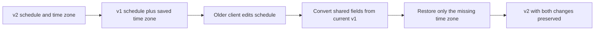

# Preserve Fields Across Kubebuilder API Version Conversions

Author: [nawazdhandala](https://www.github.com/nawazdhandala)

Tags: Kubernetes, Kubebuilder, Go

Description: Design conversion webhooks that preserve newer fields during older API reads and updates, with tested annotation helpers and explicit compatibility limits.

Your new API version adds a field that the old version cannot express. A read through the old endpoint appears harmless. But an older client reads that object, changes a shared field, and writes it back. If conversion drops the new field, a routine edit can silently reset behavior.

The solution starts with a compatibility contract: decide which information must survive, how older clients carry it, and which edits remain meaningful. Conversion is not just renaming Go fields. Kubernetes may need it to return objects in a requested version, so a conversion error can also prevent reads. [Kubebuilder conversion concepts](https://book.kubebuilder.io/multiversion-tutorial/conversion-concepts).

## Identify exactly what cannot round-trip

Consider a `SyncTask` API with this change:

| Version | Fields visible to clients |
| --- | --- |
| v1 | `spec.schedule` |
| v2 | `spec.schedule`, `spec.timeZone` |

Both versions use the same schedule string. The v2 hub adds a time zone. Original v1 objects have an explicit compatibility meaning: UTC. A v2 object using `Europe/London` cannot be fully represented by the v1 specification alone.

For this example, older clients may edit the schedule, but the active controller reads v2. An old controller that assumes every schedule is UTC is not behaviorally compatible merely because conversion preserves the hidden time zone. Separate client compatibility from controller compatibility before enabling the new field.

Define the intended round trip: converting v2 to v1 and back preserves the time zone; changing the v1 schedule changes the final v2 schedule; an original v1 object without preservation data receives UTC. These are concrete assertions you can test.

## Preserve the missing field, not an authoritative snapshot

One option is a reserved annotation on the older representation. Kubernetes conversion webhooks may change labels and annotations, while other object metadata must be preserved. [Webhook conversion constraints](https://kubernetes.io/docs/tasks/extend-kubernetes/custom-resources/custom-resource-definition-versioning/#webhook-conversion).

Cluster API provides a real example of annotation-based conversion preservation in its `MarshalData` and `UnmarshalData` helpers. That establishes the pattern, not a promise that importing those helpers automatically solves your API's merge semantics. [Cluster API v1.11.2 conversion utilities](https://github.com/kubernetes-sigs/cluster-api/blob/v1.11.2/util/conversion/conversion.go).



Do not restore a complete old specification over the incoming specification. That can undo a legitimate edit. Treat shared fields in the current request as authoritative and restore only fields absent from that version.

## Use a bounded, versioned preservation format

The following complete helper package was tested with Go **1.25.0**. It is application code, not a built-in Kubebuilder feature. The fixture deliberately permits only `UTC` and `Europe/London`, so it does not depend on a host time-zone database. Replace this policy only alongside your API schema and controller behavior.

```go
package conversionextras

import (
	"encoding/json"
	"fmt"
)

const extrasKey = "platform.example.com/conversion-extras"

type preserved struct {
	Format   int    `json:"format"`
	TimeZone string `json:"timeZone"`
}

// This fixture supports exactly these two zones, not every IANA zone.
func validZone(zone string) bool {
	return zone == "UTC" || zone == "Europe/London"
}

func cloneAnnotations(in map[string]string) map[string]string {
	out := make(map[string]string, len(in)+1)
	for k, v := range in {
		out[k] = v
	}
	return out
}

// PackZone prepares annotations for the older API representation.
func PackZone(in map[string]string, zone string) (map[string]string, error) {
	if !validZone(zone) {
		return nil, fmt.Errorf("unsupported time zone %q", zone)
	}
	payload, err := json.Marshal(preserved{Format: 1, TimeZone: zone})
	if err != nil {
		return nil, err
	}
	out := cloneAnnotations(in)
	out[extrasKey] = string(payload)
	return out, nil
}

// UnpackZone restores only the field absent from the older API.
func UnpackZone(in map[string]string) (string, map[string]string, error) {
	zone := "UTC" // Explicit compatibility default for original v1 objects.
	if payload, exists := in[extrasKey]; exists {
		if len(payload) > 4096 {
			return "", nil, fmt.Errorf("conversion extras too large")
		}
		var saved preserved
		if err := json.Unmarshal([]byte(payload), &saved); err != nil {
			return "", nil, fmt.Errorf("invalid conversion extras: %w", err)
		}
		if saved.Format != 1 || !validZone(saved.TimeZone) {
			return "", nil, fmt.Errorf("unsupported conversion extras")
		}
		zone = saved.TimeZone
	}
	out := cloneAnnotations(in)
	delete(out, extrasKey)
	return zone, out, nil
}
```

The annotation format has its own version number, independent of the API version. That gives a future converter a way to recognize older preservation payloads. The helper clones annotation maps instead of modifying its source, preserves unrelated annotations, and removes its reserved key from the restored v2 representation.

The 4096-byte input bound is a local defensive policy. It does not reserve annotation capacity on an object already near Kubernetes' overall metadata limits. The payload here is tiny; a design that stores whole specifications needs separate size testing and may be unsuitable for annotations.

## Connect the helper to both conversion directions

In this arrangement, v2 is the hub and v1 is the spoke. Controller-runtime's `ConvertFrom` fills the v1 receiver from the hub, while `ConvertTo` fills a hub destination from v1. Check source and destination types before accessing their fields. [Pinned conversion interfaces](https://github.com/kubernetes-sigs/controller-runtime/blob/v0.22.1/pkg/conversion/conversion.go).

For v2-to-v1 conversion, after the checked type assertion, deep-copy metadata, copy the schedule, and pack the extra field. This fragment uses `src` for the v2 source and `dst` for the v1 destination:

```go
dst.ObjectMeta = *src.ObjectMeta.DeepCopy()
dst.Spec.Schedule = src.Spec.Schedule
annotations, err := conversionextras.PackZone(src.Annotations, src.Spec.TimeZone)
if err != nil {
    return err
}
dst.Annotations = annotations
```

For v1-to-v2, shared fields again come from the current source. Restore only the extra field:

```go
zone, annotations, err := conversionextras.UnpackZone(src.Annotations)
if err != nil {
    return err
}
dst.ObjectMeta = *src.ObjectMeta.DeepCopy()
dst.Spec.Schedule = src.Spec.Schedule
dst.Spec.TimeZone = zone
dst.Annotations = annotations
```

These are integration fragments, not complete webhook methods. Import the helper using your module path, map your other specification and status fields, and retain the scaffold's correct source/destination handling. Do not accidentally copy the source API version into a destination that must represent another version.

## Treat preservation data as user-controlled input

An annotation is not trusted storage. A client that can update annotations can change or remove this payload. The helper rejects malformed JSON, unsupported format numbers, and unsupported zones. It does not authenticate the annotation or make it a security boundary.

Removing the annotation makes an old representation indistinguishable from an original v1 object, so this fixture uses UTC. If losing the field that way is unacceptable, this compatibility strategy is insufficient. You may need a different API design or carefully enforced admission rules instead of silently assuming every client preserves annotations.

Returning an error for malformed payloads avoids silently discarding information, but can block conversion-dependent reads. Audit existing objects before deploying stricter parsing, keep support for already-issued formats, and test recovery through a version that does not require the failing conversion where possible. Do not catch every decode error and replace it with a default simply to make reads succeed.

## Test the contract before changing storage

At the helper level, test a non-default zone round trip, the absent-annotation default, unrelated annotation preservation, and source-map immutability. Include malformed JSON, unknown formats, invalid zones, and oversized input. Those cases passed in the local test for this article.

At the complete webhook level, add v2-to-v1-to-v2 tests with real objects. Change the shared schedule between conversions and verify that the new schedule survives. Test status fields, metadata, and the annotations your supported clients actually preserve. Then exercise the installed webhook through the API server with both reads and updates; helper tests alone do not establish that wiring.

Keep storage migration separate from this work. Deploy compatible converters before permitting new values that older converters cannot read. During a rolling upgrade, every serving replica must understand the preservation format it might receive. Retain compatibility until older clients and stored representations have been accounted for.

Some changes cannot be made compatible with a hidden annotation. A new mode with no valid old equivalent may need to remain unavailable while the old API is served, or require a deliberate breaking-version transition. Preserving bytes is useful only when the behavior visible to each supported client still has a clear meaning.
