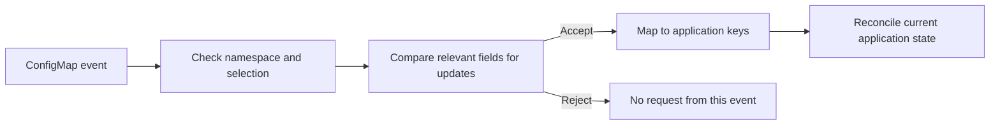

# Filter Kubebuilder Events Without Losing Required Updates

Author: [nawazdhandala](https://www.github.com/nawazdhandala)

Tags: Kubernetes, Kubebuilder, Go

Description: Filter noisy ConfigMap events and excluded namespaces while preserving data changes, opt-in transitions, and deletion signals in Kubebuilder controllers.

A busy ConfigMap watch can enqueue application reconciliations for changes the application does not use. Filtering those notifications can reduce work, but an overly broad filter can quietly break recovery or cleanup. The goal is to reject irrelevant observations while preserving every state transition the controller's contract requires.

A predicate is a function that decides whether an event reaches its handler. It does not replace reconciliation, define authorization, or make the watched objects disappear from the informer cache. This example targets **controller-runtime v0.22.4** and was compiled and tested with its matching Kubernetes v0.34.1 libraries.

We will filter a secondary ConfigMap watch. Applications explicitly select ConfigMaps with the label `example.com/watch: "true"`. Two namespaces are excluded by configuration. Changes to text data, binary data, selection labels, or deletion state remain relevant.

## Write the event contract first

A ConfigMap may enter or leave the selected set. If an update removes its opt-in label, checking only the new object would reject the event. A dependent application might then continue using configuration that is no longer eligible.

The update rule must therefore consider both the old and new objects. Either can establish that the transition matters. Reconciliation decides how to handle the new state, including detaching a dependency or reporting that it is no longer selected.

| Event | Accept when |
|---|---|
| Create | Object is selected and its namespace is allowed |
| Delete | Deleted object was selected and its namespace is allowed |
| Generic | Object is selected and its namespace is allowed |
| Update | Old or new object is selected, and a relevant field changed |

A resource-version-only change is not relevant under this contract. An unrelated annotation change is not relevant either. If your application reads a particular annotation, add that annotation explicitly rather than copying this rule unchanged.



## Implement the predicate

Place this helper in your controller project. The excluded namespace map is startup configuration: do not mutate it concurrently while predicates are reading it. The label is an example contract owned by this application, not a Kubernetes built-in label.

```go
package filters

import (
	corev1 "k8s.io/api/core/v1"
	"reflect"
	"sigs.k8s.io/controller-runtime/pkg/client"
	"sigs.k8s.io/controller-runtime/pkg/event"
	"sigs.k8s.io/controller-runtime/pkg/predicate"
)

const watchLabel = "example.com/watch"

func ConfigMapEvents(excluded map[string]bool) predicate.Predicate {
	selected := func(obj client.Object) bool {
		cm, ok := obj.(*corev1.ConfigMap)
		return ok && cm != nil && !excluded[cm.Namespace] && cm.Labels[watchLabel] == "true"
	}
	return predicate.Funcs{
		CreateFunc:  func(e event.CreateEvent) bool { return selected(e.Object) },
		DeleteFunc:  func(e event.DeleteEvent) bool { return selected(e.Object) },
		GenericFunc: func(e event.GenericEvent) bool { return selected(e.Object) },
		UpdateFunc: func(e event.UpdateEvent) bool {
			oldCM, okOld := e.ObjectOld.(*corev1.ConfigMap)
			newCM, okNew := e.ObjectNew.(*corev1.ConfigMap)
			if !okOld || !okNew || oldCM == nil || newCM == nil {
				return false
			}
			if !selected(oldCM) && !selected(newCM) {
				return false
			}
			return oldCM.Labels[watchLabel] != newCM.Labels[watchLabel] ||
				!reflect.DeepEqual(oldCM.Data, newCM.Data) ||
				!reflect.DeepEqual(oldCM.BinaryData, newCM.BinaryData) ||
				!reflect.DeepEqual(oldCM.DeletionTimestamp, newCM.DeletionTimestamp)
		},
	}
}
```

The helper handles text and binary data separately. It also preserves the update that sets a deletion timestamp, which matters when a resource has finalizers and is not immediately removed. The delete event remains accepted when the object eventually disappears.

`reflect.DeepEqual` treats a nil map and an empty map as different. That may admit an extra harmless event; it does not suppress a real data change. If you normalize these representations, test the normalization against your application semantics before using it as an optimization.

The four callbacks are explicit because `predicate.Funcs` defaults an omitted callback to accepting its event. A namespace check implemented only for updates would still accept creates and deletes from excluded namespaces. See the [tagged predicate implementation](https://github.com/kubernetes-sigs/controller-runtime/blob/v0.22.4/pkg/predicate/predicate.go).

## Attach the filter to the intended watch

Use `builder.WithPredicates` on the ConfigMap watch, leaving the primary-resource watch's policy independent. The following is a setup fragment for an existing Deployment reconciler whose mapping function returns the Deployments referencing a ConfigMap:

```go
return ctrl.NewControllerManagedBy(mgr).
    For(&appsv1.Deployment{}).
    Watches(&corev1.ConfigMap{},
        handler.EnqueueRequestsFromMapFunc(r.deploymentsForConfigMap),
        builder.WithPredicates(filters.ConfigMapEvents(map[string]bool{
            "kube-system": true,
            "excluded-config": true,
        }))).
    Complete(r)
```

Replace the `filters` import with the package containing the helper. This fragment assumes your existing reconciler, scheme registration, and mapping function. The mapper must still find dependents when the new ConfigMap is deselected; do not put an incompatible “new label must be true” check back into that mapper.

Avoid using `WithEventFilter` for a ConfigMap-specific predicate on this multi-type controller. That builder option applies to all its ordinary watched objects, so the primary Deployment events would encounter a filter written for another kind. The [builder source](https://github.com/kubernetes-sigs/controller-runtime/blob/v0.22.4/pkg/builder/controller.go#L224) documents global filtering and the exception for raw sources.

Predicates supplied together to a source must all accept an event. Adding a generation-change predicate alongside this data predicate does not mean “generation changed OR data changed.” Express an intended OR explicitly, and verify every combination. ConfigMap data changes should not depend on assumptions about generation semantics copied from a custom resource.

## Exclusion is not isolation

A namespace predicate rejects notifications after the informer has observed the object. It does not reduce the service account's permissions or necessarily reduce the number of objects the cache stores. For memory or security boundaries, configure the manager's cache scope and RBAC separately.

Conversely, narrowing the cache can change reconciliation behavior: dependent objects outside the watched scope will not be available through that cache. Establish one coherent scope for watches, indexed lookups, and reconciliation reads. A predicate should not be used to disguise a permission error or a partially synchronized cache.

Changing the exclusion configuration at runtime also does not synthesize events for all objects newly included or excluded. This example treats configuration as fixed for the process lifetime. If dynamic scope changes are required, design a rescan or restart process and define how existing managed state is cleaned up.

## Test transitions rather than only steady states

The local tests for this helper exercise unchanged objects, resource-version changes, unrelated annotations, text data, binary data, opt-in, opt-out, deletion timestamps, excluded namespaces, lifecycle callbacks, and missing event objects. They confirm that selection removal is accepted and namespace exclusion applies across event types.

For integration testing, run the manager in staging and count reconciliation requests for a known dependent Deployment. Change an ignored annotation and confirm that this watch does not add work. Then change data, remove the selection label, and delete the ConfigMap. Confirm each required transition reaches the mapper and the reconciler handles the current state correctly.

Other watches, retries, and explicit requeues can still reconcile the same Deployment, so do not interpret every extra call as a failed predicate. Correlate handler diagnostics or targeted test instrumentation with the event under investigation. Keep those diagnostics free of ConfigMap contents when the data may be sensitive.

Finally, make reconciliation idempotent even after filtering. A predicate reduces unnecessary notifications; it cannot guarantee that a request arrives only once. The successful outcome is lower irrelevant queue traffic while data changes, selection boundaries, and lifecycle cleanup remain observable.
