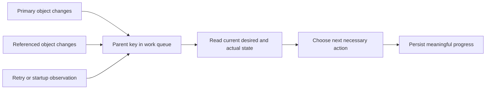

# Model Kubebuilder State Transitions Instead of Triggering Events

Author: [nawazdhandala](https://www.github.com/nawazdhandala)

Tags: Kubernetes, Kubebuilder, Go

Description: Design reconciliation that survives coalesced events and restarts by reading current state, persisting progress, and using stable identities for external work.

A controller starts external work when a custom resource is created. Later, an update arrives and the controller starts the same work again. The tempting fix is to ask `Reconcile` whether it was called by a create event or an update event. In the standard Kubebuilder reconciliation model, that information is deliberately absent.

With controller-runtime **v0.22.4**, the ordinary `reconcile.Request` contains a namespace and name. It does not contain an event type, an old object, or the object that triggered a secondary-resource watch. The [request definition](https://github.com/kubernetes-sigs/controller-runtime/blob/v0.22.4/pkg/reconcile/reconcile.go#L57) makes that contract explicit.

The reliable fix is to decide what work remains from current state. An event gets an object onto the work queue; it is not a durable command to perform an operation exactly once.

## Why the event history cannot drive correctness

A resource can change several times before the worker handles its key. A child resource can change too, mapping back to the same parent. Repeated requests may be combined by the queue, and a controller restart can cause existing objects to be examined again.



The [controller-runtime FAQ](https://github.com/kubernetes-sigs/controller-runtime/blob/v0.22.4/FAQ.md) recommends idempotent reconciliation: repeated attempts should converge on the same result. That is what allows the controller to tolerate skipped or combined event notifications.

You can log event metadata in a handler for diagnosis. You can also build a custom request type with additional fields. Neither makes an in-memory event history durable or makes an old event describe the latest object. If every individual action must be retained, model each action as a durable object or use an appropriate durable command system.

## Turn a workflow into observable states

Consider a hypothetical `SyncTask` custom resource that asks an external service to synchronize a dataset. The external service supports lookup and idempotent creation using a caller-supplied operation key. That service contract is an application prerequisite, not a feature Kubernetes automatically provides.

A useful reconciliation table looks like this:

| Current observation | Next action |
|---|---|
| Desired inputs are invalid | Report a validation condition; do not start work |
| External lookup failed | Return the error; do not interpret it as absence |
| No operation exists for the desired key | Ensure an operation exists using that same key |
| Operation exists and is running | Record its identity and progress; arrange another observation |
| Operation succeeded | Record success for the inputs that operation actually used |
| Operation failed | Record failure and apply an explicit retry policy |

Status can store the operation key, external operation ID, phase, observed generation, and conditions. These fields explain what the controller has observed. They are not a transaction lock around the external service.

A retry policy should distinguish retrying a network request from requesting another attempt at failed business work. The first should usually reuse the key. The second may need an explicit attempt identifier in desired state. Generating a new random key on every reconcile turns transient failures into duplicate operations.

## Give each desired operation a stable identity

The object's namespace and name alone are insufficient. A deleted object can be recreated under the same name with a new UID. Desired inputs can also change while the name remains constant.

This standard-library Go helper derives a key from object UID, generation, and a digest of the relevant dependency inputs. It is a model for a service accepting 69-character keys, not a universal external-service API. Compile it in your own package and adapt the key format to the service contract.

```go
package state

import (
	"crypto/sha256"
	"encoding/hex"
	"encoding/json"
	"fmt"
)

type Inputs struct {
	UID              string `json:"uid"`
	Generation       int64  `json:"generation"`
	DependencyDigest string `json:"dependencyDigest"`
}

func OperationKey(in Inputs) (string, error) {
	if in.UID == "" || in.Generation < 1 || in.DependencyDigest == "" {
		return "", fmt.Errorf("incomplete operation identity")
	}
	encoded, err := json.Marshal(in)
	if err != nil {
		return "", err
	}
	sum := sha256.Sum256(encoded)
	return "sync-" + hex.EncodeToString(sum[:]), nil
}
```

For the same three inputs, the key is unchanged after a restart. A new object UID, generation, or dependency digest produces a different key. Local tests check those properties and reject incomplete identity inputs. The helper does not implement remote deduplication; the service must enforce that behavior, including concurrent requests and response loss.

Construct the dependency digest from a deterministic representation of the configuration actually consumed by the operation. Do not hash an entire dependency object if unrelated metadata or status updates should not start new work. If input order is semantically irrelevant, normalize it before hashing.

Likewise, decide whether every desired-generation change should create another operation. If only a subset of the spec affects the synchronization, replace the generation-based policy with a documented semantic-input digest. Generation is useful bookkeeping, but it cannot represent referenced ConfigMap changes on its own.

## Close the crash window explicitly

The difficult sequence is: the service creates an operation, the controller crashes, and the status write never happens. On restart, status still looks empty. A controller that equates empty status with “never started” can duplicate expensive work.

With a stable operation key, reconciliation can ask the service about that same operation. If lookup finds it, record its actual state. If the create response was lost, repeat the idempotent ensure request with the same key rather than inventing a new operation.

This relies on the service retaining idempotency records long enough and rejecting incompatible payloads under the same key. If the service provides no lookup or deduplication contract, a status flag cannot manufacture exactly-once behavior across two independent systems. Document the remaining failure window and design compensation or durable coordination appropriate to the application.

When inputs change, also decide what happens to earlier running work. You might cancel it, wait for it, or allow both versions to finish. Persist enough identity to find the older work; overwriting the only external operation ID with the newest one can orphan an operation.

## Keep observation and progress distinct

Set observed generation only for the desired generation you actually evaluated. A result from generation three must not mark generation four complete. Re-read or use conflict-aware updates when writing status, and avoid overwriting other actors' fields.

Do not update timestamps or conditions merely because reconciliation ran. Write status when its meaningful content changes. A status write can itself cause another watch event, so an unconditional write makes a controller noisy even when nothing needs doing.

For a running external operation with no watch integration, use a bounded polling interval through `RequeueAfter`. For transient read failures, return the error rather than claiming the operation is absent. The [versioned reconcile result contract](https://github.com/kubernetes-sigs/controller-runtime/blob/v0.22.4/pkg/reconcile/reconcile.go#L110) describes retry and delayed-requeue behavior.

## Test interruptions rather than event labels

Test a second reconciliation with unchanged state, a controller restart with an existing remote operation, a lost create response, a new generation arriving during old work, and an object recreated with the same name but a new UID. Verify the operation key and meaningful status transition in each case.

Then exercise real API-server conflicts and the external service's idempotency contract in integration tests. The local key-helper tests here do not prove those distributed guarantees. A correct design should explain its next action from durable observations even when nobody can recover which event first put the key on the queue.
