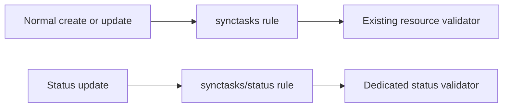

# Route Kubebuilder Status Webhooks Without Duplicate Validation

Author: [nawazdhandala](https://www.github.com/nawazdhandala)

Tags: Kubernetes, Kubebuilder, Admission Webhook

Description: Give status updates a dedicated validation route, generate precise admission rules, and distinguish duplicate webhook matching from separate API requests.

A custom resource's normal updates and its `/status` updates are different admission targets. A validating webhook configured only for `synctasks` does not automatically validate `synctasks/status`. Expanding every rule to a wildcard can solve the missing call while creating another problem: several webhook entries may now match the same request.

Use precise resource rules and separate responsibilities. This example keeps normal resource validation on its existing endpoint and adds a dedicated status endpoint. It uses **controller-runtime v0.22.4** and **controller-gen v0.19.0**, with a hypothetical project-owned `platform.example.com/v1` SyncTask API.

The handler and AdmissionReview HTTP exchange were tested locally, and the marker output was generated and inspected. No live API-server admission or TLS test is claimed.

## Separate the two request paths

Assume the SyncTask CRD already enables the status subresource and declares an optional integer `status.observedGeneration`. Its controller writes status through the status client. Normal validation covers desired configuration; status validation checks a narrow invariant about reported progress.



Kubernetes matches admission rules by group, version, operation, resource, and subresource. `synctasks` and `synctasks/status` are distinct resource patterns. A broader `synctasks/*` pattern matches its subresources; `*/*` includes resources and subresources. The [admission rule documentation](https://kubernetes.io/docs/reference/access-authn-authz/extensible-admission-controllers/#matching-requests-rules) explains these patterns.

An HTTP PATCH to the status endpoint is represented as an admission `UPDATE` operation. There is no separate `PATCH` operation to put in a webhook rule. Also, a normal resource update followed by a controller's status write is two API requests, not evidence that one webhook call was duplicated.

## Generate non-overlapping rules

Keep the root-resource marker on the existing validator and add the status marker beside the dedicated handler. The two markers are shown together to make the difference visible:

```go
// +kubebuilder:webhook:path=/validate-platform-example-com-v1-synctask,mutating=false,failurePolicy=fail,sideEffects=None,groups=platform.example.com,resources=synctasks,verbs=create;update,versions=v1,name=vsynctask.platform.example.com,admissionReviewVersions=v1,matchPolicy=Exact
// +kubebuilder:webhook:path=/validate-platform-example-com-v1-synctask-status,mutating=false,failurePolicy=fail,sideEffects=None,groups=platform.example.com,resources=synctasks/status,verbs=update,versions=v1,name=vsynctask-status.platform.example.com,admissionReviewVersions=v1,matchPolicy=Exact
```

Both use `matchPolicy=Exact` because this example handles only the declared `v1` route. Add and test other served versions deliberately if your project requires them. Each entry has a distinct webhook name and service path. Keep the path strings identical between generated configuration and server registration.

Run the project's usual manifest generator and inspect the resulting `ValidatingWebhookConfiguration`. The [Kubebuilder marker reference](https://book.kubebuilder.io/reference/markers/webhook) describes the generation fields. Generated markers configure API-server routing; they do not register an HTTP handler inside your process.

Do not leave an earlier wildcard entry installed alongside these two entries if it routes the same requests to the same validation logic. Review all deployed validating configurations, including older release names, because two different configuration objects can both match one request.

## Register a dedicated status handler

The status handler below accepts only the intended route. Its example policy allows an absent observed generation, but rejects negative values or values newer than the object's generation. This is a small consistency check, not complete business validation or authorization of the status writer.

Place the code in your webhook package and call `RegisterStatusWebhook(mgr)` once during manager setup. Keep the existing root webhook registration unchanged and registered only once.

```go
package webhooks

import (
	"context"
	"encoding/json"
	admissionv1 "k8s.io/api/admission/v1"
	metav1 "k8s.io/apimachinery/pkg/apis/meta/v1"
	"net/http"
	ctrl "sigs.k8s.io/controller-runtime"
	"sigs.k8s.io/controller-runtime/pkg/webhook/admission"
)

const statusPath = "/validate-platform-example-com-v1-synctask-status"

type StatusValidator struct{}

func (StatusValidator) Handle(_ context.Context, req admission.Request) admission.Response {
	if req.Resource.Group != "platform.example.com" || req.Resource.Version != "v1" ||
		req.Resource.Resource != "synctasks" || req.SubResource != "status" ||
		req.Operation != admissionv1.Update {
		return admission.Denied("unexpected admission route")
	}
	var object struct {
		Metadata metav1.ObjectMeta `json:"metadata"`
		Status   struct {
			ObservedGeneration *int64 `json:"observedGeneration,omitempty"`
		} `json:"status"`
	}
	if err := json.Unmarshal(req.Object.Raw, &object); err != nil {
		return admission.Errored(http.StatusBadRequest, err)
	}
	observed := object.Status.ObservedGeneration
	if observed != nil && (*observed < 0 || *observed > object.Metadata.Generation) {
		return admission.Denied("observedGeneration must be between zero and metadata.generation")
	}
	return admission.Allowed("status generation is valid")
}

func RegisterStatusWebhook(mgr ctrl.Manager) {
	mgr.GetWebhookServer().Register(statusPath,
		&admission.Webhook{Handler: StatusValidator{}})
}
```

The request guard makes an unexpected route visible instead of silently running status logic on a root update. The minimal decoding struct reads only fields this validator needs; it does not write a partially decoded object back to Kubernetes. No external calls or mutations occur, consistent with `sideEffects=None`.

`admission.Webhook` handles the AdmissionReview envelope around the response. Registering a second handler under the same path is not a way to chain validators: controller-runtime's [webhook server](https://github.com/kubernetes-sigs/controller-runtime/blob/v0.22.4/pkg/webhook/server.go#L171) rejects duplicate path registration. Use distinct paths or one deliberate dispatcher.

A generated `ValidateUpdate` method alone does not distinguish root updates from status updates by method name. When a validator serves both routes, it must inspect admission request context or dispatch explicitly. The dedicated handler here receives the request directly, so the distinction is visible in its signature and guard.

## Test matching separately from handler behavior

First inspect the rendered and deployed webhook entries. For every entry, record its name, path, operations, API groups, versions, and resource patterns. The root rule should contain `synctasks`; the status rule should contain `synctasks/status` and only `UPDATE` for this example.

Next test the handler directly. The local cases covered an observed generation equal to or below the current generation, an absent value, a future value, a negative value, malformed JSON, and incorrect routes. A local HTTP test also checked that the AdmissionReview response preserved the request UID and allowed a valid status update.

Those tests do not exercise API-server matching. In a staging cluster with the CRD and webhook already installed, substitute your real resource name and namespace:

```bash
kubectl -n staging get synctasks.platform.example.com sample -o yaml
kubectl -n staging patch synctasks.platform.example.com sample \
  --subresource=status --type=merge \
  -p '{"status":{"observedGeneration":0}}' --dry-run=server
```

The dry run sends the request through server-side processing without persisting the status change. For this example policy, zero is allowed. Choose a known value greater than the object's current generation for a separate negative test and expect denial by the status validator. Do not mistake a CRD schema rejection or RBAC denial for evidence that your handler ran.

Ensure the testing identity has permission to update or patch the status subresource and that the API server trusts the webhook's certificate. `failurePolicy=Fail` means routing or TLS failures can block status writes; fix those failures instead of treating a timeout as a validation result.

## Explain apparent duplicate calls with request identities

Log the admission UID, resource, subresource, operation, and handler path. Avoid logging whole objects merely to count calls. Two handlers seeing the same request UID can indicate overlapping webhook entries. Different UIDs usually indicate distinct API requests, such as a spec update followed by status reporting or a client retry.

Inspect whether both the old and new release configurations remain active. Also check whether the controller writes unchanged status repeatedly; routing fixes do not repair that separate reconciliation loop.

The intended result is precise: ordinary writes reach the root validator, status writes reach the status validator, and each path enforces only the policy assigned to it. Local handler tests, generated-rule inspection, and staging admission evidence establish different parts of that result. Keep those checks separate so a passing unit test is never mistaken for a fully working webhook deployment.
